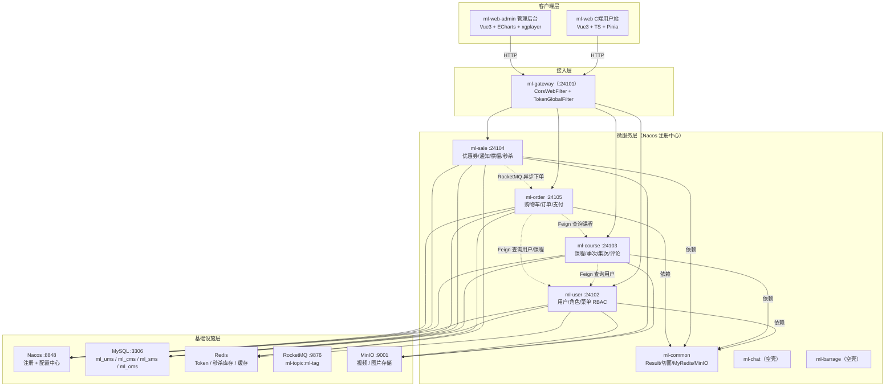

# my-lesson 项目总览与系统架构

> 版本：1.0.0 ｜ 最后更新：2026-10-27 ｜ 适用代码：my-lesson 根工程

## 1. 项目定位

**my-lesson** 是一个基于 **Spring Cloud Alibaba 微服务架构**的在线课程学习（知识付费）平台，包含面向学员的 C 端用户站（`ml-web`）和面向运营的管理后台（`ml-web-admin`）。

项目覆盖完整业务闭环：**注册登录 → 浏览课程 → 秒杀/优惠券 → 购物车下单 → 支付 → 视频学习 → 评论/收藏/举报**。

| 属性 | 说明 |
|---|---|
| 工程名称 | my-lesson |
| 工程类型 | Maven 多模块微服务工程 |
| 后端语言 | Java 17 |
| 前端框架 | Vue 3（Vite + TypeScript / JavaScript） |
| 数据库 | MySQL 8.2（4 库 21 表） |
| 部署形态 | 单体多服务，独立端口，Nacos 统一注册与配置 |

## 2. 功能清单

| 端 | 模块 | 功能 |
|---|---|---|
| C 端（ml-web） | 用户 | 注册、登录、个人中心、学习记录、账号安全、绑定手机号 |
| C 端（ml-web） | 课程 | 课程分类、课程列表/搜索、课程详情、视频播放、评论、收藏、举报 |
| C 端（ml-web） | 交易 | 购物车、确认订单、支付（二维码）、订单列表/详情 |
| C 端（ml-web） | 营销 | 秒杀列表/详情、优惠券领取/兑换、公告、横幅 |
| 管理端（ml-web-admin） | 系统 | 登录、个人资料、Dashboard 统计 |
| 管理端（ml-web-admin） | UMS | 用户、角色、菜单、用户角色、角色菜单（RBAC） |
| 管理端（ml-web-admin） | CMS | 课程分类、课程、季次、集次、评论、收藏、举报 |
| 管理端（ml-web-admin） | SMS | 优惠券、秒杀、秒杀明细、通知、横幅、新闻 |
| 管理端（ml-web-admin） | OMS | 订单、订单明细 |

## 3. 技术栈

| 类别 | 技术 | 版本 |
|---|---|---|
| 基础框架 | Spring Boot | 3.2.5 |
| 微服务 | Spring Cloud | 2023.0.1 |
| 微服务组件 | Spring Cloud Alibaba | 2023.0.1.0 |
| 注册/配置中心 | Nacos（Spring Cloud Alibaba） | 2023.0.1.0 |
| 网关 | Spring Cloud Gateway | 2023.0.1 |
| ORM | MyBatis-Flex（含 codegen 代码生成器） | 1.10.2 / 1.10.1 |
| 数据库 | MySQL Connector/J | 8.2.0 |
| 缓存 | Spring Data Redis + Redisson | redisson-spring-boot-starter 3.33.0 |
| 消息队列 | RocketMQ（spring-boot-starter） | 2.2.2 |
| 对象存储 | MinIO | 3.0.10 |
| 接口文档 | Knife4j（OpenAPI 3 / SpringDoc） | 4.4.0 |
| 工具库 | Hutool | 5.8.25 |
| Excel | EasyExcel | 3.3.4 |
| 支付 | 支付宝 EasySDK | 2.2.0 |
| 定时任务 | XXL-Job（依赖已引入，尚未使用） | 2.4.2 |
| 参数校验 | Hibernate Validator | 8.0.1.Final |
| 前端 C 端 | Vue 3 + Vite + TypeScript + Element Plus + Pinia + Axios | — |
| 前端管理端 | Vue 3 + Vite + Element Plus + ECharts + xgplayer + VueQuill + Vuex | — |

## 4. 模块划分

### 4.1 后端模块

| 模块 | 端口 | 职责 | 数据库 | 状态 |
|---|---|---|---|---|
| `ml-gateway` | 24101（Nacos 配置） | API 网关：CORS、Token 鉴权、路由转发 | — | ✅ 已实现 |
| `ml-user` | 24102 | 用户、角色、菜单，基于 RBAC 的权限管理 | `ml_ums`（5 表） | ✅ 已实现 |
| `ml-course` | 24103 | 课程分类、课程、季次、集次、评论、收藏、举报 | `ml_cms`（7 表） | ✅ 已实现 |
| `ml-sale` | 24104 | 优惠券、通知、横幅、新闻、秒杀（含 RocketMQ 生产） | `ml_sms`（6 表） | ✅ 已实现 |
| `ml-order` | 24105 | 购物车、订单、订单明细、支付、扣库存（含 RocketMQ 消费） | `ml_oms`（3 表） | ✅ 已实现 |
| `ml-common` | — | 公共模块：统一返回、异常处理、切面、Redis 封装、MinIO、Feign 配置 | — | ✅ 已实现 |
| `ml-chat` | — | 聊天服务（预留） | — | ⚠️ 空壳，未开发 |
| `ml-barrage` | — | 弹幕服务（预留） | — | ⚠️ 空壳，未开发 |
| `ml-generator` | — | MyBatis-Flex 代码生成器（开发工具，不部署） | — | ✅ 工具型 |

> 端口来源：各模块 `bootstrap.yaml` 中 `server.port`；网关端口 24101 来自前端 `ml-web` 请求 baseURL 与 Vite 代理配置，实际由 Nacos 配置中心下发。

### 4.2 前端模块

| 模块 | 说明 | 技术要点 |
|---|---|---|
| `ml-web` | C 端用户站 | Vue 3 + TS + Pinia，axios 封装统一带 `token` 请求头，响应 `code===1000` 视为成功 |
| `ml-web-admin` | 运营管理后台 | Vue 3 + Vuex + ECharts + xgplayer，按 ums/cms/sms/oms 分组维护页面 |

## 5. 系统架构



## 6. 核心业务流程

### 6.1 登录鉴权

```
用户输入账号密码
  → ml-user 校验（BCrypt 密码比对）
  → 生成 UUID Token，用户信息 JSON 写入 Redis（key=token，TTL 30 分钟）
  → 返回 LoginVO（用户 + Token + 角色 + 菜单）
后续请求
  → ml-gateway TokenGlobalFilter：白名单放行 / 无 Token 拒绝 / Redis 校验 / 每次续期 30 分钟
```

### 6.2 秒杀下单（Redis 预扣 + MQ 异步建单）

```
用户发起秒杀（POST /api/v1/seckill/kill）
  → 校验活动存在、时间范围
  → Redisson 分布式锁（skLock，30s 过期，看门狗续期）
  → 防重复抢购检查（Redis SK_SUC 键，7 天）
  → Redis 预扣库存（SECKILL_COURSE_COUNT_PREFIX，INCR -1）
  → 发送 RocketMQ 消息（ml-topic:ml-tag，消息体 OrderMessage）
  → ml-order OrderMessageListener 消费：查用户/课程 → 建订单 + 订单明细
```

### 6.3 正常下单（prePay）

```
POST /api/v1/order/prePay
  → 校验是否重复购买（已购课程去重）
  → 创建订单（sn 随机 19 位、payType=0 未支付、status=0 未付款）
  → Feign 查用户、查课程 → 保存订单明细
  → 删除购物车对应记录
  → 返回订单 ID
支付：POST /api/v1/order/getQrCode 生成支付二维码 → POST /api/v1/order/prePayNotify 接收支付回调
```

## 7. 服务间协作约定

| 调用方 | 被调方 | 方式 | 用途 |
|---|---|---|---|
| ml-course | ml-user | Feign（`UserFeign`，path=`/api/v1/user`） | 查询用户信息 |
| ml-order | ml-user | Feign（`UserFeign`） | 下单时查询用户 |
| ml-order | ml-course | Feign（`CourseFeign`） | 下单时查询课程 |
| ml-sale | ml-order | RocketMQ（`ml-topic:ml-tag`） | 秒杀异步下单 |

## 8. 统一约定速查

| 约定项 | 值 |
|---|---|
| 接口前缀 | `api/v1/...`（网关按服务分发） |
| 统一响应 | `Result{code, message, coderMessage, data}`，成功 code=1000 |
| Token 传递 | 请求头 `token`，网关校验，Redis 存储，30 分钟续期 |
| 逻辑删除 | 所有表 `deleted` 字段（0 未删除 / 1 已删除） |
| 乐观锁 | 所有表 `version` 字段 |
| 状态字段 | `status`/`pay_type` 等使用整型枚举，见 `ML` 常量类 |
| 接口文档 | 各服务 Knife4j（SpringDoc），地址见《环境搭建与快速启动》 |

## 9. 相关文档

- [02-environment-setup](./02-environment-setup.md)
- [03-database-design](./03-database-design.md)
- [04-api-reference](./04-api-reference.md)
- [05-development-standards](./05-development-standards.md)
