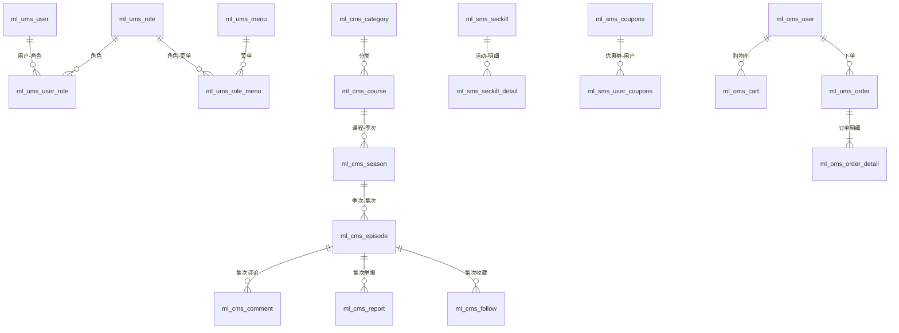

# my-lesson 数据库设计

> 版本：1.0.0 ｜ 最后更新：2026-10-27 ｜ 脚本位置：`ml-generator/SQL/`

## 1. 数据库总览

项目按业务域拆分为 4 个独立数据库（数据库按服务划分），脚本共 21 张表；另有一张代码中引用但脚本缺失的表（见 6.2 已知问题）。

| 数据库 | 归属服务 | 表数量 | 业务域 |
|---|---|---|---|
| `ml_ums` | ml-user | 5 | 用户体系（RBAC） |
| `ml_cms` | ml-course | 7 | 课程内容 |
| `ml_sms` | ml-sale | 6（+user_coupons 缺失） | 营销 |
| `ml_oms` | ml-order | 3 | 交易订单 |

## 2. 公共字段约定

所有业务表统一包含以下 4 个公共字段（由 MyBatis-Flex 逻辑删除/乐观锁机制支撑，代码生成器自动识别）：

| 字段 | 类型 | 默认值 | 说明 |
|---|---|---|---|
| `id` | bigint auto_increment | — | 主键 |
| `version` | bigint | 0 | 乐观锁版本号（更新时递增） |
| `deleted` | tinyint | 0 | 逻辑删除：0 未删除，1 已删除 |
| `created` | datetime | current_timestamp | 创建时间 |
| `updated` | datetime | current_timestamp | 修改时间 |

### 设计约定

- **逻辑删除**：一律不物理删除数据，删除操作置 `deleted=1`。
- **乐观锁**：更新操作依赖 `version` 字段，由 MyBatis-Flex 自动处理。
- **冗余字段**：跨服务引用字段采用"外键 + 冗余展示字段"模式（如 `fk_user_id + username`、`fk_course_id + course_title/course_cover/course_price`），避免跨库 JOIN。
- **金额字段**：统一 `decimal(8,2)`；`coupons.cp_price` 注释为"优惠金额，单位分"，实际仍为 decimal 存储，请以业务代码口径为准。
- **枚举字段**：`status`、`pay_type`、`gender` 等使用 `tinyint`，取值定义见 `org.example.constant.ML`。

## 3. ml_ums —— 用户体系（5 张表）

### 3.1 user —— 用户表

| 字段 | 类型 | 默认 | 说明 |
|---|---|---|---|
| id | bigint auto_increment | — | 主键 |
| username | varchar(128) | '' | 账号（登录名，唯一） |
| password | varchar(128) | '' | 密码（BCrypt 加密存储） |
| nickname | varchar(128) | '' | 昵称 |
| email | varchar(128) | '' | 邮箱（唯一） |
| province | varchar(128) | '' | 省份 |
| realname | varchar(128) | '' | 真实姓名 |
| avatar | varchar(256) | '' | 头像地址 |
| zodiac | char(3) | '' | 星座 |
| phone | char(11) | '' | 手机号（唯一） |
| idcard | char(18) | '' | 身份证号（唯一） |
| gender | tinyint | 0 | 性别：0 女，1 男，2 保密 |
| age | tinyint | 0 | 年龄 |
| info | varchar(512) | '' | 描述/个性签名 |
| version / deleted / created / updated | — | — | 公共字段 |

### 3.2 role —— 角色表

| 字段 | 类型 | 默认 | 说明 |
|---|---|---|---|
| id | bigint auto_increment | — | 主键 |
| title | varchar(128) | '' | 角色标题（如"管理员""学员"） |
| idx | bigint | 0 | 序号 |
| info | varchar(512) | '' | 描述 |
| version / deleted / created / updated | — | — | 公共字段 |

### 3.3 menu —— 菜单表

| 字段 | 类型 | 默认 | 说明 |
|---|---|---|---|
| id | bigint auto_increment | — | 主键 |
| title | varchar(128) | '' | 菜单标题 |
| url | varchar(256) | '' | 跳转地址 |
| icon | varchar(256) | '' | 图标名称 |
| pid | bigint | 0 | 父菜单主键，0 视为根节点 |
| idx | bigint | 0 | 序号 |
| info | varchar(512) | '' | 描述 |
| version / deleted / created / updated | — | — | 公共字段 |

### 3.4 user_role —— 用户角色关系表

| 字段 | 类型 | 说明 |
|---|---|---|
| id | bigint auto_increment | 主键 |
| fk_user_id | bigint | 用户 ID（user 表外键） |
| fk_role_id | bigint | 角色 ID（role 表外键） |
| version / deleted / created / updated | — | 公共字段 |

### 3.5 role_menu —— 角色菜单关系表

| 字段 | 类型 | 说明 |
|---|---|---|
| id | bigint auto_increment | 主键 |
| fk_role_id | bigint | 角色 ID（role 表外键） |
| fk_menu_id | bigint | 菜单 ID（menu 表外键） |
| version / deleted / created / updated | — | 公共字段 |

## 4. ml_cms —— 课程内容（7 张表）

### 4.1 category —— 课程类别表

| 字段 | 类型 | 默认 | 说明 |
|---|---|---|---|
| id | bigint auto_increment | — | 主键 |
| title | varchar(128) | '' | 标题 |
| idx | bigint | 0 | 序号 |
| info | varchar(512) | '' | 描述 |
| version / deleted / created / updated | — | — | 公共字段 |

### 4.2 course —— 课程表

| 字段 | 类型 | 默认 | 说明 |
|---|---|---|---|
| id | bigint auto_increment | — | 主键 |
| title | varchar(128) | '' | 标题 |
| author | varchar(128) | '' | 作者 |
| fk_category_id | bigint | — | 类别 ID（category 表外键） |
| summary | varchar(256) | '' | 摘要图地址 |
| cover | varchar(256) | '' | 封面图地址 |
| price | decimal(8,2) | 0.00 | 单价，单位元 |
| idx | bigint | 0 | 序号 |
| info | varchar(512) | '' | 描述 |
| version / deleted / created / updated | — | — | 公共字段 |

### 4.3 season —— 季次表

| 字段 | 类型 | 默认 | 说明 |
|---|---|---|---|
| id | bigint auto_increment | — | 主键 |
| title | varchar(128) | '' | 标题 |
| info | varchar(512) | '' | 描述 |
| fk_course_id | bigint | — | 课程 ID（course 表外键） |
| idx | bigint | 0 | 序号 |
| version / deleted / created / updated | — | — | 公共字段 |

### 4.4 episode —— 集次表

| 字段 | 类型 | 默认 | 说明 |
|---|---|---|---|
| id | bigint auto_increment | — | 主键 |
| title | varchar(128) | '' | 标题 |
| info | varchar(512) | '' | 描述 |
| video | varchar(256) | '' | 视频媒体地址（MinIO） |
| cover | varchar(256) | '' | 视频封面地址 |
| fk_season_id | bigint | — | 季次 ID（season 表外键） |
| idx | bigint | 0 | 序号 |
| version / deleted / created / updated | — | — | 公共字段 |

### 4.5 comment —— 评论表

| 字段 | 类型 | 默认 | 说明 |
|---|---|---|---|
| id | bigint auto_increment | — | 主键 |
| fk_episode_id | bigint | — | 集次 ID（episode 表外键） |
| fk_user_id | bigint | — | 评论人 ID（user 表外键） |
| nickname | varchar(128) | '' | 评论人昵称（冗余） |
| avatar | varchar(128) | '' | 评论人头像（冗余） |
| province | varchar(128) | '' | 评论人省份（冗余） |
| pid | bigint | 0 | 父评论主键，0 视为根节点 |
| content | varchar(512) | '' | 评论内容 |
| version / deleted / created / updated | — | — | 公共字段 |

### 4.6 report —— 举报表

| 字段 | 类型 | 默认 | 说明 |
|---|---|---|---|
| id | bigint auto_increment | — | 主键 |
| fk_episode_id | bigint | — | 集次 ID（episode 表外键） |
| fk_user_id | bigint | — | 举报人 ID（user 表外键） |
| nickname | varchar(128) | '' | 举报人昵称（冗余） |
| content | varchar(512) | '' | 举报内容 |
| version / deleted / created / updated | — | — | 公共字段 |

### 4.7 follow —— 收藏表

| 字段 | 类型 | 默认 | 说明 |
|---|---|---|---|
| id | bigint auto_increment | — | 主键 |
| fk_episode_id | bigint | — | 集次 ID（episode 表外键） |
| fk_user_id | bigint | — | 收藏人 ID（user 表外键） |
| nickname | varchar(128) | '' | 收藏人昵称（冗余） |
| version / deleted / created / updated | — | — | 公共字段 |

## 5. ml_sms —— 营销（6 张表 + 1 张缺失）

### 5.1 notice —— 通知表

| 字段 | 类型 | 默认 | 说明 |
|---|---|---|---|
| id | bigint auto_increment | — | 主键 |
| content | varchar(512) | '' | 内容 |
| idx | bigint | 0 | 序号 |
| version / deleted / created / updated | — | — | 公共字段 |

### 5.2 banner —— 横幅表

| 字段 | 类型 | 默认 | 说明 |
|---|---|---|---|
| id | bigint auto_increment | — | 主键 |
| url | varchar(256) | '' | 图片地址 |
| info | varchar(512) | '' | 描述 |
| idx | bigint | 0 | 序号 |
| version / deleted / created / updated | — | — | 公共字段 |

### 5.3 article —— 新闻表

| 字段 | 类型 | 默认 | 说明 |
|---|---|---|---|
| id | bigint auto_increment | — | 主键 |
| title | varchar(128) | '' | 标题 |
| content | varchar(512) | '' | 内容 |
| idx | bigint | 0 | 序号 |
| version / deleted / created / updated | — | — | 公共字段 |

### 5.4 seckill —— 秒杀活动表

| 字段 | 类型 | 默认 | 说明 |
|---|---|---|---|
| id | bigint auto_increment | — | 主键 |
| title | varchar(128) | '' | 标题 |
| info | varchar(512) | '' | 描述 |
| start_time | datetime | current_timestamp | 活动开始时间 |
| end_time | datetime | current_timestamp | 活动结束时间 |
| status | tinyint | 0 | 0 未开始，1 已开始，2 已结束 |
| version / deleted / created / updated | — | — | 公共字段 |

### 5.5 seckill_detail —— 秒杀明细表

| 字段 | 类型 | 默认 | 说明 |
|---|---|---|---|
| id | bigint auto_increment | — | 主键 |
| fk_seckill_id | bigint | — | 秒杀活动 ID（seckill 表外键） |
| fk_course_id | bigint | — | 课程 ID（course 表外键） |
| course_title | varchar(128) | '' | 课程标题（冗余） |
| course_cover | varchar(256) | '' | 课程封面图（冗余） |
| course_price | decimal(8,2) | 0.00 | 课程单价（冗余） |
| sk_price | decimal(8,2) | 0.00 | 秒杀价格，单位元 |
| sk_count | int | 0 | 秒杀数量（库存） |
| info | varchar(512) | '' | 描述 |
| version / deleted / created / updated | — | — | 公共字段 |

### 5.6 coupons —— 优惠券表

| 字段 | 类型 | 默认 | 说明 |
|---|---|---|---|
| id | bigint auto_increment | — | 主键 |
| code | varchar(128) | '' | 兑换码/口令（唯一） |
| title | varchar(128) | '' | 标题 |
| cp_price | decimal(8,2) | 0.00 | 优惠金额 |
| info | varchar(512) | '' | 描述 |
| start_time | datetime | current_timestamp | 优惠券生效时间 |
| end_time | datetime | current_timestamp | 优惠券失效时间 |
| version / deleted / created / updated | — | — | 公共字段 |

### 5.7 user_coupons —— 用户优惠券表（⚠️ 脚本缺失，代码使用）

代码实体 `org.example.entity.UserCoupons` 映射 `ml_sms.user_coupons`，用于记录用户领券关系（`CouponsServiceImpl.receive()` 写入、`mine()` 查询）。**当前 SQL 脚本中无此表建表语句**，需要手动补充（建议结构见 6.2）。

| 字段 | 类型 | 说明 |
|---|---|---|
| id | bigint auto_increment | 主键 |
| fk_user_id | bigint | 用户 ID |
| fk_coupons_id | bigint | 优惠券 ID |
| version / deleted / created / updated | — | 建议按公共字段补齐 |

## 6. ml_oms —— 交易订单（3 张表）

### 6.1 cart —— 购物车表

| 字段 | 类型 | 默认 | 说明 |
|---|---|---|---|
| id | bigint auto_increment | — | 主键 |
| fk_user_id | bigint | — | 用户 ID（user 表外键） |
| username | varchar(128) | '' | 用户账号（冗余） |
| fk_course_id | bigint | — | 课程 ID（course 表外键） |
| course_title | varchar(128) | '' | 课程标题（冗余） |
| course_cover | varchar(256) | '' | 课程封面图（冗余） |
| course_price | decimal(8,2) | 0.00 | 课程单价（冗余） |
| version / deleted / created / updated | — | — | 公共字段 |

### 6.2 order —— 订单表

| 字段 | 类型 | 默认 | 说明 |
|---|---|---|---|
| id | bigint auto_increment | — | 主键 |
| sn | varchar(128) | '' | 订单编号（随机 19 位） |
| total_amount | decimal(8,2) | 0.00 | 订单总金额 |
| pay_amount | decimal(8,2) | 0.00 | 实际支付总金额 |
| pay_type | tinyint | 0 | 支付方式：0 未支付，1 微信，2 支付宝，3 其他 |
| status | tinyint | 0 | 订单状态：0 未付款，1 已付款，2 已取消，3 其他 |
| fk_user_id | bigint | — | 用户 ID（user 表外键） |
| username | varchar(128) | '' | 用户账号（冗余） |
| fk_coupons_id | bigint | — | 优惠券 ID（coupons 表外键） |
| info | varchar(512) | '' | 描述 |
| version / deleted / created / updated | — | — | 公共字段 |

### 6.3 order_detail —— 订单明细表

| 字段 | 类型 | 默认 | 说明 |
|---|---|---|---|
| id | bigint auto_increment | — | 主键 |
| fk_order_id | bigint | — | 订单 ID（order 表外键） |
| fk_course_id | bigint | — | 课程 ID（course 表外键） |
| course_title | varchar(128) | '' | 课程标题（冗余） |
| course_cover | varchar(256) | '' | 课程封面图（冗余） |
| course_price | decimal(8,2) | 0.00 | 课程单价（冗余） |
| version / deleted / created / updated | — | — | 公共字段 |

## 7. 表关系图



## 8. 已知问题

1. **`user_coupons` 建表语句缺失**：SQL 脚本中未包含，需手动创建，否则"领取优惠券 / 我的优惠券"功能运行时报"表不存在"。建议建表语句：

```sql
CREATE TABLE `user_coupons` (
  `id`          bigint       NOT NULL AUTO_INCREMENT COMMENT '主键',
  `fk_user_id`  bigint       NOT NULL DEFAULT 0 COMMENT '用户ID',
  `fk_coupons_id` bigint     NOT NULL DEFAULT 0 COMMENT '优惠券ID',
  `version`     bigint       NOT NULL DEFAULT 0 COMMENT '数据版本',
  `deleted`     tinyint      NOT NULL DEFAULT 0 COMMENT '0未删除，1已删除',
  `created`     datetime     NOT NULL DEFAULT CURRENT_TIMESTAMP COMMENT '创建时间',
  `updated`     datetime     NOT NULL DEFAULT CURRENT_TIMESTAMP COMMENT '修改时间',
  PRIMARY KEY (`id`)
) ENGINE=InnoDB DEFAULT CHARSET=utf8mb4 COMMENT='用户优惠券表';
```

2. **`UserCoupons` 关联注解字段名笔误**：`@RelationOneToOne(selfField = "fkCouponId", ...)` 与实体字段 `fkCouponsId` 不一致，若触发关联查询需修正。
3. **无外键约束**：SQL 中无物理外键（`fk_*` 字段仅注释标明外键语义），保证跨库解耦，一致性由业务代码保证。
