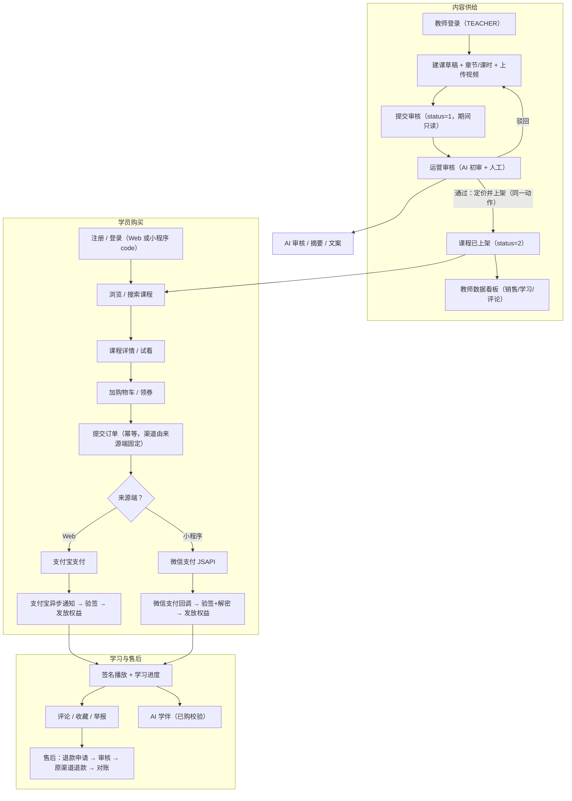
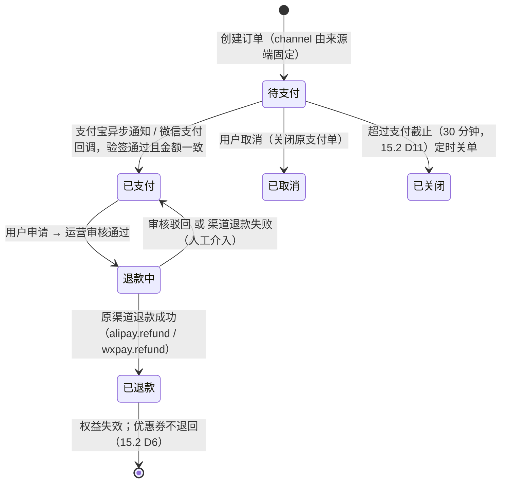
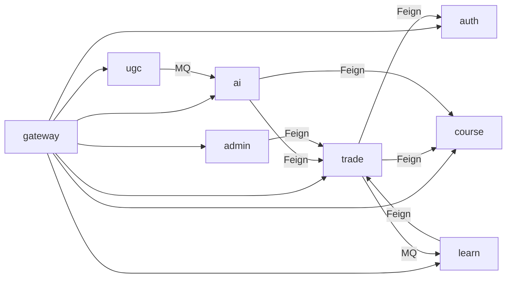
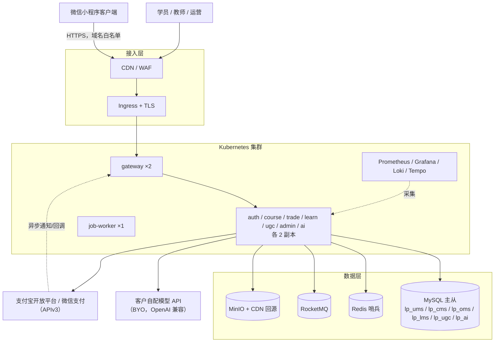
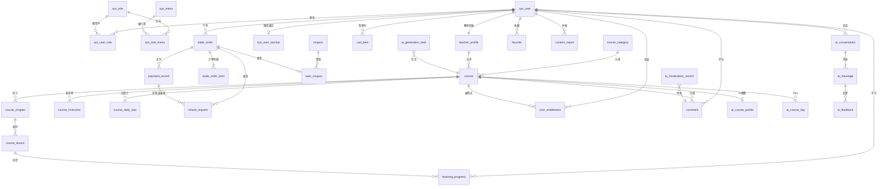
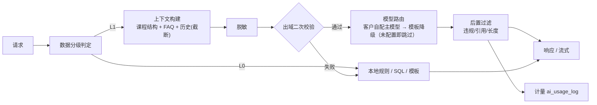
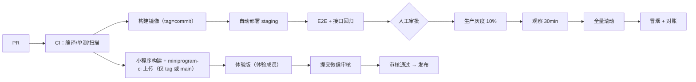
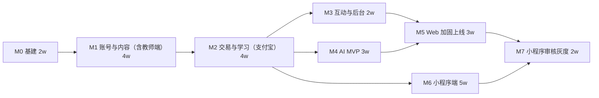

# 课程平台工程规划与上线方案

> 版本：1.1（按产品事实源对齐）｜ 日期：2026-11-02 ｜ 适用范围：从 0 起盘的新项目
>
> **输入说明**：本文是首版工程承接文档：产品范围、角色权限、业务规则、验收口径与产品指标以 [07-product-lifecycle](./07-product-lifecycle.md)（产品事实源）为准，本文只承接技术实现（架构、数据模型、接口与部署），须与 07 配合阅读；两者冲突时以 07 为准，回改项见 [08-product-document-conflicts](./08-product-document-conflicts.md)。旧项目文档 `01`–`05` 仅作历史参考：旧实现的缺陷、表结构、接口形态不作为约束继承。
>
> **依据标注**：
> - `【文档事实】`：来自现有 01–05 文档的业务范围、字段语义或既有约束。
> - `【行业惯例】`：通用工程实践或主流选型推断。
> - `【需业务确认】`：必须由业务/产品拍板，本文给出默认结论。
>
> 文中所有排期、人日、费用均为**估算**，误差约 ±50%，签约或立项前需用真实数据复算。

---

## 目录

1. 项目定位、范围与成功标准
2. 角色与核心业务流程
3. 总体技术架构
4. 数据模型设计
5. API 接口规范
6. 身份鉴权与数据分层
7. AI 能力设计
8. 安全、隐私与合规
9. 开发规范与工程流程
10. 可观测性与运维
11. 测试与验收
12. 上线计划
13. 里程碑与排期
14. 成本估算
15. 风险登记册与待决策清单
- 附录 A 错误码总表
- 附录 B 表清单速查
- 附录 C 上线检查清单（可勾选）

---

# 1. 项目定位、范围与成功标准

## 1.1 定位

面向成人职业技能的**知识付费视频课程平台**：教师/内容方在平台内自助建课并供给内容，平台负责审核、上架、交易、学习交付与售后；学员完成「浏览 → 购买 → 学习 → 互动 → 售后」闭环。交付**双端**：Web 站（PC + H5）与微信小程序；不建教务体系（无班级、无作业、无考试）。

【文档事实】现有平台为 Spring Cloud Alibaba 微服务 + Vue 3 的知识付费课程站，覆盖注册登录、课程浏览、营销、下单支付、视频学习、评论收藏举报。
【已决策】教师端纳入首版（D1）；支付双通道，Web 用支付宝、小程序用微信支付 JSAPI（D2）；不做 iOS App 与 IAP（D3）。

> **产品事实源**：产品范围、角色权限、业务规则、验收口径与产品指标以 [07-product-lifecycle](./07-product-lifecycle.md) 为准；本文与之不一致处按 [08-product-document-conflicts](./08-product-document-conflicts.md) 回改清单逐项对齐。`01`–`05` 为旧项目历史资料，不作为首版需求与技术依据。

## 1.2 首版范围（MVP，必须交付）

| 模块 | 首版内容 |
|---|---|
| 账号 | 注册、登录、JWT 续期、**小程序 `code` 登录**、个人资料、头像 |
| 内容 | 两级分类、课程、章节、课时（视频）、上下架与审核 |
| **教师端** | 教师工作台（`apps/admin` 内的受限菜单，不单独部署前端）：建课草稿、章节课时与视频上传、提交审核、本人课程上架/下架、课程数据看板；数据范围**仅本人课程** |
| 交易 | 购物车（**仅 Web**）、优惠券、下单（小程序按单课程购买）、**双通道支付**（Web 支付宝 / 小程序微信 JSAPI）、两套回调、取消、退款申请与审核（**仅全额退款、人工审核**，准入规则见 15.2 D6）、**分渠道对账** |
| 学习 | 购买权益、签名播放地址、学习进度、我的课程 |
| 互动 | 评论（含审核状态，双端）、收藏与举报（**仅 Web**，小程序首版不承诺，07 §4.3） |
| 运营后台 | 课程/课时/用户/订单/退款/评论/举报管理、**教师与课程审核**、基础看板 |
| **小程序端** | 微信小程序（`apps/miniapp`）：登录、浏览、下单、微信支付、学习、评论；与 Web 共用同一套后端接口与鉴权体系；**不含购物车、收藏、举报与 AI 学伴**（07 §4.3） |
| AI | 课程摘要与大纲、评论与举报审核、运营文案助手；学伴**灰度**（不作为 GA 承诺） |

## 1.3 首版明确不做（写进范围基线，防止蔓延）

| 不做项 | 原因 |
|---|---|
| 秒杀、拼团、砍价 | 高并发与库存一致性复杂度高，首版以稳定交易为先【行业惯例】 |
| 直播、连麦、弹幕 | 需要实时音视频基础设施，投入产出比低 |
| 作业、考试、测评、证书 | 无对应业务模型，属新业务域【文档事实：原平台无相关表】 |
| 教师结算、分账、佣金 | 涉及资金合规与分账对账，首版由平台统一收款、按月线下结算教师课时费【已决策：仅做内容供给，不做资金分账】 |
| 多租户 / SaaS 化 | 首版单租户，`X-Tenant-Id` 仅预留 |
| **iOS App、App 内购买（IAP）** | 数字内容在 iOS 端销售必须走 IAP 并接受平台抽成（通常 15%–30%），还需独立开发者账号与逐版本审核；ROI 不成立，首版用 Web + 微信小程序覆盖移动端【行业惯例】【已决策 D3】 |
| Android App | 与小程序能力重叠，且需应用商店上架与资质审核；首版不投【行业惯例】 |
| 视频转码流水线、DRM | **已决策自建交付**：只接受标准 MP4/H.264 并做服务端校验，播放走短时效签名 URL + CDN 防盗链；不接云点播，首版不做转码（第 15.2 节 D5、4.3.2 节） |
| 向量检索 / 语义搜索 | 先用 MySQL 全文索引，效果不足再评估 |
| 社区、私信、关注关系 | 首版只有评论/收藏/举报 |
| AI 学伴全量上线 | 语料不足，先灰度验证（第 7 章） |

## 1.4 成功标准（首版上线后 90 天）

| 指标 | 目标 | 口径 |
|---|---|---|
| Web 下单支付成功率 | ≥ 98% | 支付宝成功订单 / Web 发起支付订单 |
| 小程序下单支付成功率 | ≥ 97% | 微信支付成功订单 / 小程序发起支付订单（含用户放弃授权，首月口径） |
| 支付回调处理成功率 | ≥ 99.5% | 两个渠道回调成功处理数 / 有效回调数 |
| 双通道对账一致率 | 账单日差异 0 | 渠道账单 vs `payment_record`/`refund_request` 逐日核对，`payment_reconcile` 落库 |
| 教师课程上线周期 | 中位数 ≤ 3 个工作日 | 教师提交审核 → 运营审核通过 → 上架 |
| 教师端课程占比 | ≥ 60% 的新上架课程由教师自助提交 | 教师提交课程数 / 全部新上架课程数 |
| 核心接口可用性 | ≥ 99.9% | 网关 5xx 比例 |
| 课程详情页 P95 | ≤ 300ms | 服务端耗时 |
| 视频首帧加载 P95 | ≤ 2s | CDN + 播放器埋点 |
| 学伴灰度可用率 | 无法回答率 ≤ 50% | 抽样 100 条人工评估 |
| 审核覆盖 | 100% UGC 与教师上传内容进审核链路 | 评论/举报/课程提交逐条落审核记录 |
| 数据合规 | 0 起 PII 出域事件 | 出域 payload 审计 + 红队抽检 |

产品事件、漏斗与跨端属性按 07 第 10 章统一：事件名与必要属性见 07 §10.2，`source` 取值仅 `web/miniapp`（15.2 D10）；学习会话按 15 分钟切分统计。本章成功率与性能类技术指标口径不变。

---

# 2. 角色与核心业务流程

## 2.1 角色定义

| 角色 | 说明 | 关键权限 | 依据 |
|---|---|---|---|
| 游客 | 未登录用户 | 浏览分类/课程列表/详情、试看免费课时 | 【行业惯例】 |
| 学员 STUDENT | 购买并学习 | 下单、支付、学习、评论、收藏、举报、AI 学伴 | — |
| 教师/内容方 TEACHER | 课程供给方，**首版正式角色** | 建课草稿、章节课时与视频上传、提交审核、本人课程上架/下架、查看本人课程销售与学习数据；**数据范围仅本人课程**（按 `course.owner_teacher_id` + `course_instructor` 双重校验）；**不能改他人课程、不能定价、不能处置评论** | 【已决策 D1】 |
| 运营 OPS | 平台运营 | 课程审核/上架、定价、优惠券、内容审核、订单/退款处理、教师资质审核、AI 文案与画像 | — |
| 管理员 ADMIN | 系统管理 | 用户与角色、菜单权限、全局配置、审计日志 | — |
| 小程序用户 | 微信侧学员（同一 STUDENT 角色） | 账号与权益跨端一致；能力范围按 07 §4.3 分端执行：小程序首版提供登录、浏览、下单（单课程）、微信支付、学习、评论，**不提供购物车、收藏、举报与 AI 学伴**；登录来源记为 `X-User-Source=miniapp`，支付仅可走微信支付 | 【已决策 D2】 |

> 教师与学员可以并存（同一账号可同时持有 `STUDENT` 与 `TEACHER`）；教师数据范围由**归属校验**保证，不由前端菜单保证。教师端前端复用 `apps/admin`，通过 `sys_menu.permission_code`（`teacher:*`）限定可见菜单。

## 2.2 核心业务流程

> 支付渠道由**来源端**决定，不由用户选择：Web 端仅展示支付宝，小程序端仅展示微信支付。服务端校验 `X-User-Source` 与请求 `channel` 一致，不一致返回 `62005`；重新支付仅可在原渠道发起（先关闭原支付单），**不提供跨渠道切换**（07 §6.6）。

## 2.3 关键流程的状态机

**课程状态**：`0 草稿 → 1 待审核 → 2 已上架 → 3 已下架`；审核驳回回到 `0` 并记录 `review_remark`。规则（07 §6.4/7.1）：**待审核只读**，不可编辑、不可撤回、不可重复提交；运营**审核通过与定价、首次上架为同一动作**（`1→2`），不设置「审核通过待上架」的中间状态；已下架课程**未发生内容变更**可直接再上架（`3→2`），一旦编辑内容即回草稿（`3→0`）并必须重新审核。教师只能对自己 `owner_teacher_id` 的课程发起 `0→1`、`2→3`、`3→2`；`1→2` 只能由运营执行。

**订单状态**（两个渠道共用一套订单状态，渠道差异只体现在 `payment_record.channel`）：

**支付单状态**（`payment_record.status`）：`0 待支付 / 1 成功 / 2 已关闭 / 3 已退款 / 4 退款中 / 5 退款失败`。

**退款单状态**（`refund_request.status`）：`0 待审核 / 1 审核通过（调渠道中）/ 2 已退款 / 3 驳回 / 4 退款失败`。

**权益**：任一渠道支付成功后写入 `user_entitlement`（唯一约束 `user_id + course_id`）；退款成功后置为失效。重复购买由唯一约束拦截。
**渠道固定**：订单渠道由来源端唯一决定（Web→支付宝、小程序→微信），创建订单时写入且不可变更；重新发起支付前必须先关闭原支付单（`payment_record.status=2`），未关闭时返回 `62006`；**重新支付仅可在原渠道进行，不提供跨渠道切换**（07 §6.6）。

---

# 3. 总体技术架构

## 3.1 技术选型与理由

| 层 | 选型 | 理由 | 依据 |
|---|---|---|---|
| 后端语言 | Java 17 | 与团队既有技术栈一致，生态成熟 | 【文档事实】原工程 Java 17 |
| 框架 | Spring Boot 3.2.x | 长期支持版本，虚拟线程可用 | 【行业惯例】 |
| 微服务 | Spring Cloud Alibaba 2023.x + Nacos | 团队已有使用经验，注册/配置一体 | 【文档事实】原工程同栈 |
| 网关 | Spring Cloud Gateway | 统一鉴权、限流、路由 | 同上 |
| ORM | MyBatis-Flex 1.10.x | 原工程使用，支持逻辑删除/乐观锁/QueryChain | 【文档事实】 |
| 数据库 | MySQL 8.0（InnoDB） | 事务成熟；8.0 支持 ngram 全文索引，首版免引向量库 | 【行业惯例】 |
| 缓存 | Redis 7 + Redisson | Token、限流、缓存、分布式锁 | 【文档事实】 |
| 消息 | RocketMQ 5.x | 支付后发放权益、审核事件、AI 异步任务 | 【文档事实】 |
| 对象存储 | MinIO（S3 协议）+ CDN 回源 | 视频/图片私有化存储，迁移云厂商成本低 | 【文档事实】（原用 MinIO） |
| 前端 C 端 | Vue 3 + Vite + TypeScript + Pinia | 团队栈，构建快 | 【文档事实】 |
| 前端后台 | Vue 3 + Vite + Element Plus + ECharts | 同上；**教师工作台复用该工程，用菜单权限隔离** | 【文档事实】 |
| 小程序端 | 微信小程序原生（WXML/WXSS + TypeScript + 自定义组件） | 只投微信一端，原生方案审核兼容性最好、无跨端框架运行时风险；1 名前端约 2 周可上手 | 【行业惯例】 |
| 支付 SDK | 支付宝 EasySDK（Java）+ 微信支付 APIv3（`wechatpay-java`） | 两渠道官方 SDK，避免自实现签名 | 【行业惯例】 |
| 认证 | JWT（RS256，access 15min）+ Redis refresh token（7d） | 无状态校验，网关可验签；refresh 可吊销 | 【行业惯例】 |
| AI | **客户自配模型（BYO）**：OpenAI 兼容 `base_url` + `api_key` + 模型名，统一调用层适配 | 平台不采购模型、不承担模型费用；换供应商只改后台配置，无代码发布【已决策 D4】 | 平台只做适配与计量（第 3.2.1、15.2 节） |
| 可观测 | Prometheus + Grafana + Loki + Tempo（OTLP） | 指标/日志/链路三件套，开源可落地 | 【行业惯例】 |
| CI/CD | GitHub Actions + Docker + Kubernetes | 仓库在 GitHub；K8s 支持滚动/灰度/HPA | 【行业惯例】 |
| 部署 | 开发 Docker Compose；预发/生产 K8s 单集群双 namespace | 成本可控，支持按环境隔离 | 【行业惯例】 |

## 3.2 模块划分与服务边界

| 模块 | 端口 | 归属库 | 职责 | 不负责 |
|---|---|---|---|---|
| `gateway` | 8080 | — | 路由、JWT 校验、身份注入、限流、CORS | 业务逻辑 |
| `auth-service` | 8101 | `lp_ums` | 注册登录、Token 签发/刷新、用户资料 | 权限菜单管理（归 admin） |
| `course-service` | 8102 | `lp_cms` | 分类、课程、章节、课时、上下架、搜索 | 交易与权益 |
| `trade-service` | 8103 | `lp_oms` | 购物车、优惠券、订单、**双通道支付（支付宝/微信）**、退款、对账 | 权益与学习 |
| `learn-service` | 8104 | `lp_lms` | 权益、播放签名、学习进度 | 订单状态 |
| `ugc-service` | 8105 | `lp_ugc` | 评论、收藏、举报 | 内容审核决策（AI 出建议，运营处置） |
| `admin-service` | 8106 | `lp_ums`/`lp_cms` | 后台聚合接口、RBAC、审核队列、看板、教师资质管理 | 不直接改交易状态（调用 trade） |
| `ai-service` | 8107 | `lp_ai` | AI 编排、脱敏、本地规则、评测、计量 | 不持有业务主数据 |
| `common` | — | — | Result、异常、身份上下文、Feign、Redis、MinIO、脱敏 | — |
| `job-worker` | — | — | 超时关单、对账、AI 批处理（XXL-Job） | — |

> 教师域接口归属 `course-service`（路径 `/api/v1/teacher/**`），不新增服务：教师操作的对象就是课程/章节/课时，跨服务反而增加归属校验漏洞。

**多端接入约定**：

| 端 | 域名/入口 | 登录方式 | 支付渠道 | 身份头来源值 |
|---|---|---|---|---|
| Web（PC + H5） | `www` / `m` 域名 → gateway | 账号密码 / 手机验证码 | 支付宝 | `X-User-Source=web` |
| 小程序 | 微信内打开，HTTPS 域名需加入小程序后台白名单 | `wx.login` 的 `code` → auth-service 换会话 | 微信支付 JSAPI | `X-User-Source=miniapp` |
| 运营/教师后台 | `admin` 域名（内网/VPN） | 账号密码 | 不使用 | `X-User-Source=admin` |

- 小程序**不直连**业务服务，全部经 gateway；`/api/v1/auth/miniapp-login` 与支付回调属于白名单路径（见 5.3、6.2）。
- 支付渠道用**策略接口**隔离：`PayChannelAdapter{channel, prepay, query, refund, verifyNotify}`，`AlipayAdapter` 与 `WxpayAdapter` 两个实现，禁止在业务代码里写 `if (alipay)`。

### 3.2.1 模型接入层（BYO，客户自配）

| 项 | 设计 |
|---|---|
| 配置来源 | 运营在后台「模型接入配置」维护（第 5.9 节 `admin/ai/model-config`）；`ai-service` 通过 Nacos 配置快照 + 本地缓存读取，**代码中不写死任何供应商地址与密钥**，**不内置默认平台密钥** |
| 协议 | 仅要求 OpenAI 兼容：`POST {base_url}/chat/completions`（流式 + 非流式）；`base_url` 必须以 `https://` 开头 |
| 适配器 | `ModelProviderAdapter{chat, streamChat, healthCheck}`，首版只实现 `OpenAiCompatibleAdapter`；业务代码只依赖接口 |
| 生效范围 | `scope=platform` 单份生效（首版）；表预留 `tenant_id` 供将来多租户，**首版不实现隔离逻辑** |
| 未配置/校验失败 | `ai-service` 启动即不加载任何 provider；`/api/v1/ai/**` 返回 `50303`，前端隐藏 AI 入口（读 `GET /api/v1/ai/status` 的 `enabled=false`）；基础交易、学习、播放不受影响 |
| 密钥可见性 | 仅服务端可见：密文存库（AES-GCM 或 KMS 托管），后台只回显尾号掩码，任何接口不返回明文，前端包与小程序包不出现密钥 |
| 限流与配额 | 按日/月 token 上限在 `ai-service` 本地计数（Redis 原子计数），超额返回 `50305` 并降级到本地规则 |
| 连通性 | 后台可发起「连通性测试」：一次最小对话请求，结果写 `last_check_status/last_error`，不落请求体与密钥 |

**依赖方向**（禁止反向依赖）：

## 3.3 部署拓扑

## 3.4 环境规划

| 环境 | 用途 | 数据 | 支付 | 小程序 | 访问 |
|---|---|---|---|---|---|
| dev | 本地开发 | Docker Compose 全栈；种子数据 | 支付宝沙箱 + 微信支付 Mock（本地假回调） | 开发者工具，`request` 指向本机网关 | 开发者 |
| staging | 预发验收 | 脱敏副本或种子数据；**禁止真实 PII** | 支付宝沙箱；微信支付用**商户号 1 分钱实测**（APIv3 无沙箱环境）【需业务确认】 | 体验版（体验成员 15 人内） | 内网 + VPN |
| prod | 生产 | 真实数据；MySQL 主从 + 每日备份 | 支付宝正式 + 微信支付正式 | 正式版（审核发布） | 公网（WAF）+ 微信 |

配置管理：所有服务从 Nacos 读取（`group=lp-group`），共享配置 `common.yaml`；模型/双通道支付密钥（支付宝应用私钥、微信商户 APIv3 密钥、平台证书序列号）只存 K8s Secret 与 Nacos 加密配置，不入库、不入仓。

**小程序工程与环境**：

| 项 | 规划 |
|---|---|
| 代码仓 | 同一 monorepo 下 `apps/miniapp`（独立 `package.json`，独立 CI job） |
| AppID | 开发/体验与正式分离（`dev` 用测试号，`prod` 用正式号，AppID 与微信支付商户号绑定） |
| 域名白名单 | `request`/`downloadFile`/`uploadFile` 至少配置 `api.<domain>` 与 CDN 域名；必须是备案过的 HTTPS |
| 发布审核流程 | 开发者工具上传 → 提交体验版 → 内部验收 → 提交审核（微信审核 1–7 天）→ 审核通过后**手动**发布；不依赖热更新（首版不用 `wx.getUpdateManager` 灰度能力） |

## 3.5 目录与工程约定

- 后端 Maven 多模块聚合，父工程统一 `dependencyManagement`；各服务模块名为 `{域}-service`（**规划中**，仓库尚未创建）。
- 包结构固定：`controller / dto / vo / entity / mapper / service / service.impl / feign / mq / config / util`；命名规则见 `AGENTS.md` 第 11.5 节。
- 前端：`apps/web`（C 端 Web）、`apps/admin`（运营后台 + **教师工作台**）、`apps/miniapp`（微信小程序）、`packages/shared`（类型与请求封装，Web 与 admin 共用；小程序单独维护轻量 `api/` 层）——**以上目录均为规划中**，当前仓库仅有 `AGENTS.md` 与 `docs/`。
- 单仓库（monorepo），按模块独立构建镜像；`apps/miniapp` 构建产物为微信小程序包，由 CI 调 `miniprogram-ci` 上传。
- 文件/目录/表/接口/配置/分支/tag/CI job 的命名一律按 `AGENTS.md` 第十一节执行，本节不重复条文。

---

# 4. 数据模型设计

## 4.1 全局约定

> 表名、字段、索引、唯一约束与枚举的命名规则统一见 `AGENTS.md` 第 11.3 节；本节只列数据建模约定。

| 项 | 约定 |
|---|---|
| 主键 | `id BIGINT UNSIGNED AUTO_INCREMENT` |
| 公共字段 | `version INT NOT NULL DEFAULT 0`（乐观锁）、`deleted TINYINT NOT NULL DEFAULT 0`（逻辑删除）、`created_at DATETIME(3) NOT NULL DEFAULT CURRENT_TIMESTAMP(3)`、`updated_at DATETIME(3) NOT NULL DEFAULT CURRENT_TIMESTAMP(3) ON UPDATE CURRENT_TIMESTAMP(3)` |
| 金额 | `DECIMAL(10,2)`，单位元；禁止 float/double |
| 枚举 | `TINYINT`，取值在代码常量类统一定义 |
| 外键 | 不建物理外键，用 `*_id` + 索引；跨库不 JOIN，冗余展示字段 |
| 字符集 | `utf8mb4` / `utf8mb4_0900_ai_ci` |
| 日志/映射类表 | 追加写，只保留 `id, created_at`（明确例外，见各表说明） |
| 分库 | 按服务分库：`lp_ums / lp_cms / lp_oms / lp_lms / lp_ugc / lp_ai` |

## 4.2 ER 图

## 4.3 核心表清单

> 下列为**建表级设计**，字段与第 5 章接口一一对应。索引均为建议名。

### 4.3.1 用户与权限（`lp_ums`）

**sys_user 用户**

| 字段 | 类型 | 约束 | 说明 |
|---|---|---|---|
| id | BIGINT UNSIGNED | PK | — |
| username | VARCHAR(32) | NOT NULL, UNIQUE `uk_username` | 登录名，字母数字 4–20 |
| password_hash | VARCHAR(100) | NOT NULL | BCrypt |
| nickname | VARCHAR(32) | NOT NULL | 展示名 |
| avatar_url | VARCHAR(255) | NULL | 头像 |
| email | VARCHAR(128) | NULL, UNIQUE `uk_email` | 可空；唯一 |
| phone | VARCHAR(20) | NULL, UNIQUE `uk_phone` | 可空；**不采集身份证** |
| gender | TINYINT | NOT NULL DEFAULT 0 | 0 未知/1 男/2 女 |
| status | TINYINT | NOT NULL DEFAULT 1 | 1 正常/0 禁用/2 注销冷静期（7 天）/3 已注销（15.2 D8） |
| last_login_at | DATETIME(3) | NULL | — |
| version/deleted/created_at/updated_at | — | 公共字段 | — |

索引：`idx_status(status)`；`idx_nickname(nickname)`。

**sys_role 角色**

| 字段 | 类型 | 约束 | 说明 |
|---|---|---|---|
| id | BIGINT UNSIGNED | PK | — |
| code | VARCHAR(32) | NOT NULL, UNIQUE `uk_code` | STUDENT/TEACHER/OPS/ADMIN |
| name | VARCHAR(32) | NOT NULL | 展示名 |
| description | VARCHAR(200) | NULL | — |
| status | TINYINT | NOT NULL DEFAULT 1 | — |
| 公共字段 | — | — | — |

**sys_menu 菜单权限**

| 字段 | 类型 | 约束 | 说明 |
|---|---|---|---|
| id | BIGINT UNSIGNED | PK | — |
| parent_id | BIGINT UNSIGNED | NOT NULL DEFAULT 0 | 0 根 |
| name | VARCHAR(32) | NOT NULL | — |
| path | VARCHAR(120) | NULL | 前端路由 |
| permission_code | VARCHAR(64) | NULL, UNIQUE `uk_permission` | 如 `course:publish` |
| type | TINYINT | NOT NULL | 1 目录/2 菜单/3 按钮 |
| sort | INT | NOT NULL DEFAULT 0 | — |
| 公共字段 | — | — | — |

**sys_user_role / sys_role_menu**：`id, user_id/role_id, role_id/menu_id` + 公共字段；唯一索引 `uk_user_role(user_id, role_id)`、`uk_role_menu(role_id, menu_id)`；普通索引 `idx_role_id`、`idx_menu_id`。

**teacher_profile 教师档案**

| 字段 | 类型 | 约束 | 说明 |
|---|---|---|---|
| id | BIGINT UNSIGNED | PK | — |
| user_id | BIGINT UNSIGNED | NOT NULL, UNIQUE `uk_user` | 关联 sys_user |
| display_name | VARCHAR(64) | NOT NULL | 对外讲师名 |
| title | VARCHAR(64) | NULL | 职称/头衔，如「资深后端工程师」 |
| bio | VARCHAR(1000) | NULL | 简介 |
| avatar_url | VARCHAR(255) | NULL | — |
| qualification_ref | VARCHAR(255) | NULL | 资质证明对象键（MinIO），运营审核用；**不进任何外部模型** |
| audit_status | TINYINT | NOT NULL DEFAULT 0 | 0 待审核/1 通过/2 驳回（教师入驻审核） |
| status | TINYINT | NOT NULL DEFAULT 1 | 1 可授课/0 停用 |
| course_count | INT | NOT NULL DEFAULT 0 | 冗余：在架课程数（异步重算） |
| 公共字段 | — | — | — |

索引：`idx_audit_status(audit_status, created_at)`、`idx_status(status)`。教师入驻审核与课程审核是两条独立流程：入驻未通过不能建课（返回 `40301`）。

**sys_user_wechat 微信身份绑定**

| 字段 | 类型 | 约束 | 说明 |
|---|---|---|---|
| id | BIGINT UNSIGNED | PK | — |
| user_id | BIGINT UNSIGNED | NOT NULL | 关联 sys_user |
| openid | VARCHAR(64) | NOT NULL | 小程序内用户唯一标识（**L2，不出域**） |
| unionid | VARCHAR(64) | NULL | 开放平台 unionid（有则存） |
| app_id | VARCHAR(64) | NOT NULL | 小程序 AppID（多小程序时区分） |
| nickname | VARCHAR(64) | NULL | 微信侧昵称快照（不覆盖平台昵称） |
| bound_phone | VARCHAR(20) | NULL | 通过 `getPhoneNumber` 授权的手机号（加密列或独立加密表，首版按 L2 明文列 + 库级加密盘） |
| 公共字段 | — | — | — |

唯一 `uk_app_openid(app_id, openid)`、`uk_user_app(user_id, app_id)`；索引 `idx_user(user_id)`。`openid` 仅用于发起 JSAPI 支付与登录关联，禁止出现在任何日志、提示词与 API 响应中。

> **绑定冲突（15.2 D8）**：小程序 `getPhoneNumber` 授权手机号与既有账号冲突时**不自动合并账号**，提示「该手机号已绑定其他账号」，要求用户登录原账号后再完成绑定；微信侧身份与平台账号的映射保持一对一。

### 4.3.2 课程内容（`lp_cms`）

**course_category 分类**

| 字段 | 类型 | 约束 | 说明 |
|---|---|---|---|
| id | BIGINT UNSIGNED | PK | — |
| parent_id | BIGINT UNSIGNED | NOT NULL DEFAULT 0 | 仅两级 |
| name | VARCHAR(32) | NOT NULL | — |
| sort | INT | NOT NULL DEFAULT 0 | — |
| status | TINYINT | NOT NULL DEFAULT 1 | 1 启用/0 停用 |
| 公共字段 | — | — | — |

索引：`idx_parent_sort(parent_id, sort)`；唯一 `uk_parent_name(parent_id, name)`。

**course 课程**

| 字段 | 类型 | 约束 | 说明 |
|---|---|---|---|
| id | BIGINT UNSIGNED | PK | — |
| category_id | BIGINT UNSIGNED | NOT NULL | 二级分类 |
| owner_teacher_id | BIGINT UNSIGNED | NOT NULL | **归属教师**（`teacher_profile.id`），教师数据范围的唯一依据 |
| title | VARCHAR(120) | NOT NULL | — |
| subtitle | VARCHAR(200) | NULL | 副标题/卖点 |
| cover_url | VARCHAR(255) | NOT NULL | 封面 |
| description | TEXT | NULL | 详情正文 |
| price | DECIMAL(10,2) | NOT NULL DEFAULT 0 | 售价（运营定价，教师不可改）；首版约束 `price>0`，0 元课程不支持下单，免费内容由运营直接发放权益（15.2 D9） |
| original_price | DECIMAL(10,2) | NULL | 划线价 |
| instructor_id | BIGINT UNSIGNED | NOT NULL | 主讲 `teacher_profile.id`（通常 = owner_teacher_id） |
| level | TINYINT | NOT NULL DEFAULT 1 | 1 入门/2 进阶/3 高级 |
| status | TINYINT | NOT NULL DEFAULT 0 | 0 草稿/1 待审核/2 已上架/3 已下架；无「审核通过待上架」中间态（`1→2` 同一动作）；已下架编辑即回草稿须复审（07 §6.4/7.1） |
| review_remark | VARCHAR(300) | NULL | 审核意见（驳回原因） |
| submitted_at | DATETIME(3) | NULL | 提交审核时间 |
| reviewed_by | BIGINT UNSIGNED | NULL | 审核人（运营） |
| reviewed_at | DATETIME(3) | NULL | 审核时间 |
| sales_count | INT | NOT NULL DEFAULT 0 | 冗余计数（支付成功后 +1） |
| published_at | DATETIME(3) | NULL | — |
| version/deleted/created_at/updated_at | — | 公共字段 | — |

索引：`idx_category_status(category_id, status)`、`idx_owner_status(owner_teacher_id, status, updated_at)`（教师工作台主查询）、`idx_instructor(instructor_id)`、`idx_status_published(status, published_at)`、`FULLTEXT ft_title_subtitle(title, subtitle) WITH PARSER ngram`。

**course_instructor 多讲师**

`id, course_id, teacher_id, role_type TINYINT(1 主讲/2 助教), sort` + 公共字段；唯一 `uk_course_teacher(course_id, teacher_id)`；索引 `idx_course(course_id)`。

**course_chapter 章节**

| 字段 | 类型 | 约束 | 说明 |
|---|---|---|---|
| id | BIGINT UNSIGNED | PK | — |
| course_id | BIGINT UNSIGNED | NOT NULL | — |
| title | VARCHAR(120) | NOT NULL | — |
| sort | INT | NOT NULL DEFAULT 0 | — |
| status | TINYINT | NOT NULL DEFAULT 1 | 1 正常/0 隐藏 |
| 公共字段 | — | — | — |

索引：`idx_course_sort(course_id, sort)`。

**course_lesson 课时/视频**

| 字段 | 类型 | 约束 | 说明 |
|---|---|---|---|
| id | BIGINT UNSIGNED | PK | — |
| course_id | BIGINT UNSIGNED | NOT NULL | 冗余，便于按课程查 |
| chapter_id | BIGINT UNSIGNED | NOT NULL | — |
| title | VARCHAR(120) | NOT NULL | — |
| video_url | VARCHAR(500) | NOT NULL | MinIO 对象键（非公网直链） |
| video_duration_sec | INT | NOT NULL DEFAULT 0 | 时长（上传校验通过后写入实际值） |
| video_codec | VARCHAR(16) | NOT NULL | `h264`（仅接受 H.264） |
| video_width / video_height | INT | NOT NULL | 分辨率，校验通过后写入 |
| video_size_bytes | BIGINT | NOT NULL | 文件大小 |
| video_sha256 | CHAR(64) | NOT NULL | 内容哈希，用于去重与篡改校验 |
| cover_url | VARCHAR(255) | NULL | — |
| is_free | TINYINT | NOT NULL DEFAULT 0 | 1 试看 |
| sort | INT | NOT NULL DEFAULT 0 | — |
| status | TINYINT | NOT NULL DEFAULT 1 | 1 正常/0 隐藏 |
| 公共字段 | — | — | — |

索引：`idx_chapter_sort(chapter_id, sort)`、`idx_course_status(course_id, status)`、`idx_sha256(video_sha256)`。

**视频存储与上传校验（已决策：自建，不接云点播，不做转码）**：

- 存储：MinIO（S3 协议）私有桶，对象键 `video/{courseId}/{lessonId}/{sha256}.mp4`；**不走公网直链**，播放一律由 learn-service 签发短时效 URL。
- 上传校验：服务端同步执行，任一不通过即拒收（不入库、不落对象）：

| 校验项 | 规则 | 失败提示 |
|---|---|---|
| 容器格式 | 必须 MP4；`ftyp` 为 `isom/mp42/avc1` 之一 | 「仅支持 MP4 格式，请重新导出」 |
| 编码 | 视频 H.264（AVC）；音频 AAC 或无声 | 「视频编码须为 H.264，音频须为 AAC」 |
| 分辨率 | 宽 ≤ 1920、高 ≤ 1080，且宽高为偶数 | 「分辨率不得超过 1080p」 |
| 时长 | 5s ≤ 时长 ≤ 4h | 「课时时长需在 5 秒至 4 小时之间」 |
| 文件大小 | ≤ 2GB | 「单个视频不得超过 2GB」 |
| 文件完整性 | `moov` 原子可解析，`duration` 可读 | 「文件损坏或不完整，请重新上传」 |

- 校验实现：`ffprobe` 只读取元信息（不转码、不落临时副本）；校验耗时上限 30s，超时按失败处理并提示重试。
- 落库顺序：校验通过 → 服务端流式上传对象存储（不经客户端直传）→ 写 `course_lesson` 技术字段；失败返回 `61003`（第 5.2 节）。上传中断产生的孤儿对象由 `job-worker` 每日清理。
- 播放与防盗链：签名 URL 有效期 10min，绑定 `userId + lessonId`，一次性签发；CDN 开启 Referer 白名单（仅平台域名与小程序来源）、URL 签名校验，并禁止空 Referer；单用户同一课时并发播放 ≤ 2 路（签名接口按 `userId` 计数，超限返回 `61004`）。

**course_daily_stat 课程日统计（教师看板数据源）**

| 字段 | 类型 | 约束 | 说明 |
|---|---|---|---|
| id | BIGINT UNSIGNED | PK | — |
| course_id | BIGINT UNSIGNED | NOT NULL | — |
| owner_teacher_id | BIGINT UNSIGNED | NOT NULL | 冗余，教师看板按此过滤 |
| stat_date | DATE | NOT NULL | 统计日（UTC） |
| paid_order_count | INT | NOT NULL DEFAULT 0 | 当日支付成功订单数 |
| revenue | DECIMAL(12,2) | NOT NULL DEFAULT 0 | 当日成交额（付款口径，不含退款） |
| refund_amount | DECIMAL(12,2) | NOT NULL DEFAULT 0 | 当日退款额 |
| new_learner_count | INT | NOT NULL DEFAULT 0 | 新增学习者 |
| active_learner_count | INT | NOT NULL DEFAULT 0 | 当日有进度的学习者 |
| avg_progress_percent | DECIMAL(5,2) | NOT NULL DEFAULT 0 | 平均进度 |
| 公共字段 | — | — | — |

唯一 `uk_course_date(course_id, stat_date)`；索引 `idx_owner_date(owner_teacher_id, stat_date)`、`idx_date(stat_date)`。由 `job-worker` 每日 T+1 汇总（数据来自 trade 的订单与 learn 的进度，写本表只做聚合，不跨库 JOIN）。

### 4.3.3 交易（`lp_oms`）

**cart_item 购物车**

| 字段 | 类型 | 约束 | 说明 |
|---|---|---|---|
| id | BIGINT UNSIGNED | PK | — |
| user_id | BIGINT UNSIGNED | NOT NULL | — |
| course_id | BIGINT UNSIGNED | NOT NULL | — |
| price_snapshot | DECIMAL(10,2) | NOT NULL | 加车时价格 |
| 公共字段 | — | — | — |

唯一 `uk_user_course(user_id, course_id)`；索引 `idx_user_created(user_id, created_at)`。

**coupon 优惠券模板**

| 字段 | 类型 | 约束 | 说明 |
|---|---|---|---|
| id | BIGINT UNSIGNED | PK | — |
| code | VARCHAR(32) | NOT NULL, UNIQUE `uk_code` | 兑换口令 |
| name | VARCHAR(64) | NOT NULL | — |
| type | TINYINT | NOT NULL | 1 满减/2 折扣 |
| threshold_amount | DECIMAL(10,2) | NOT NULL DEFAULT 0 | 门槛 |
| discount_amount | DECIMAL(10,2) | NULL | 满减金额 |
| discount_rate | DECIMAL(4,2) | NULL | 折扣（0.85） |
| total_count | INT | NOT NULL DEFAULT 0 | 发放总量 |
| received_count | INT | NOT NULL DEFAULT 0 | 已领数量 |
| start_at / end_at | DATETIME(3) | NOT NULL | 有效期 |
| status | TINYINT | NOT NULL DEFAULT 1 | 1 启用/0 停用 |
| 公共字段 | — | — | — |

**user_coupon 用户券**

`id, user_id, coupon_id, status TINYINT(0 未使用/1 已使用/2 过期), order_id BIGINT NULL, received_at, used_at` + 公共字段；唯一 `uk_user_coupon(user_id, coupon_id)`；索引 `idx_user_status(user_id, status)`、`idx_order(order_id)`。订单退款时**不退回优惠券**（视为已使用，15.2 D6）。

**trade_order 订单**

| 字段 | 类型 | 约束 | 说明 |
|---|---|---|---|
| id | BIGINT UNSIGNED | PK | — |
| order_no | VARCHAR(32) | NOT NULL, UNIQUE `uk_order_no` | 业务单号 |
| user_id | BIGINT UNSIGNED | NOT NULL | 来自可信身份 |
| total_amount | DECIMAL(10,2) | NOT NULL | 原价合计 |
| discount_amount | DECIMAL(10,2) | NOT NULL DEFAULT 0 | 优惠合计 |
| pay_amount | DECIMAL(10,2) | NOT NULL | 应付 |
| status | TINYINT | NOT NULL DEFAULT 0 | 0 待支付/1 已支付/2 已取消/3 已关闭/4 退款中/5 已退款 |
| coupon_id | BIGINT UNSIGNED | NULL | 使用的券 |
| channel | TINYINT | NOT NULL | 渠道由来源端固定：1 支付宝（Web）/2 微信（小程序），下单时写入且不可变更（07 §6.6） |
| pay_expire_at | DATETIME(3) | NOT NULL | 支付截止（下单后 30 分钟，15.2 D11），超时由 job-worker 定时关单 |
| paid_at | DATETIME(3) | NULL | — |
| cancel_reason | VARCHAR(200) | NULL | — |
| 公共字段 | — | — | — |

索引：`idx_user_status(user_id, status, created_at)`、`idx_status_expire(status, pay_expire_at)`、`idx_channel_status(channel, status, paid_at)`。

**trade_order_item 订单明细**

`id, order_id, course_id, owner_teacher_id BIGINT UNSIGNED（冗余，教师看板按教师聚合）, course_title VARCHAR(120), price DECIMAL(10,2), discount_amount DECIMAL(10,2), actual_amount DECIMAL(10,2)` + 公共字段；唯一 `uk_order_course(order_id, course_id)`；索引 `idx_course(course_id)`、`idx_owner(owner_teacher_id, order_id)`。

**payment_record 支付记录**

| 字段 | 类型 | 约束 | 说明 |
|---|---|---|---|
| id | BIGINT UNSIGNED | PK | — |
| order_id | BIGINT UNSIGNED | NOT NULL | — |
| pay_no | VARCHAR(64) | NOT NULL, UNIQUE `uk_pay_no` | 平台支付单号（19 位：`LP` + 日期 + 序列） |
| channel | TINYINT | NOT NULL | **1 支付宝 / 2 微信** |
| pay_scene | TINYINT | NOT NULL DEFAULT 1 | 1 Web 页面支付 / 2 小程序 JSAPI |
| amount | DECIMAL(10,2) | NOT NULL | 与 `trade_order.pay_amount` 必须一致，回调时校验 |
| status | TINYINT | NOT NULL DEFAULT 0 | 0 待支付/1 成功/2 已关闭/3 已退款/4 退款中/5 退款失败 |
| channel_trade_no | VARCHAR(64) | NULL | **渠道交易单号**：支付宝 `trade_no` / 微信 `transaction_id` |
| channel_app_id | VARCHAR(64) | NULL | 渠道侧 AppID（支付宝 `app_id` / 微信小程序 AppID） |
| channel_mch_id | VARCHAR(64) | NULL | 渠道商户号（微信 `mchid`；支付宝为 `pid`） |
| payer_openid | VARCHAR(64) | NULL | 微信支付付款人 `openid`（**L2，不出域、不落日志**） |
| paid_at | DATETIME(3) | NULL | 渠道支付成功时间 |
| raw_digest | VARCHAR(64) | NULL | 回调原文摘要（不存原文） |
| 公共字段 | — | — | — |

索引：`idx_order(order_id)`、`idx_status_paid(status, paid_at)`、`idx_channel_paid(channel, paid_at)`；唯一约束 **`uk_channel_trade(channel, channel_trade_no)`** —— 同一渠道同一渠道单号只能落一条，是防重复回调的第一道闸；`uk_pay_no` 防重复发起。

**refund_request 退款申请**

| 字段 | 类型 | 约束 | 说明 |
|---|---|---|---|
| id | BIGINT UNSIGNED | PK | — |
| refund_no | VARCHAR(64) | NOT NULL, UNIQUE `uk_refund_no` | 平台退款单号（`LR` + 日期 + 序列） |
| order_id | BIGINT UNSIGNED | NOT NULL | — |
| payment_id | BIGINT UNSIGNED | NOT NULL | 对应 `payment_record.id`（确定渠道） |
| user_id | BIGINT UNSIGNED | NOT NULL | — |
| channel | TINYINT | NOT NULL | 1 支付宝/2 微信（由 `payment_id` 决定，不信任前端） |
| amount | DECIMAL(10,2) | NOT NULL | 首版仅全额退款，固定 = 实付金额（15.2 D6） |
| reason | VARCHAR(300) | NOT NULL | — |
| status | TINYINT | NOT NULL DEFAULT 0 | 0 待审核/1 审核通过（调渠道中）/2 已退款/3 驳回/4 退款失败 |
| channel_refund_no | VARCHAR(64) | NULL | **渠道退款单号**：微信 `out_refund_no` 回执 / 支付宝 `refund_no` |
| channel_refund_id | VARCHAR(64) | NULL | 渠道退款流水号（微信 `refund_id`） |
| reviewed_by | BIGINT UNSIGNED | NULL | — |
| reviewed_at | DATETIME(3) | NULL | — |
| refunded_at | DATETIME(3) | NULL | 渠道退款成功时间 |
| fail_reason | VARCHAR(300) | NULL | 渠道失败原因（脱敏后） |
| 公共字段 | — | — | — |

索引：`idx_order(order_id)`、`idx_status_created(status, created_at)`、`idx_channel_status(channel, status)`；唯一 `uk_channel_refund(channel, channel_refund_no)`（同一渠道退款单号只处理一次）、`uk_order_refund(order_id, status)` 不适用（一单可多次部分退款场景首版不做，改为**业务约束：同一订单仅允许一条未撤销的退款单**，由 `payment_id + status IN (0,1,2)` 条件插入保证）。

**payment_reconcile 分渠道对账记录**

| 字段 | 类型 | 约束 | 说明 |
|---|---|---|---|
| id | BIGINT UNSIGNED | PK | — |
| channel | TINYINT | NOT NULL | 1 支付宝/2 微信 |
| bill_date | DATE | NOT NULL | 账单日 |
| bill_type | TINYINT | NOT NULL DEFAULT 1 | 1 支付账单/2 退款账单 |
| channel_count | INT | NOT NULL DEFAULT 0 | 渠道账单笔数 |
| channel_amount | DECIMAL(12,2) | NOT NULL DEFAULT 0 | 渠道账单金额 |
| local_count | INT | NOT NULL DEFAULT 0 | 本地 `payment_record`/`refund_request` 笔数 |
| local_amount | DECIMAL(12,2) | NOT NULL DEFAULT 0 | 本地金额 |
| diff_count | INT | NOT NULL DEFAULT 0 | 差异笔数（**长款+短款**） |
| diff_amount | DECIMAL(12,2) | NOT NULL DEFAULT 0 | 差异金额（正=渠道多收） |
| diff_detail_ref | VARCHAR(255) | NULL | 差异明细对象键（MinIO CSV） |
| status | TINYINT | NOT NULL DEFAULT 0 | 0 对账中/1 一致/2 有差异待处理/3 已处理 |
| handled_by | BIGINT UNSIGNED | NULL | — |
| handled_at | DATETIME(3) | NULL | — |
| 公共字段 | — | — | — |

唯一 `uk_channel_date_type(channel, bill_date, bill_type)`（同一渠道同一天同一账单类型只允许一条，重跑对账为覆盖更新）；索引 `idx_status_date(status, bill_date)`。

### 4.3.4 学习（`lp_lms`）

**user_entitlement 课程权益**

| 字段 | 类型 | 约束 | 说明 |
|---|---|---|---|
| id | BIGINT UNSIGNED | PK | — |
| user_id | BIGINT UNSIGNED | NOT NULL | — |
| course_id | BIGINT UNSIGNED | NOT NULL | — |
| source_type | TINYINT | NOT NULL | 1 购买/2 运营发放/3 兑换（运营发放用于免费课开通与客诉补偿，不产生订单，15.2 D9） |
| source_order_id | BIGINT UNSIGNED | NULL | — |
| start_at | DATETIME(3) | NOT NULL | — |
| expire_at | DATETIME(3) | NULL | 空=永久 |
| status | TINYINT | NOT NULL DEFAULT 1 | 1 有效/0 失效 |
| 公共字段 | — | — | — |

唯一 `uk_user_course(user_id, course_id)`；索引 `idx_course(course_id)`、`idx_user_status(user_id, status)`。

**learning_progress 学习进度**

| 字段 | 类型 | 约束 | 说明 |
|---|---|---|---|
| id | BIGINT UNSIGNED | PK | — |
| user_id | BIGINT UNSIGNED | NOT NULL | — |
| course_id | BIGINT UNSIGNED | NOT NULL | 冗余 |
| lesson_id | BIGINT UNSIGNED | NOT NULL | — |
| last_position_sec | INT | NOT NULL DEFAULT 0 | 断点 |
| max_position_sec | INT | NOT NULL DEFAULT 0 | 历史最大播放位置，用于识别拖动跳过 |
| watched_sec | INT | NOT NULL DEFAULT 0 | 累计有效观看时长（单调递增；拖动跳过的时段不计入，15.2 D7） |
| completed | TINYINT | NOT NULL DEFAULT 0 | 1 完成；由服务端判定（播放进度 ≥ 90% 且有效观看时长 ≥ 课时时长 90%），客户端不可直接提交完成态（15.2 D7） |
| last_learned_at | DATETIME(3) | NOT NULL | — |
| 公共字段 | — | — | — |

唯一 `uk_user_lesson(user_id, lesson_id)`；索引 `idx_user_course(user_id, course_id, last_learned_at)`。

### 4.3.5 互动（`lp_ugc`）

**comment 评论**

| 字段 | 类型 | 约束 | 说明 |
|---|---|---|---|
| id | BIGINT UNSIGNED | PK | — |
| course_id | BIGINT UNSIGNED | NOT NULL | — |
| lesson_id | BIGINT UNSIGNED | NULL | 空=课程级评论 |
| user_id | BIGINT UNSIGNED | NOT NULL | 可信身份 |
| parent_id | BIGINT UNSIGNED | NOT NULL DEFAULT 0 | 0 根，仅两级 |
| content | VARCHAR(1000) | NOT NULL | — |
| like_count | INT | NOT NULL DEFAULT 0 | — |
| status | TINYINT | NOT NULL DEFAULT 0 | 0 待审/1 通过/2 拒绝/3 隐藏 |
| 公共字段 | — | — | — |

索引：`idx_lesson_status(lesson_id, status, created_at)`、`idx_course_status(course_id, status, created_at)`、`idx_user(user_id)`。

**favorite 收藏**

`id, user_id, target_type TINYINT(1 课程/2 课时), target_id BIGINT` + 公共字段；唯一 `uk_user_target(user_id, target_type, target_id)`；索引 `idx_user_type(user_id, target_type, created_at)`。

**content_report 举报**

`id, reporter_id, target_type TINYINT(1 评论/2 课程/3 用户), target_id, reason_type TINYINT, content VARCHAR(500), status TINYINT(0 待处理/1 成立/2 驳回), handled_by BIGINT NULL, handled_at` + 公共字段；索引 `idx_status_created(status, created_at)`、`idx_target(target_type, target_id)`。

### 4.3.6 AI（`lp_ai`）

**ai_model_config 模型接入配置（BYO）**

| 字段 | 类型 | 约束 | 说明 |
|---|---|---|---|
| id | BIGINT UNSIGNED | PK | — |
| scope | TINYINT | NOT NULL DEFAULT 1 | 1 platform（首版唯一）/2 tenant（**预留扩展**） |
| tenant_id | BIGINT UNSIGNED | NOT NULL DEFAULT 0 | **预留扩展**：首版固定 0，不实现多租户隔离逻辑 |
| base_url | VARCHAR(255) | NOT NULL | OpenAI 兼容地址，必须 `https://` |
| model_name | VARCHAR(64) | NOT NULL | 对话/生成模型名 |
| api_key_cipher | VARBINARY(1024) | NOT NULL | **AES-GCM 密文**（密钥在 K8s Secret 或 KMS），禁止明文 |
| api_key_tail | CHAR(4) | NOT NULL | 尾号掩码，后台展示 `****{tail}` |
| key_version | INT | NOT NULL DEFAULT 1 | 轮换版本，每次换钥 +1 |
| timeout_ms | INT | NOT NULL DEFAULT 30000 | 单次调用超时 |
| max_retries | TINYINT | NOT NULL DEFAULT 1 | 仅幂等只读场景重试 |
| daily_token_limit | BIGINT | NOT NULL DEFAULT 0 | 0 表示不限；超限由 `ai-service` 拒绝 |
| monthly_token_limit | BIGINT | NOT NULL DEFAULT 0 | 同上 |
| enabled | TINYINT | NOT NULL DEFAULT 0 | 0 停用/1 启用；**未配置即 0** |
| last_check_at | DATETIME(3) | NULL | 最近连通性测试时间 |
| last_check_status | TINYINT | NULL | 1 通过/2 失败 |
| last_error | VARCHAR(500) | NULL | 脱敏后的失败原因（不含密钥与请求体） |
| created_by / updated_by | BIGINT UNSIGNED | NULL | 操作人，写 `audit_log` |
| 公共字段 | — | — | — |

唯一 `uk_scope_tenant(scope, tenant_id)`（首版只有 `(1,0)` 一行）；索引 `idx_enabled(enabled)`。密钥轮换、启停、连通性测试均写 `audit_log`（`action=AI_MODEL_CONFIG_*`），`detail` 只记掩码尾号与新版本号。

**ai_course_profile 课程画像**

| 字段 | 类型 | 约束 | 说明 |
|---|---|---|---|
| id | BIGINT UNSIGNED | PK | — |
| course_id | BIGINT UNSIGNED | NOT NULL, UNIQUE `uk_course` | — |
| summary | VARCHAR(300) | NOT NULL | 一句话卖点 |
| audience | VARCHAR(300) | NULL | 适合人群 |
| objectives | JSON | NULL | 学习目标数组 |
| outline | JSON | NULL | 章节大纲树 |
| difficulty | TINYINT | NULL | 1–3 |
| model | VARCHAR(64) | NULL | 生成模型 |
| prompt_version | VARCHAR(32) | NULL | 提示词版本 |
| content_hash | CHAR(64) | NOT NULL | 课程语料哈希，未变则跳过 |
| status | TINYINT | NOT NULL DEFAULT 0 | 0 生成中/1 成功/2 失败/3 人工编辑 |
| generated_at | DATETIME(3) | NULL | — |
| 公共字段 | — | — | — |

**ai_conversation 会话**

`id, user_id, scene TINYINT(1 课程答疑/2 售后), course_id BIGINT NULL, title VARCHAR(120), message_count INT, last_message_at DATETIME(3)` + 公共字段；索引 `idx_user_scene(user_id, scene, last_message_at)`。

**ai_message 消息**

| 字段 | 类型 | 约束 | 说明 |
|---|---|---|---|
| id | BIGINT UNSIGNED | PK | — |
| conversation_id | BIGINT UNSIGNED | NOT NULL | — |
| role | TINYINT | NOT NULL | 1 用户/2 助手/3 系统 |
| content | TEXT | NOT NULL | 已脱敏后的展示文本 |
| citations | JSON | NULL | 引用集次/FAQ ID |
| token_in / token_out | INT | NOT NULL DEFAULT 0 | 计量 |
| latency_ms | INT | NULL | 首字/总耗时另记 |
| model | VARCHAR(64) | NULL | — |
| 公共字段 | — | — | — |

索引：`idx_conversation(conversation_id, id)`。

**ai_generation_task 异步任务**

`id, task_type TINYINT(1 课程画像/2 审核/3 文案/4 推荐理由/5 字幕), biz_type VARCHAR(32), biz_id BIGINT, status TINYINT(0 待处理/1 处理中/2 成功/3 失败), retry_count TINYINT, error_code VARCHAR(32), error_msg VARCHAR(500), result_ref VARCHAR(120), started_at, finished_at` + 公共字段；索引 `idx_type_status(task_type, status, created_at)`、`idx_biz(biz_type, biz_id)`。

**ai_moderation_record 审核结果**

| 字段 | 类型 | 约束 | 说明 |
|---|---|---|---|
| id | BIGINT UNSIGNED | PK | — |
| biz_type | TINYINT | NOT NULL | 1 评论/2 举报 |
| biz_id | BIGINT UNSIGNED | NOT NULL | 业务 ID |
| content_snapshot | VARCHAR(1200) | NOT NULL | 脱敏后快照，避免跨库读 |
| risk_level | TINYINT | NOT NULL | 1 低/2 中/3 高 |
| category | VARCHAR(32) | NOT NULL | AD/ABUSE/ILLEGAL/PRIVACY/IRRELEVANT |
| reason | VARCHAR(500) | NULL | 判定理由 |
| action | TINYINT | NOT NULL | 1 通过/2 转人工/3 拦截 |
| handled_by | BIGINT UNSIGNED | NULL | 运营 |
| handled_at | DATETIME(3) | NULL | — |
| 公共字段 | — | — | — |

索引：`idx_biz(biz_type, biz_id)`、`idx_status_risk(action, risk_level, created_at)`。

**ai_usage_log 调用计量（追加写）**

`id, user_id BIGINT NULL, scene VARCHAR(32), model VARCHAR(64), token_in INT, token_out INT, cost DECIMAL(10,6), latency_ms INT, ttft_ms INT NULL, status TINYINT(1 成功/2 失败/3 降级), trace_id CHAR(32), payload_hash CHAR(64), masked_fields INT, created_at`。

索引：`idx_created(created_at)`、`idx_scene_created(scene, created_at)`、`idx_user_created(user_id, created_at)`。仅 `id + created_at`，明确例外。

**ai_pii_mapping 脱敏映射（追加写，加密）**

`id, mask_token VARCHAR(32) UNIQUE, biz_type VARCHAR(32), biz_id BIGINT, cipher_text VARBINARY(512), expire_at DATETIME(3), created_at`。

索引：`idx_expire(expire_at)`、`idx_biz(biz_type, biz_id)`。加密密钥在 K8s Secret；定时清理过期行。

**ai_course_faq 课程 FAQ**

`id, course_id, question VARCHAR(200), answer VARCHAR(1000), source TINYINT(1 运营/2 评论沉淀), status TINYINT(1 启用/0 停用)` + 公共字段；索引 `idx_course_status(course_id, status)`。

**ai_feedback 反馈**

`id, message_id, user_id, rating TINYINT(1 有用/2 无用), comment VARCHAR(300)` + 公共字段；唯一 `uk_message_user(message_id, user_id)`。

### 4.3.7 审计（`lp_ums`）

**audit_log 操作审计（追加写）**：`id, actor_id, actor_role, action VARCHAR(64), target_type, target_id, detail JSON, ip VARCHAR(64), trace_id CHAR(32), created_at`；索引 `idx_actor_created(actor_id, created_at)`、`idx_action_created(action, created_at)`。

## 4.4 数据一致性与事务边界

| 场景 | 方案 |
|---|---|
| 下单 | 单库事务：校验券 → 建 trade_order + trade_order_item（含 `owner_teacher_id` 冗余）→ 锁券（`user_coupon` 条件更新）→ 删购物车 |
| 支付回调 | 以 `uk_pay_no` + `uk_channel_trade(channel, channel_trade_no)` 双唯一约束保证幂等；事务内更新 `payment_record` → `trade_order` → 写权益 → 发 MQ（事务消息或本地消息表）；重复回调直接返回渠道要求的成功应答 |
| 发放权益 | 消费 MQ 幂等：`uk_user_course` 唯一约束 + 重复消费直接忽略 |
| 退款 | 准入校验（付款后 7 天内且学习进度 ≤ 20%，15.2 D6）→ 审核通过 → 按 `payment_record.channel` 调对应渠道退款（仅全额）→ 成功后置订单 `已退款` + `payment_record.status=3` + 权益失效（优惠券不退回，视为已使用）；渠道失败置 `refund_request.status=4` 并告警人工介入 |
| 分渠道对账 | `job-worker` 每日拉取两渠道账单 → 写 `payment_reconcile`（`uk_channel_date_type` 覆盖更新）→ `diff_count>0` 置 `status=2` 并告警 |
| 教师数据范围 | 所有 `/api/v1/teacher/**` 在 service 层按 `owner_teacher_id = 当前教师ID` 过滤，不接受前端传教师 ID；看板只读 `course_daily_stat` |
| 模型配置变更 | 单条事务更新 `ai_model_config` + 写 `audit_log`；提交后清空 `ai-service` 本地缓存（Nacos 配置刷新），失败不改旧配置 |
| 学习进度 | `uk_user_lesson` + 条件更新（`watched_sec = GREATEST(watched_sec, ?)`），乐观锁兜底 |
| 评论计数 | 审核通过后异步重算课程评论计数（不产出评分，07 §2.5），避免热点行更新 |

---

# 5. API 接口规范

## 5.1 统一约定

> 路径、参数、请求头与错误码分段的命名规则统一见 `AGENTS.md` 第 11.4 节；本节只列协议与行为约定。

| 项 | 约定 |
|---|---|
| 协议 | HTTPS，JSON（`application/json`），时间为 ISO-8601 |
| 版本 | 路径版本 `/api/v1`；破坏性变更升 `/api/v2`，旧版至少保留 90 天 |
| 鉴权 | `Authorization: Bearer <accessToken>`；网关验签并注入身份头（第 6 章） |
| 响应 | `{"code":0,"message":"ok","data":{...},"traceId":"..."}`；`code=0` 成功 |
| 错误 | HTTP 状态码与业务码并存：401/403/429 用 HTTP 语义，业务失败返回 200 + 业务码【行业惯例】 |
| 分页 | 请求 `pageNum`（默认 1）、`pageSize`（默认 20，最大 100）；响应 `{"pageNum","pageSize","total","records":[]}` |
| 幂等 | 写接口支持 `Idempotency-Key`（UUID），Redis 保留 24h；订单创建、支付发起、退款必须携带 |
| 限流 | 网关按 `userId`/IP 令牌桶；AI 接口额外按用户日额度（第 7 章） |
| 追踪 | 请求头/响应头 `X-Request-Id`（网关生成），全链路透传 |
| 时间 | 统一 UTC 存储，响应带时区偏移 |

**埋点端点**：`POST /api/v1/metrics/events`，请求 `{events:[{name,props:{path?,code?,cost?}}]}`，响应 `{accepted:n}`；登录态可选（未登录按匿名计数）；服务端只做指标聚合，**不落明细、不收 PII**，超出 20 条/次或含敏感字段直接丢弃（返回 `40001`）。该端点由小程序与 Web 共用。

> **跨端接口范围（07 §4.3）**：小程序首版不接入 5.7 收藏、5.8 AI 学伴与购物车接口（`/api/v1/cart/**` 仅 Web）；登录、课程浏览、下单支付、评论、退款、学习进度双端一致。越范围调用按 `X-User-Source=miniapp` 拦截（`40301`）。

## 5.2 错误码体系

| 码 | 含义 | 触发 |
|---|---|---|
| 0 | 成功 | — |
| 40001 | 参数校验失败 | Bean Validation |
| 40002 | 参数格式错误 | JSON 解析/类型不匹配 |
| 40101 | 未登录或凭证无效 | 无 Token/签名失败 |
| 40102 | 凭证已过期 | access token 过期 |
| 40301 | 无权限 | 角色/归属校验失败 |
| 40302 | 未购买该课程 | 权益校验失败 |
| 40303 | 非本人课程 | 教师访问他人课程（`owner_teacher_id` 不匹配） |
| 40401 | 资源不存在 | — |
| 40901 | 状态冲突 | 重复购买、订单状态不允许、课程状态不允许 |
| 42901 | 请求过于频繁 | 网关限流 |
| 50001 | 系统异常 | 未捕获异常 |
| 50201 | 下游服务失败 | Feign 超时/错误 |
| 50202 | 支付宝渠道失败 | 支付宝下单/退款返回失败 |
| 50203 | 微信支付渠道失败 | 微信下单/退款返回失败、openid 缺失 |
| 50204 | 对账存在未处理差异 | 查询/结算前置校验 |
| 50301 | AI 服务暂不可用 | 熔断/内部错误，AI 入口整体不可用 |
| 50302 | AI 输出未通过安全校验 | 后置过滤 |
| 50303 | 模型未配置或已停用 | `ai_model_config` 无启用记录，AI 入口隐藏 |
| 50304 | 模型密钥无效或被拒 | 上游返回 401/403，需运营重配密钥 |
| 50305 | 模型配额用尽 | 日/月 token 上限触顶，降级到本地规则 |
| 50306 | 模型上游超时或限流 | 上游 429/超时，按配置重试后仍失败 |
| 61001 | 课程未上架 | 下单/播放 |
| 61002 | 课程已购买 | 重复购买 |
| 61003 | 视频上传校验未通过 | 容器/编码/分辨率/时长/大小/完整性任一不符（第 4.3.2 节） |
| 61004 | 播放并发超限 | 同一用户同一课时并发 > 2 路 |
| 62001 | 订单状态不允许 | 取消/支付/退款 |
| 62002 | 订单已过期 | 超时关单 |
| 62003 | 优惠券不可用 | 门槛/有效期/已用 |
| 62004 | 退款金额超限 | 超过实付 |
| 62005 | 支付渠道与来源端不匹配 | 小程序请求支付宝 / Web 请求微信 JSAPI |
| 62006 | 订单已有进行中的支付单 | 重新发起支付前未关闭原支付单（关闭后仅限原渠道重付，15.2 D11 不涉及跨渠道） |
| 62007 | 退款准入不满足 | 超过付款后 7 天或学习进度 > 20%（15.2 D6） |
| 62008 | 0 元课程不支持下单 | 课程 `price=0`，免费内容由运营发放权益（15.2 D9） |
| 63001 | 学习进度越界 | 超出视频时长 |
| 64001 | 内容含违规信息 | 本地关键词兜底 |
| 64002 | 举报目标不存在 | — |
| 65001 | AI 会话不存在或不属于本人 | — |
| 66001 | 小程序登录凭证无效 | `code` 失效/已被使用/jscode2session 失败 |
| 66002 | 微信授权信息缺失 | 未授权手机号或拒绝授权，需引导重新授权 |

**分段规则（与 `AGENTS.md` 第 11.4 节一致）**：`4xxxx` 为客户端/协议类（400 参数、401 凭证、403 权限/归属、404 资源、409 状态、429 限流）；`5xxxx` 为服务端与依赖类（500 未捕获、502 第三方支付渠道、503 AI 模型链路）；`6xxxx` 为业务类，第 2 位表示域（61 课程、62 交易、63 学习、64 互动、65 AI 会话、66 小程序登录）。同一语义只在一个段内定义，禁止跨段重复；新增码按域顺延，不得跳号占用。

## 5.3 认证与用户域（auth-service）

| 方法 | 路径 | 用途 | 请求 | 响应 | 主要错误码 |
|---|---|---|---|---|---|
| POST | `/api/v1/auth/register` | 注册学员 | `{username,password,nickname,email?}` | `{userId}` | 40001,40901(账号重复) |
| POST | `/api/v1/auth/login` | 登录签发 Token | `{account,password}` | `{accessToken,refreshToken,expiresIn,user:{id,nickname,avatarUrl,roles[]}}` | 40101,40301(禁用) |
| POST | `/api/v1/auth/refresh` | 刷新 access token | `{refreshToken}` | `{accessToken,expiresIn}` | 40102,40101 |
| POST | `/api/v1/auth/miniapp-login` | 小程序登录（`wx.login` 的 code 换会话） | `{code}` | `{accessToken,refreshToken,expiresIn,isNewUser,user:{id,nickname,avatarUrl,roles[]}}` | 40001,66001 |
| POST | `/api/v1/auth/miniapp/bind-phone` | 小程序授权手机号并绑定（需登录态；手机号与既有账号冲突时返回 `40901` 并提示登录原账号，**不自动合并账号**，15.2 D8） | `{code}`（`getPhoneNumber` 返回的动态令牌） | `{phoneMasked:"138****0000"}` | 40101,66002,40901 |
| POST | `/api/v1/auth/logout` | 注销并吊销 refresh | 空 | `{}` | 40101 |
| GET | `/api/v1/auth/me` | 当前用户与角色 | — | `{id,username,nickname,avatarUrl,email,phone,roles[]}` | 40101 |
| PUT | `/api/v1/user/profile` | 改昵称/头像 | `{nickname?,avatarUrl?}` | `{updated:true}` | 40001 |
| PUT | `/api/v1/user/password` | 改密码 | `{oldPassword,newPassword}` | `{updated:true}` | 40001,40101 |
| POST | `/api/v1/user/avatar` | 上传头像（multipart `file`） | form-data | `{avatarUrl}` | 40002,50001 |
| POST | `/api/v1/user/deactivation` | 申请账号注销（进入 7 天冷静期，15.2 D8；有进行中订单/退款时拒绝） | `{confirm:bool}` | `{status:2,effectiveAt}` | 40101,40901 |
| POST | `/api/v1/user/deactivation/cancel` | 撤销注销（冷静期内可撤） | `{}` | `{status:1}` | 40101,40901 |

## 5.4 课程与内容域（course-service）

| 方法 | 路径 | 用途 | 请求 | 响应 | 主要错误码 |
|---|---|---|---|---|---|
| GET | `/api/v1/categories/tree` | 分类树 | — | `[{id,name,children[]}]` | — |
| GET | `/api/v1/courses` | 课程列表/搜索 | query:`keyword,categoryId,level,sort(hot/new),pageNum,pageSize` | 分页 `{records:[CourseCard]}` | 40001 |
| GET | `/api/v1/courses/{courseId}` | 详情 | — | `{id,title,subtitle,coverUrl,description,price,originalPrice,instructor:{id,displayName},level,salesCount,chapters:[{id,title,lessons:[{id,title,durationSec,isFree,locked}]}],entitled:bool}` | 40401,61001 |
| GET | `/api/v1/courses/{courseId}/chapters` | 章节目录 | — | `{chapters:[...]}`（未购仅返回免费课时可播） | 40401 |
| GET | `/api/v1/courses/{courseId}/comments` | 评论分页 | query:`pageNum,pageSize` | 分页 `{records:[{id,nickname,avatarUrl,content,likeCount,createdAt,replies[]}]}` | 40401 |
| POST | `/api/v1/courses/{courseId}/favorite` | 收藏课程 | `{}` | `{favorited:true}` | 40101,40401 |
| DELETE | `/api/v1/courses/{courseId}/favorite` | 取消收藏 | — | `{favorited:false}` | 40101 |
| POST | `/api/v1/comments` | 发评论 | `{courseId,lessonId?,parentId?,content}` | `{id,status:0}` | 40001,40301(未购),64001 |
| DELETE | `/api/v1/comments/{commentId}` | 删本人评论（逻辑删） | — | `{deleted:true}` | 40301,40401 |
| POST | `/api/v1/reports` | 举报 | `{targetType,targetId,reasonType,content}` | `{id}` | 40001,64002 |

**CourseCard**：`{id,title,subtitle,coverUrl,price,originalPrice,instructorName,level,salesCount}`。

## 5.5 交易域（trade-service）

| 方法 | 路径 | 用途 | 请求 | 响应 | 主要错误码 |
|---|---|---|---|---|---|
| GET | `/api/v1/cart` | 购物车 | — | `{items:[{courseId,title,coverUrl,price}]}` | 40101 |
| POST | `/api/v1/cart/items` | 加购 | `{courseId}` | `{added:true}` | 40401,61001,40901 |
| DELETE | `/api/v1/cart/items/{courseId}` | 移除 | — | `{removed:true}` | — |
| GET | `/api/v1/coupons/available` | 可用券 | query:`amount` | `[{id,name,type,threshold,value}]` | — |
| POST | `/api/v1/coupons/{couponId}/receive` | 领券 | `{}` | `{received:true}` | 40901(重复领),62003 |
| GET | `/api/v1/coupons/mine` | 我的券 | query:`status` | `[{id,couponId,name,status,expireAt}]` | 40101 |
| POST | `/api/v1/orders` | 创建订单（幂等） | `{courseIds[],couponId?}` + `Idempotency-Key`；`channel` 由服务端按 `X-User-Source` 固定（web→alipay，miniapp→wxpay），不接受前端传参 | `{orderId,orderNo,payAmount,payExpireAt,channel}` | 40001,61001,61002,62003,62005,62008 |
| GET | `/api/v1/orders` | 我的订单 | query:`status,pageNum,pageSize` | 分页 `{records:[{orderId,orderNo,payAmount,channel,status,createdAt,items[]}]}` | 40101 |
| GET | `/api/v1/orders/{orderId}` | 订单详情 | — | `{orderId,orderNo,totalAmount,discountAmount,payAmount,channel,status,payExpireAt,items:[{courseId,title,price}]}` | 40301,40401 |
| POST | `/api/v1/orders/{orderId}/cancel` | 取消（同时关闭进行中的支付单） | `{reason?}` | `{status:2}` | 40301,62001 |
| POST | `/api/v1/orders/{orderId}/pay` | 发起支付（幂等；渠道由订单固定，请求不传 `channel`） | `{payScene:1\|2,openid?}` + `Idempotency-Key`；微信 JSAPI 必须带 `openid`（服务端按 `X-User-Id` 查 `sys_user_wechat`，不接受前端随意传） | 支付宝：`{payNo,channel:1,payUrl,expireAt}`；微信：`{payNo,channel:2,jsapi:{appId,timeStamp,nonceStr,package,paySign}}` | 62001,62002,62005,62006,50202,50203 |
| POST | `/api/v1/payments/callback/alipay` | 支付宝异步通知（公开，RSA2 验签） | `application/x-www-form-urlencoded` 原文 | 纯文本 `success`/`failure` | 50202 |
| POST | `/api/v1/payments/callback/wxpay` | 微信支付回调（公开，APIv3 验签 + AES-GCM 解密） | JSON：`{id,event_type,resource:{ciphertext,nonce,associated_data}}` + 头 `Wechatpay-Signature/-Serial/-Timestamp/-Nonce` | JSON `{"code":"SUCCESS","message":"成功"}`；失败返回 4xx + `{code:"FAIL"}` | 50203 |
| POST | `/api/v1/orders/{orderId}/refund` | 申请全额退款（付款后 7 天内且学习进度 ≤ 20%，15.2 D6） | `{reason}` + `Idempotency-Key` | `{refundId,refundNo,channel,status:0}` | 40301,62001,62004,62007 |
| GET | `/api/v1/refunds/{refundId}` | 退款进度（用户自查） | — | `{refundNo,channel,amount,status,refundedAt,failReason?}` | 40301,40401 |
| GET | `/api/v1/reconcile/daily` | 分渠道对账查询（运营/管理员） | query:`channel(1\|2),date,pageNum` | 分页 `{records:[{id,channel,billDate,billType,channelCount,channelAmount,localCount,localAmount,diffCount,diffAmount,status}]}` | 40101,40301 |
| POST | `/api/v1/reconcile/{reconcileId}/recheck` | 重跑对账（运营/管理员） | `{}` | `{status,diffCount,diffAmount}` | 40301,40401,50204 |

> **两套回调的幂等与应答差异**：支付宝要求返回纯文本 `success`（否则会重试 8 次，间隔 4m/10m/10m/1h/2h/6h/15h）；微信要求返回 `{"code":"SUCCESS"}`（否则按 15s/15s/30s/3m/10m/20m/30m/30m/30m/60m/3h/3h/3h/6h/6h 重试）。两者都必须**先落库再应答**，且重复回调直接返回成功。

## 5.6 学习域（learn-service）

| 方法 | 路径 | 用途 | 请求 | 响应 | 主要错误码 |
|---|---|---|---|---|---|
| GET | `/api/v1/learning/my-courses` | 我的课程 | query:`pageNum,pageSize` | 分页 `{records:[{courseId,title,coverUrl,progressPercent,lastLessonId}]}` | 40101 |
| GET | `/api/v1/lessons/{lessonId}/play-token` | 获取签名播放地址 | — | `{playUrl,expiresAt}` | 40302,40401,61001 |
| POST | `/api/v1/learning/progress` | 上报进度（完成态由服务端按播放进度 ≥ 90% 且有效观看 ≥ 课时时长 90% 重算，请求不可直接置完成，15.2 D7） | `{lessonId,positionSec,watchedSec}` | `{saved:true,completed}` | 40302,63001 |
| GET | `/api/v1/learning/progress` | 课程进度 | query:`courseId` | `{courseId,lessons:[{lessonId,positionSec,watchedSec,completed,lastLearnedAt}]}` | 40101,40401 |

## 5.7 互动域（ugc-service）

| 方法 | 路径 | 用途 | 请求 | 响应 | 主要错误码 |
|---|---|---|---|---|---|
| GET | `/api/v1/favorites` | 我的收藏 | query:`targetType,pageNum,pageSize` | 分页 `{records:[{targetType,targetId,title,coverUrl}]}` | 40101 |
| POST | `/api/v1/favorites` | 收藏 | `{targetType,targetId}` | `{favorited:true}` | 40001,40401 |
| DELETE | `/api/v1/favorites` | 取消 | `{targetType,targetId}` | `{favorited:false}` | — |

## 5.8 AI 域（ai-service）

| 方法 | 路径 | 用途 | 请求 | 响应 | 主要错误码 |
|---|---|---|---|---|---|
| POST | `/api/v1/ai/chat/stream` | 学伴流式问答 | `{courseId,lessonId?,conversationId?,question}` | `text/event-stream`：`event:meta` `{conversationId,messageId}`；`event:delta` `{text}`；`event:citation` `{lessonId,title}`；`event:done` `{messageId,usage}` | 40101,40302,42901,50301 |
| GET | `/api/v1/ai/conversations` | 我的会话 | query:`scene,pageNum` | 分页 `{records:[{id,title,scene,lastMessageAt}]}` | 40101 |
| GET | `/api/v1/ai/conversations/{id}/messages` | 会话消息 | query:`pageNum,pageSize` | 分页 `{records:[{id,role,content,citations,createdAt}]}` | 40301,65001 |
| POST | `/api/v1/ai/messages/{messageId}/feedback` | 反馈 | `{rating,comment?}` | `{saved:true}` | 40301,65001 |
| GET | `/api/v1/ai/courses/{courseId}/profile` | 课程画像（**仅运营确认后公开**，未确认对学员返回 40401，C06-09） | — | `{summary,audience,objectives[],outline,difficulty}` | 40401 |
| GET | `/api/v1/ai/courses/{courseId}/faqs` | 课程 FAQ | — | `[{id,question}]`（答案随学伴返回） | 40401 |
| GET | `/api/v1/ai/status` | **AI 能力可用状态**（前端据此显示/隐藏入口） | — | `{enabled:bool,reason?:"NOT_CONFIGURED"/"KEY_INVALID"/"QUOTA_EXHAUSTED"/"DISABLED"}` | — |

> 未配置模型时 `/api/v1/ai/status` 返回 `enabled=false`，除本接口外的 `/api/v1/ai/**` 一律返回 `50303`；前端不得在未确认 `enabled=true` 时渲染 AI 入口。

## 5.9 管理域（admin-service）

| 方法 | 路径 | 用途 | 请求 | 响应 | 主要错误码 |
|---|---|---|---|---|---|
| POST | `/api/v1/admin/courses` | 建课（草稿） | `{categoryId,title,subtitle,coverUrl,description,price,instructorId,level}` | `{courseId,status:0}` | 40001,40301 |
| PUT | `/api/v1/admin/courses/{courseId}` | 编辑 | 同建课字段（可部分） | `{updated:true}` | 40301,40901 |
| POST | `/api/v1/admin/courses/{courseId}/submit` | 提交审核（运营代提交） | `{}` | `{status:1}` | 40901 |
| POST | `/api/v1/admin/courses/{courseId}/review` | **审核课程**（通过：定价并上架同一动作 `1→2`，无「待上架」中间态；驳回→草稿） | `{approved:bool,remark?,price?}` | `{status:0\|2,reviewRemark}` | 40301,40901,40401 |
| POST | `/api/v1/admin/courses/{courseId}/publish` | 上架并定价（运营；已下架未变更可直接再上架 `3→2`，内容变更过须回草稿复审） | `{price?,categoryId?}` | `{status:2}` | 40301,40901 |
| POST | `/api/v1/admin/courses/{courseId}/unpublish` | 下架 | `{reason}` | `{status:3}` | 40301 |
| POST | `/api/v1/admin/entitlements/grant` | 运营发放课程权益（免费课开通/客诉补偿，不产生订单，15.2 D9） | `{userId,courseId,reason}` | `{entitlementId}` | 40001,40301,40901(已有权益) |
| GET | `/api/v1/admin/teachers` | 教师列表/入驻审核队列 | query:`auditStatus,keyword,pageNum` | 分页 `{records:[{teacherId,userId,displayName,title,auditStatus,courseCount,createdAt}]}` | 40301 |
| POST | `/api/v1/admin/teachers/{teacherId}/review` | 教师入驻审核 | `{approved:bool,remark?}` | `{auditStatus}` | 40301,40401 |
| POST | `/api/v1/admin/courses/{courseId}/chapters` | 建章节 | `{title,sort}` | `{chapterId}` | 40301 |
| POST | `/api/v1/admin/chapters/{chapterId}/lessons` | 建课时 | `{title,isFree,sort,coverUrl}` | `{lessonId}` | 40301 |
| POST | `/api/v1/admin/lessons/{lessonId}/video` | 上传视频（multipart） | form-data `file` | `{videoUrl,durationSec,codec,width,height,sizeBytes}` | 40002,50001,61003 |
| GET | `/api/v1/admin/users` | 用户分页 | query:`keyword,status,pageNum,pageSize` | 分页 | 40301 |
| PUT | `/api/v1/admin/users/{userId}/status` | 启用/禁用 | `{status}` | `{updated:true}` | 40301 |
| PUT | `/api/v1/admin/users/{userId}/roles` | 分配角色 | `{roleIds[]}` | `{updated:true}` | 40301 |
| GET | `/api/v1/admin/orders` | 订单分页 | query:`status,orderNo,userId,dateFrom,dateTo,pageNum` | 分页 | 40301 |
| GET | `/api/v1/admin/refunds` | 退款列表 | query:`status,pageNum` | 分页 | 40301 |
| POST | `/api/v1/admin/refunds/{refundId}/review` | 退款审核 | `{approved:bool,rejectReason?}` | `{status}` | 40301,62001 |
| GET | `/api/v1/admin/comments` | 评论管理 | query:`status,riskLevel,pageNum` | 分页 | 40301 |
| PUT | `/api/v1/admin/comments/{commentId}/status` | 处置评论 | `{status:1/2/3}` | `{updated:true}` | 40301 |
| GET | `/api/v1/admin/reports` | 举报管理 | query:`status,pageNum` | 分页 | 40301 |
| PUT | `/api/v1/admin/reports/{reportId}/handle` | 处置举报 | `{status:1/2}` | `{updated:true}` | 40301 |
| GET | `/api/v1/admin/ai/moderation` | AI 审核队列 | query:`riskLevel,action,pageNum` | 分页 `{records:[{id,bizType,bizId,snapshot,riskLevel,category,reason,action}]}` | 40301 |
| PUT | `/api/v1/admin/ai/moderation/{id}/handle` | 人工处置 | `{action:1/2/3}` | `{updated:true}` | 40301,40401 |
| POST | `/api/v1/admin/ai/course-profile/{courseId}/generate` | 重建课程画像 | `{force?:bool}` | `{taskId}` | 40301,50301 |
| POST | `/api/v1/admin/ai/course-profile/{courseId}/confirm` | 确认课程画像（确认后才对学员公开；可先编辑再确认，C06-09） | `{summary?,audience?,objectives?,outline?,difficulty?}` | `{status:3}` | 40301,40401 |
| POST | `/api/v1/admin/ai/copy` | 文案生成 | `{scene:COURSE_DETAIL/NOTICE/BANNER/COUPON,fields:{},style?,length?}` | `{candidates:[{text,length}]}` | 40301,42901,50301 |
| GET | `/api/v1/admin/metrics/overview` | 看板 | query:`dateFrom,dateTo` | `{gmv,orderCount,paidRate,newUsers,courseSalesTop5}` | 40301 |
| GET | `/api/v1/admin/ai/model-config` | **读取模型接入配置**（密钥仅尾号） | — | `{scope,tenantId,baseUrl,modelName,apiKeyMasked:"****{tail}",keyVersion,timeoutMs,maxRetries,dailyTokenLimit,monthlyTokenLimit,enabled,lastCheckAt,lastCheckStatus,lastError}` | 40301,40401(未配置) |
| PUT | `/api/v1/admin/ai/model-config` | **保存/更新配置**（`apiKey` 明文仅入参，服务端加密） | `{baseUrl,modelName,apiKey?,timeoutMs?,maxRetries?,dailyTokenLimit?,monthlyTokenLimit?,enabled}` | `{updated:true,apiKeyMasked,keyVersion}` | 40001,40301,50304(保存后测试失败) |
| POST | `/api/v1/admin/ai/model-config/test` | **连通性测试** | `{}` | `{ok:bool,latencyMs,model,error?}` | 40301,50303,50304,50306 |
| POST | `/api/v1/admin/ai/model-config/rotate-key` | **密钥轮换**（旧钥保留 24h 双活） | `{apiKey}` | `{keyVersion,apiKeyMasked}` | 40001,40301 |

## 5.10 教师域（course-service，`/api/v1/teacher`）

鉴权要求：`X-User-Roles` 含 `TEACHER` 且 `teacher_profile.audit_status=1`；**每条请求都在 service 层按 `owner_teacher_id = 当前用户对应 teacher_profile.id` 过滤**，不做前端信任，越权返回 `40303`。

| 方法 | 路径 | 用途 | 请求 | 响应 | 主要错误码 |
|---|---|---|---|---|---|
| GET | `/api/v1/teacher/overview` | 教师总览 | — | `{courseCount,publishedCount,pendingReviewCount,totalRevenue30d,learnerCount30d}` | 40101,40301,40303 |
| GET | `/api/v1/teacher/courses` | 我的课程列表 | query:`status,keyword,pageNum,pageSize` | 分页 `{records:[{courseId,title,coverUrl,status,price,salesCount,updatedAt,reviewRemark?}]}` | 40101,40301 |
| GET | `/api/v1/teacher/courses/{courseId}` | 我的课程详情（含章节/课时） | — | `{courseId,title,subtitle,description,coverUrl,price,level,status,reviewRemark,chapters:[{id,title,lessons:[{id,title,isFree,durationSec,status}]}]}` | 40303,40401 |
| POST | `/api/v1/teacher/courses` | 建课草稿 | `{categoryId,title,subtitle?,coverUrl,description,level}` | `{courseId,status:0}` | 40001,40301,40901 |
| PUT | `/api/v1/teacher/courses/{courseId}` | 编辑本人课程（草稿/驳回/已下架可改，**不含 price**；已下架课程编辑后回草稿 `3→0` 须重新审核） | `{title?,subtitle?,coverUrl?,description?,categoryId?,level?}` | `{updated:true}` | 40303,40901,40401 |
| POST | `/api/v1/teacher/courses/{courseId}/submit` | 提交审核（`0→1`；待审核期间只读，不可撤回、不可重复提交） | `{}` | `{status:1,submittedAt}` | 40303,40901 |
| POST | `/api/v1/teacher/courses/{courseId}/publish` | 本人课程再上架（`3→2`；仅内容未变更可直接上架，编辑过须回草稿复审） | `{}` | `{status:2}` | 40303,40901 |
| POST | `/api/v1/teacher/courses/{courseId}/unpublish` | 本人课程下架（`2→3`） | `{reason}` | `{status:3}` | 40303,40901 |
| POST | `/api/v1/teacher/courses/{courseId}/chapters` | 建章节 | `{title,sort}` | `{chapterId}` | 40303,40001 |
| PUT | `/api/v1/teacher/chapters/{chapterId}` | 改章节 | `{title?,sort?,status?}` | `{updated:true}` | 40303,40401 |
| DELETE | `/api/v1/teacher/chapters/{chapterId}` | 删章节（逻辑删，级联隐藏课时） | — | `{deleted:true}` | 40303,40901,40401 |
| POST | `/api/v1/teacher/chapters/{chapterId}/lessons` | 建课时 | `{title,isFree,sort,coverUrl?}` | `{lessonId}` | 40303,40001 |
| PUT | `/api/v1/teacher/lessons/{lessonId}` | 改课时 | `{title?,isFree?,sort?,coverUrl?,status?}` | `{updated:true}` | 40303,40401 |
| DELETE | `/api/v1/teacher/lessons/{lessonId}` | 删课时（逻辑删） | — | `{deleted:true}` | 40303,40401 |
| POST | `/api/v1/teacher/lessons/{lessonId}/video` | 上传视频（multipart，同步校验） | form-data `file` | `{videoUrl,durationSec,codec,width,height,sizeBytes}` | 40303,40002,50001,61003 |
| GET | `/api/v1/teacher/courses/{courseId}/dashboard` | **课程数据看板** | query:`dateFrom,dateTo`（≤90 天） | `{summary:{salesCount,revenue,refundAmount,newLearnerCount,avgProgressPercent,commentCount},trend:[{date,paidOrderCount,revenue,newLearnerCount}]}` | 40303,40401 |
| GET | `/api/v1/teacher/courses/{courseId}/comments` | 本人课程评论查看（只读，不能处置） | query:`status,pageNum` | 分页 `{records:[{id,content,status,createdAt}]}` | 40303,40401 |

> 教师接口的归属校验统一走 `CourseOwnerChecker.check(courseId, teacherId)`，`chapter/lesson` 通过 `course_id` 反查；删除有已售订单的课时需先下架（`40901`）。

## 5.11 接口与数据模型一致性校验

| 接口字段 | 对应表字段 |
|---|---|
| `trade_order.payAmount` | `trade_order.pay_amount` |
| `trade_order.channel` | `trade_order.channel`（1 alipay / 2 wxpay） |
| `pay.channel/payScene` | `payment_record.channel / pay_scene` |
| `pay.jsapi.appId` | `payment_record.channel_app_id` |
| `refund.channel/refundNo` | `refund_request.channel / refund_no` |
| `refund.channelRefundNo` | `refund_request.channel_refund_no` |
| `reconcile.diffCount/diffAmount` | `payment_reconcile.diff_count / diff_amount` |
| `teacher.courses.status/reviewRemark` | `course.status / review_remark` |
| `teacher.dashboard.trend` | `course_daily_stat.*` |
| `courses.{id,price,...}` | `course.price` 等 |
| `learning.progress.positionSec` | `learning_progress.last_position_sec` |
| `ai profile.objectives/outline` | `ai_course_profile.objectives/outline` |
| `admin.ai.moderation.snapshot` | `ai_moderation_record.content_snapshot` |
| `admin.ai.modelConfig.baseUrl/modelName` | `ai_model_config.base_url / model_name` |
| `admin.ai.modelConfig.apiKeyMasked` | `ai_model_config.api_key_tail`（仅尾号；密文与明文永不返回） |
| `teacher.lesson.video.codec/width/height/sizeBytes` | `course_lesson.video_codec / video_width / video_height / video_size_bytes` |
| `trade_order.status` | `trade_order.status` 枚举一一对应 |

---

# 6. 身份鉴权与数据分层

## 6.1 鉴权链路

1. 客户端登录 → auth-service 签发 **JWT access（15min）** + **refresh token（7d，Redis 白名单）**。
   - Web：账号密码 / 验证码登录。
   - 小程序：`wx.login()` 取 `code` → `POST /api/v1/auth/miniapp-login` → auth-service 调微信 `jscode2session`（`appid + secret`，secret 存 Secret）→ 得 `openid` → 按 `sys_user_wechat(uk_app_openid)` 查用户，无则建号 → **签发与 Web 完全相同的 JWT**（不新增第二套鉴权体系）。
2. 请求携带 `Authorization: Bearer <access>` → gateway 验签（RS256 公钥）→ 校验 Redis 会话未被吊销。
3. gateway **剥离**入站所有身份头 → 注入可信头 → 转发；`X-User-Source` 由网关按**入口域名/`X-Client-Platform` 头 + 会话属性**判定，**不采信客户端自报**（小程序请求由网关的 `/mp/**` 路由段统一标记为 `miniapp`）。
4. 下游服务只读可信头，不信任 body/path 中的用户 ID；教师归属、订单归属、会话归属一律用头里的 `X-User-Id` 反查。
5. access 过期返回 `40102`，客户端用 refresh 换新；refresh 失效要求重新登录（小程序端重新 `wx.login`，不保留敏感授权）。

## 6.2 头字段规范

| 头 | 必填 | 取值 | 说明 |
|---|---|---|---|
| `X-User-Id` | 是（登录态） | 数字字符串 | 唯一身份依据 |
| `X-User-Roles` | 是 | 角色 code 逗号分隔，如 `STUDENT,OPS` | 用 code 不用中文；服务端二次校验 |
| `X-User-Source` | 是 | `web/admin/miniapp/internal` | 来源端；`miniapp` 由网关按路由段 `/mp/**` 判定，下游据此拒绝 `channel=1`（支付宝）；**支付渠道由来源端固定**（Web→支付宝、小程序→微信），不提供跨渠道切换（07 §6.6） |
| `X-Request-Id` | 是 | UUID | 全链路追踪 |
| `X-Tenant-Id` | 预留 | 固定 `default` | 首版单租户 |
| `X-Auth-Timestamp` / `X-Auth-Signature` | 可选 | 时间戳 / HMAC-SHA256 | 内网加固开关 |
| 禁止头 | — | `X-User-Name/Phone/Email` | 身份头禁带 PII |

规则：头名大小写不敏感；`X-User-Roles` 上限 20 项；缺失 `X-User-Id` 且非公开路径 → `40101`；白名单请求**不注入**用户头。

## 6.3 防伪造

| 威胁 | 对策 |
|---|---|
| 外部携带 `X-User-Id` | 网关无条件剥离（含白名单、`OPTIONS` 预检、CORS） |
| 内网直连服务端口 | K8s NetworkPolicy 仅允许 gateway 访问业务服务；可选 `X-Auth-Signature` |
| 重复头/大小写变体 | 统一规范化后取首个并告警 |
| body/path 冒充他人 | 强校验期直接拒绝；归属校验（订单、评论、会话） |
| 学员调管理接口 | `X-User-Source=admin` + 服务端角色校验（OPS/ADMIN），双保险 |
| **教师访问他人课程** | `X-User-Id` → `teacher_profile.id` → 与 `course.owner_teacher_id` 比对；`chapter/lesson` 经 `course_id` 反查；不匹配返回 `40303` |
| 回调被注入身份 | 支付回调走公开路径，只验签、不使用用户头 |
| **支付宝回调伪造** | RSA2 验签（支付宝公钥）+ 校验 `app_id`、`out_trade_no`、`total_amount`；拒绝非本应用通知 |
| **微信回调伪造** | APIv3 验签：`Wechatpay-Signature` + 平台证书（按 `Wechatpay-Serial` 选择，证书定期刷新）+ 时间戳偏差 ≤ 5min；`resource` 用 APIv3 密钥 AES-GCM 解密；校验 `mchid`、`appid`、`out_trade_no`、`amount.total`；解密后的 `openid` 只用于校验身份归属，不落日志 |
| **小程序 code 重放** | `code` 只能用一次；auth-service 换 `openid` 后立即丢弃，不做缓存；同一 `openid` 短时间高频登录触发风控（5 次/分钟） |
| 异步消息伪造 | MQ Topic 生产权限限制；消费端校验用户存在且消息来源可信 |

**模型密钥保护与审计（BYO）**：

| 项 | 做法 |
|---|---|
| 存储 | `ai_model_config.api_key_cipher` 以 AES-GCM 加密（数据密钥由 K8s Secret 注入，或托管在 KMS）；密文与数据密钥分域存放，不在同一配置项 |
| 可见性 | **密钥只在服务端可见**：任何接口、日志、异常栈、链路追踪、前端包与小程序包均不得出现明文或密文；后台仅回显 `****{tail}` |
| 轮换 | 支持轮换并保留旧钥 24h 双活（`key_version` +1），轮换期间新旧并用，24h 后旧钥自动失效 |
| 失效告警 | 上游连续 3 次 401/403 或连通性测试失败 → 标记 `last_check_status=2`，告警并返回 `50304`；AI 入口按 `enabled` 关闭 |
| 审计 | CRUD、启停、轮换、连通性测试全部写 `audit_log`，`detail` 只记 `key_version` 与尾号；操作人需具备 `SUPER_ADMIN` 或 `AI_CONFIG` 权限 |
| 泄露处置 | 疑似泄露立即轮换密钥 → 吊销旧版本 → 回查 30 天访问日志 → 按第 15.1 节 R14 走事件流程 |

## 6.4 灰度与回滚

| 阶段 | 网关 | 下游 | 退出条件 |
|---|---|---|---|
| A 观测 | 注入 + 剥离 | 仍读原参数，仅记录不一致 | 不一致率 < 0.5% |
| B 软切换 | 注入 | 优先读头，缺失回落并打点 | 回落命中连续 3 天为 0 |
| C 强校验 | 注入 | 只读头，不一致拒绝 | 越权用例 100% 拦截 |
| D 清理 | 注入 | 忽略/废弃用户 ID 参数 | 前端完成改造 |
| E 多端接入 | 增加 `/mp/**` 路由与 `X-User-Source=miniapp` 判定；小程序登录走白名单 | 微信支付仅允许 `miniapp` 来源；教师接口按 `TEACHER` + 归属过滤 | 小程序体验版全链路通过、双通道回调拦截用例 100% |

开关（Nacos 动态刷新）：`identity.inject.enabled`、`identity.enforce.mode=obs|soft|hard`、`identity.enforce.paths`、`identity.sign.enabled`、`pay.channel.wxpay.enabled`、`pay.channel.alipay.enabled`、`mp.enabled`（小程序入口总开关）。

回滚：优先把 `mode` 降回 `obs`（秒级生效）；其次关闭 `pay.channel.wxpay.enabled`（小程序侧展示「支付维护中」，**不回落到支付宝**，因为微信内无法拉起支付宝）；再回滚下游版本；无需数据回滚。触发阈值：任一渠道支付成功率下降 > 0.5%，或出现跨用户数据事件，或网关 P95 增量 > 20ms。

## 6.5 数据分层与脱敏落地

| 等级 | 范围 | 处理 | 出域 |
|---|---|---|---|
| L0 | 订单、账号、权益、优惠券、支付/退款 | 本地规则/SQL/模板 | 禁止 |
| L1 | 课程标题/简介/大纲、评论正文、举报正文、运营文案素材 | 本地脱敏后送**客户自配模型** | 允许（仅脱敏后） |
| L2 | 身份证（不采集）、手机号、邮箱、真实姓名、订单号、支付凭证、Token、映射表、**模型 api_key** | 仅本地 | 绝对禁止 |

脱敏规则：

| 字段 | 规则 | 占位符 | 回填 |
|---|---|---|---|
| 手机号 | `^1[3-9]\d{9}$` | `[PHONE_1]` | 学伴场景本地回填；文案不回填 |
| 邮箱 | 标准邮箱正则 | `[EMAIL_1]` | 不回填 |
| 姓名 | `sys_user.nickname/realname` 词典匹配 | `[NAME_1]` | 不回填 |
| 订单号 | 平台单号格式 `LP` + 18 位 | `[ORDER_NO_1]` | 不回填 |
| 微信号/QQ/外链 | 业务规则 | `[CONTACT_1]` | 不回填 |

执行顺序：识别 → 写 `ai_pii_mapping`（AES-GCM 加密原文，`expire_at` 默认 7 天）→ 替换占位符 → 出域前二次扫描（命中 L2 即阻断并降级本地模板）→ 响应侧按需回填 → 日志只记 `payload_hash` 与 `masked_fields`。

硬性约束：`ai_pii_mapping` 不参与任何提示词、不写日志、不出现在 API 响应；L0 场景代码层白名单只允许本地处理器，禁止注入模型客户端。

> **账号注销（15.2 D8）**：注销走 7 天冷静期 + 人工确认后执行；`trade_order`、`payment_record`、`refund_request`、`payment_reconcile` 等法定交易记录**保留且不可删**（用户标识匿名化），仅清理头像、昵称、会话等个人信息。

---

# 7. AI 能力设计

## 7.1 MVP 功能

| 编号 | 功能 | 角色 | 数据等级 | 上线形态 |
|---|---|---|---|---|
| AI-01 | 课程问答学伴 | 学员（**仅 Web**，小程序首版不承诺，07 §4.3） | L1 | **灰度**（单课程白名单 + 10% 用户） |
| AI-02 | 课程摘要与大纲 | 运营/学员 | L1 | 全量（异步生成；**运营确认后才对学员公开**，失败可人工填写，C06-09） |
| AI-04 | 评论与举报审核 | 运营 | L1（先去 PII） | 全量（异步） |
| AI-05 | 运营文案助手 | 运营 | L1 | 全量（后台） |

第二阶段：AI-01 GA、AI-03 找课（意图→全文检索）、AI-06 推荐理由、AI-07 本地售后问答。
第三阶段（条件触发）：AI-08 本地问数、AI-10 字幕/ASR、AI-09 学习陪伴（需先建进度，本平台已建，可在第二阶段末评估）。

## 7.2 模型调用与编排

- 统一调用层：超时（首字 10s、总 30s）、重试（仅幂等只读场景 1 次）、熔断（连续 5 次失败 60s 熔断）、降级（缓存/模板）。
- **BYO 前提（已决策 D4）**：模型由客户在后台自配，平台无默认密钥、不采购供应商。

| 状态 | 行为 | 返回码 |
|---|---|---|
| 未配置 / `enabled=0` | `ai-service` 不加载 provider，`/api/v1/ai/status` 返回 `enabled=false`，前端隐藏 AI 入口 | `50303` |
| 密钥无效（上游 401/403） | 立即熔断该 provider，告警；已生成内容不受影响 | `50304` |
| 日/月 token 配额用尽 | 关闭出域调用，学伴与文案降级到本地规则/模板；次日 0 点或次月 1 日自动恢复 | `50305` |
| 上游超时/429 | 按 `max_retries` 重试后仍失败 → 熔断 60s → 降级 | `50306` |

- 流式：`POST /api/v1/ai/chat/stream`，`Content-Type: text/event-stream`，客户端用 `fetch` 读取（不使用 `EventSource`，以便携带 `Authorization`）。
- 模型分流：摘要/审核/文案与学伴可使用不同模型名，但**都通过同一份 BYO 配置**下发；具体型号写在 `ai_model_config.model_name`，**代码与提示词不绑定厂商**。

## 7.3 提示词与上下文构造

| 场景 | 系统约束 | 上下文块 | 输出约束 |
|---|---|---|---|
| 课程画像 | 只基于给定课程结构；禁止编造时长、价格、收益、就业承诺 | 课程 + 分类 + 章节/课时标题与简介 + 讲师公开名 | JSON：`{summary,audience,objectives[3-5],outline,difficulty}`；生成结果**运营确认后才对学员公开**（C06-09） |
| 学伴 | 只答本课程范围内；无依据必须拒答；不报价、不承诺退款 | 当前课时 + 相邻课时标题 + 课程简介 + FAQ Top5 + 近 6 轮对话摘要 | 自然语言 + `citations[lessonId/faqId]`；拒答固定话术 |
| 审核 | 只做风险分类，不做处罚决定 | 正文（脱敏）+ 所属课时标题 | JSON：`{riskLevel,category,reason,suggestedAction}` |
| 文案 | 遵守长度与平台禁用词；不做绝对化承诺 | 场景字段 + 风格 + 字数 | JSON：`{candidates[3]}` |

- 模板与版本：模板放代码仓库 `resources/prompts/{scene}/{version}.md`，版本号写入 `ai_course_profile.prompt_version` 与任务记录；变更必须走评测与灰度。
- 上下文长度控制：课程画像 ≤ 4k tokens；学伴 ≤ 6k（含历史摘要）；审核 ≤ 1k；文案 ≤ 2k。
- 引用要求：学伴每条事实性回答必须带至少 1 个 `citation`（课时或 FAQ），否则按拒答处理。

## 7.4 评测与回归

| 项 | 做法 |
|---|---|
| 黄金集 | 每场景 40 条（共 160）；覆盖正常/边界/拒答/对抗/含 PII |
| 离线评测 | 提示词或模型变更前跑全量；指标：事实一致率、引用准确率、拒答正确率、PII 泄露数（必须为 0） |
| 回归门禁 | 事实一致率下降 > 5% 或出现 PII 泄露 → 阻断发布；未确认画像对学员越权可见的用例必须返回 `40401`（C06-09） |
| 在线指标 | 点赞率、无法回答率、追问率、人工复核一致率、TTFT/P95 |
| 抽检 | 每周每场景抽 50 条人工复核，记录到评测库 |

## 7.5 人工兜底

| 场景 | 兜底 |
|---|---|
| 学伴 | 拒答话术 + "转人工/去看相关课时"；未命中问题进入运营周报，转 FAQ |
| 审核 | 高风险一律进队列；低风险自动通过，中风险抽检；运营可改判并回写 |
| 文案 | 只回填表单，人工确认后保存；不直接写库 |
| 摘要 | 生成失败/不合格 → 不展示（运营确认后才公开，C06-09）；运营可手动填写或人工编辑后确认；可一键重试 |
| 整体 | 客户模型不可用（未配置/密钥失效/超时/配额用尽）→ 缓存/模板降级，页面不报错；AI 入口按 `enabled` 关闭 |

## 7.6 成本控制

- 用户日额度：学伴 30 轮/日；运营文案 200 次/日/账号（与 `ai_model_config` 的日/月 token 上限叠加生效，任一触顶即降级）。
- 缓存：课程画像按 `content_hash` 缓存；FAQ 答案缓存；相似问题命中缓存直接返回。
- 截断：只保留近 6 轮对话摘要；超长课程描述截断并摘要。
- 计量：`ai_usage_log` 记录 token/延迟/状态（**不再记平台自付成本**，`cost` 改为按配置单价换算的「客户侧参考成本」，仅供客户核对用量）。
- 配额告警：日/月 token 用量达 80% 告警、达 100% 关闭出域功能（保留本地能力），配额由客户在后台自行设定。
- 离线优先：摘要、审核、推荐理由全部异步批处理，避免峰值。

---

# 8. 安全、隐私与合规

## 8.1 数据分级与最小化采集

- 不采集身份证、银行卡；不强制采集手机号（仅登录/通知需要时采集）。
- 邮箱/手机号仅用于账号与通知，禁止进入模型上下文。
- 日志禁止打印密码、Token、支付原文、完整手机号/邮箱（保留掩码，如 `138****0000`）。
- 账号注销：7 天冷静期 + 人工确认后执行（15.2 D8）；法定交易记录保留不可删，个人信息匿名化。

## 8.2 内容审核

- 所有 UGC（评论、举报）必须落 `ai_moderation_record`；本地关键词规则**先于**模型执行，命中高危直接拦截（`64001`）。
- 评论默认 `status=0 待审`，审核通过才公开展示；举报进入运营队列。
- 运营处置写入 `handled_by/handled_at`，并同步业务状态。
- 模型输出必须经后置过滤（违规词、长度、引用存在性）。
- **教师上传内容的审核责任**：教师为内容第一责任人（在教师协议中明示）；平台对课程标题/简介/课时标题/视频做**上架前必审**（`course.status 1→2` 只能由运营触发），并对已上架内容做月度抽检（≥10%）。教师资质（`teacher_profile.qualification_ref`）需人工核验，未通过不得建课。违规处理：下架课程 + 记录 `audit_log` + 三次违规停用教师账号。
- **小程序侧内容约束**：课程标题/封面/详情不得出现联系方式、外部购买链接、诱导分享话术（这是小程序审核的高频驳回原因），提交前用同一套本地规则预检。

## 8.3 支付合规

**双通道共同要求**：

- 使用官方 SDK（支付宝 EasySDK、微信支付 APIv3 `wechatpay-java`），不自行实现签名算法。
- 回调必须验签 + 校验商户/应用归属 + 校验金额与订单号；验签失败一律丢弃并记 `raw_digest` 与来源 IP。
- 回调幂等：`uk_pay_no` + `uk_channel_trade(channel, channel_trade_no)` 双唯一约束；重复回调返回渠道要求的成功应答。
- 订单金额以服务端计算为准，绝不信任客户端金额；发起支付时如发现 `amount` 与订单不符直接拒绝。
- 渠道由来源端固定（Web→支付宝、小程序→微信），重新支付仅限原渠道，**不提供跨渠道切换**（07 §6.6）。
- 退款必须走审核 + 渠道退款接口，禁止只改数据库状态；首版仅全额退款（= 实付金额），准入为付款后 7 天内且学习进度 ≤ 20%（15.2 D6）；金额超限 `62004`、准入不满足 `62007`。
- 对账：每日 T+1 拉取两渠道账单（支付 + 退款），写入 `payment_reconcile`；差异 `status=2` 并进入运营工单，**未处理差异不影响用户侧，但阻断结算**。

**支付宝（Web 端）**：

- 应用类型为「手机网站支付 / 电脑网站支付」，签约主体必须与平台经营主体一致。
- 回调校验 `app_id`、`seller_id`（可选）、`out_trade_no`、`total_amount`，验签用支付宝公钥（RSA2）。
- 证书模式（推荐）下需维护应用私钥 + 支付宝公钥证书；密钥仅存 Secret。

**微信支付（小程序 JSAPI）**：

| 项 | 要求 |
|---|---|
| 商户资质 | 微信支付商户号需完成营业执照 + 法人验证 + 结算账户绑定；小程序 AppID 与商户号完成 **AppID 授权绑定**（否则 JSAPI 下单报 `appid 与 mchid 不匹配`） |
| 结算主体 | 结算账户必须与平台经营主体一致；如平台代收代付给教师，需另签协议并做资金合规评估（首版**不做分账**，教师按月线下结算） |
| 费率 | 一般类目 0.6%（部分类目不同），按笔收取，退款不退手续费【行业惯例，需以商户后台实际费率为准】 |
| 结算周期 | 默认 T+1 到账（部分商户 T+7）；对现金流影响见 14.4 |
| 证书与密钥 | APIv3 密钥（32 字节）+ 商户 API 证书（`apiclient_cert.pem`/`key.pem`）+ 平台证书（定期自动刷新，按 `Wechatpay-Serial` 选择）；轮换期间支持新旧双证书并行 |
| 用户侧限制 | **小程序内不得使用支付宝**：微信小程序运行环境无法拉起支付宝 SDK/网页支付，强行跳转 H5 会触发审核驳回与用户体验问题【行业惯例】【已决策 D2】 |

## 8.4 客户自配模型（BYO）的合规边界

**责任划分（必须写进合同附件）**：

| 事项 | 平台责任 | 客户责任 |
|---|---|---|
| 模型服务采购与计费 | 不采购、不结算、不代为付费，仅提供配置入口与用量计量 | 自行采购、支付费用、自负预算与涨价风险 |
| 供应商资质与备案 | 不代为审核供应商资质，仅在上线检查清单中提示客户确认 | 确保所选供应商具备合法资质与相应备案/协议 |
| 跨境传输 | 平台不做跨境传输；出域调用直连客户配置的 `base_url` | 判断目标服务是否涉及跨境，承担跨境传输的合法性责任与告知义务 |
| 内容安全 | 执行本地分层（L0/L2 不出域）+ 脱敏 + 后置过滤 | 对模型输出在自身业务中的合规使用负责 |
| 数据范围 | 只发送 L1 脱敏后内容，**L0/L2 一律本地处理，不进模型请求** | 不得要求平台把订单、账号、手机号等 L2 数据送入模型 |

**硬性约束**：

- `base_url` 变更、启用/停用、密钥轮换均需客户在后台操作并留审计；平台不代改、不代填。
- 平台不得在日志、错误信息、监控看板中出现密钥明文；运维排障只看尾号与 `key_version`。
- 若客户未配置模型，AI 功能整体关闭（`50303`），**不得因此影响交易、学习、播放等主链路**。

**密钥管理检查项**（纳入 8.7 清单）：

- [ ] `ai_model_config.api_key_cipher` 为密文，数据库直查不可见明文
- [ ] 后台接口只返回 `****{tail}`，响应体与前端网络面板无明文
- [ ] 日志、链路追踪、异常栈抽检 30 天无密钥字段
- [ ] 密钥轮换演练完成（旧钥 24h 双活后失效）
- [ ] 上游 401/403 触发告警并自动关闭 AI 入口的演练完成

## 8.5 日志脱敏

| 字段 | 处理 |
|---|---|
| 手机号 | 保留前 3 后 4 |
| 邮箱 | 保留首字符 + 域名 |
| 昵称 | 可全量（非强 PII） |
| Token/密钥 | 完全不记录 |
| 支付原文 | 不落日志，只存摘要 `raw_digest` |
| `openid` / `unionid` | **完全不记录**，仅存库；异常日志用 `user_id` 代替 |
| 渠道返回报文 | 只记录错误码与脱敏描述，不记录 `ciphertext` |

## 8.6 小程序合规

| 项 | 要求 | 依据 |
|---|---|---|
| 小程序类目 | 选「教育」类目下的**在线教育/职业培训**子类目；需提交《ICP 备案》《营业执照》，部分子类目需办学许可或《ICP 许可证》 | 【行业惯例，需以微信后台类目要求为准】 |
| ICP 备案与域名 | 请求域名必须 ICP 备案且在小程序后台 `request 合法域名` 中；不得使用 IP 或非 HTTPS | 【行业惯例】 |
| 隐私协议 | 必须配置《小程序用户隐私保护指引》，逐项声明收集的信息（手机号、头像昵称、学习记录）；调用 `getPhoneNumber` 前必须已声明「手机号」用途 | 【行业惯例】 |
| 权限声明 | 首版只申请必要权限：不请求位置、通讯录、相册（除非教师上传封面走 Web 端）；视频播放用官方 `video` 组件，不申请额外权限 | 【行业惯例】 |
| 内容合规 | 课程内容不得含题库售卖、学历承诺、就业承诺；未成年人相关需额外审核 | 【行业惯例】 |
| 账号注销 | 小程序内提供账号注销入口，与 Web 一致；7 天冷静期 + 人工确认后生效（15.2 D8），生效后 `sys_user_wechat` 同步解绑 | 【行业惯例】 |
| 支付合规 | 微信支付商户号与小程序 AppID 绑定；小程序内不得引导用户到站外支付（这是审核红线） | 【已决策 D2】 |

## 8.7 上线前合规检查清单

- [ ] 隐私政策、用户协议、未成年人保护提示已上线
- [ ] 个人信息收集清单与实际字段一致（无身份证；`openid` 已声明）
- [ ] 客户已确认所选模型供应商资质与备案，跨境传输责任已书面划分（见 8.4）
- [ ] 模型接入配置已录入并连通性测试通过；密钥为密文、后台仅显示尾号
- [ ] 模型密钥轮换与失效告警演练完成（见 8.4 检查项）
- [ ] 出域 payload 审计通过（红队抽检 100 条，PII 泄露 0）
- [ ] 支付宝商户资质、回调域名、证书校验完成
- [ ] **微信支付商户号完成 AppID 绑定、结算账户验证、APIv3 密钥与平台证书配置**
- [ ] **小程序类目资质（营业执照/ICP 备案/必要的办学或培训资质）已提交并通过预审**
- [ ] **《小程序用户隐私保护指引》已配置，权限声明与实际调用一致**
- [ ] 教师协议、内容审核责任条款、教师资质核验流程已生效
- [ ] 内容审核规则与人工处置 SLA 明确
- [ ] 数据备份与删除机制（账号注销、映射表过期清理）
- [ ] 账号注销冷静期与撤销演练；小程序绑定手机号冲突用例验证（不自动合并账号，15.2 D8）
- [ ] 生产 Knife4j/调试端点关闭，管理后台仅内网/VPN

---

# 9. 开发规范与工程流程

## 9.1 分支模型与 Git 协作（引用 AGENTS.md）

> **Git 与协作全部规则以仓库根目录 [AGENTS.md](../AGENTS.md) 为准**（AGENTS.md 是 Agent 启动即加载的仓库级工作规则）：分支命名、提交信息格式与粒度、PR 六段与合并方式、tag 与版本对应、回滚流程、密钥禁止入库、AI Agent 约束、例外审批与违规处理，均不在本章重复。人与 AI Agent 同等适用，开工前须先读完 AGENTS.md。
>
> **产品口径（C06-01）**：产品范围、业务规则、验收口径以 [07-product-lifecycle](./07-product-lifecycle.md) 为准；本章只约束工程流程，不改变产品结论。

本章只保留与**本项目工程流程**相关的差异要点：

| 分支 | 用途 | 保护 | 部署目标 | 来源 |
|---|---|---|---|---|
| `main` | 生产基线 | 保护：禁直推，1 人 approve（高风险改动 2 人）+ CI 全绿 | `prod`（打 tag 后人工发布） | 仅 PR |
| `develop` | 集成 | 保护：禁直推，CI 全绿 | `staging`（自动） | 仅 PR |
| `feature/*` | 功能 | — | — | `origin/develop` |
| `fix/*` | 缺陷修复 | — | — | `origin/develop` |
| `hotfix/*` | 线上紧急修复 | — | 先 `prod`，24h 内回合 `develop` | `origin/main` |
| `chore/*` | 配置、依赖、文档、CI | — | — | `origin/develop` |

- 提交信息格式：`<type>(<scope>): <subject>`，如 `feat(trade): 支持微信支付回调验签`；`scope` 取模块名（`gateway/auth/course/trade/learn/ugc/admin/ai/web/admin-web/miniapp/db/ci`）。
- 版本对应：后端 + Web 打 `vX.Y.Z`（镜像 tag 一致，仅从 `main` 打）；小程序打 `mp-vX.Y.Z`，tag body 记录微信后台版本号、审核单号与对应 commit。
- **高风险区**（支付、鉴权、教师归属、退款、对账）的 PR 一律 2 人评审，并附越权/验签/金额一致性用例结果；禁止与小程序契约改动混在同一 PR。
- 小程序专属改动统一用 `miniapp` scope 的分支命名（`feature/miniapp-*`），便于按路径过滤 CI 与指定评审人。

**多端协作差异**（小程序与 Web 同一 monorepo，但发布节奏不同）：

| 项 | Web / 后端 | 微信小程序（`apps/miniapp`） |
|---|---|---|
| 代码范围 | 全仓库 | 只允许改 `apps/miniapp` 与其 `api/` 层；后端契约变更需先在 Web 端验证 |
| 分支 | `feature/*` → `develop` → `main` | 同上，但 `apps/miniapp` 的改动**不随后端镜像发布**，单独走小程序发布流程 |
| 发布物 | Docker 镜像（可随时回滚） | 小程序代码包（提交审核 → 审核通过 → 发布，**不可随时回滚**） |
| 灰度 | 按 userId / 流量比例 | 只能靠「体验版 + 分阶段发布」（微信后台的「分阶段发布」能力，首版可不启用） |
| 接口兼容 | 破坏性变更升 `/api/v2`，旧版留 90 天 | **小程序客户端版本不可强制升级**，后端必须容忍旧版本客户端（至少兼容 2 个大版本） |
| 审核周期 | 无 | 1–7 天，需预留缓冲；紧急修复只能发版 → 审核 |
| 提交前检查 | CI 全绿 | CI 全绿 + 开发者工具真机预览 + 隐私声明核对 |

> 小程序接口兼容是硬约束：**所有小程序使用的接口只能新增可选字段，不能改字段语义或删除字段**；删除/改语义必须新增 `/api/v2` 并在小程序发版 90 天后下线旧版。

**取舍说明**（与通用 Git 蓝本的差异及理由）：

1. **分支基线用 `develop` 而非 `origin/main`**：本项目有三套环境，`develop` 直连 `staging` 自动部署；若从 `main` 切分支，会让所有功能绕过预发。
2. **允许中文 commit subject**：团队双语混用且工单为中文，强制英文会降低可读性；风险由"一 PR 一语言"约束控制。
3. **不设 `release/*` 长期分支**：发布以 `main` + tag 为唯一锚点，减少合并分支数量；需要冻结时用 tag 与发布单，不额外开分支。
4. **小程序 tag 与后端 tag 分离**（`mp-vX.Y.Z`）：两端版本号不可对齐（审核周期不可控），强绑定会导致后端无法独立热修。
5. **通用蓝本中"CI 失败最多重试 1 次""合并由人类执行"等条款原样保留**，未做放宽。

## 9.2 编码约定

> 命名规则（包名、变量、配置项、环境变量）见 `AGENTS.md` 第 11.5 节；本节只写编码约束。

- 分层职责：Controller 只做参数校验与转换；业务在 `service.impl`；Mapper 禁止 XML（复杂查询用 QueryChain）。
- 统一返回 `Result<T>`，业务失败抛 `BizException(code, message)`，由全局异常处理器转换。
- 参数校验用 `@Validated` + `@NotBlank/@Size/@Pattern`；金额、数量做上下界校验。
- 状态枚举集中定义，禁止魔法数字；跨库字段只存 ID + 冗余展示。
- 所有写接口必须考虑幂等与并发（唯一约束/乐观锁/分布式锁三选一，写明理由）。
- 新增配置必须有默认值；敏感配置走 Secret。

## 9.3 测试策略

| 层 | 范围 | 目标 | 工具 |
|---|---|---|---|
| 单元测试 | service 核心逻辑（金额、状态机、幂等、脱敏） | 行覆盖 ≥ 60%，核心模块 ≥ 75% | JUnit 5 + Mockito |
| 集成测试 | 数据库/Redis/MQ 交互、Feign | 交易与权益链路全覆盖 | Testcontainers |
| 接口测试 | 全部 REST 契约 | 每个接口至少 1 正 1 反 | REST Assured |
| E2E | 注册→购买→支付→学习→评论→退款 | 20 条关键路径 | Playwright |
| 安全测试 | 越权、伪造头、注入、限流 | 100% 通过 | 专项用例集 |

CI 门禁：编译 → 单测 → 静态扫描（Checkstyle/SpotBugs）→ 镜像构建 → 依赖漏洞扫描（Trivy）→ 集成测试。

## 9.4 CI/CD

- 配置：Nacos（非敏感）+ K8s Secret（密钥）；环境差异只在配置，不发多套镜像。
- 数据库变更：Flyway 管理，按版本号顺序执行；禁止生产手工改表。
- 回滚：镜像回滚（保留最近 10 个 tag）+ 配置回滚；Flyway 变更必须可向前兼容（先加字段后删字段）。
- 小程序 CI：`miniprogram-ci` 用上传密钥（存 Secret）上传体验版；**上传不等于发布**，发布必须人工在微信后台完成，且需记录版本号（`mp-vX.Y.Z`）与对应 commit。小程序不参与后端镜像的灰度比例控制。

## 9.5 代码评审

- 每个 PR ≤ 400 行变更；必须包含变更说明、影响面、测试证据。
- 交易、权益、鉴权、脱敏、**支付渠道适配、教师归属校验**相关 PR 需双人评审（一人为模块 owner）。
- 禁止在 PR 中混入无关重构。

---

# 10. 可观测性与运维

## 10.1 日志规范

- 结构化 JSON：`timestamp, level, service, traceId, spanId, userId(可空), path, method, status, latencyMs, errorCode, msg`。
- 访问日志由网关与服务统一输出；业务关键节点（下单、支付回调、权益发放、退款）单独打点。
- 禁止打印请求体原文（含 PII）；异常堆栈仅服务端保留。

## 10.2 核心指标

| 指标 | 类型 | 目标/告警 |
|---|---|---|
| `http_server_requests_p95` | 延迟 | 课程详情 ≤ 300ms；下单 ≤ 500ms；支付回调 ≤ 500ms |
| `http_5xx_rate` | 错误率 | > 0.5% 持续 5min 告警 |
| `order_create_success_rate` | 业务 | < 98% 告警 |
| `pay_callback_success_rate` | 业务 | < 99.5% 告警 |
| `entitlement_grant_delay` | 消息 | P95 > 10s 告警 |
| `refund_pending_age` | 运营 | > 24h 告警 |
| `ai_ttft_ms` | AI | P95 > 3s 告警 |
| `ai_error_rate` | AI | > 3% 告警；熔断触发告警 |
| `ai_model_call_success_rate` | AI（BYO） | < 95% 持续 10min 告警（区分 50304/50305/50306） |
| `ai_model_latency_p95` | AI（BYO） | 非流式 P95 > 5s 告警；流式首字 P95 > 3s 告警 |
| `ai_quota_usage_ratio{daily\|monthly}` | AI 配额 | 达 80% 告警、达 100% 关闭出域并告警（`50305`） |
| `ai_model_key_invalid_total` | AI 密钥 | 出现 1 次即告警（上游 401/403，`50304`），并自动关闭 AI 入口 |
| `moderation_queue_age` | 审核 | > 12h 告警 |
| `mysql_slow_query` | DB | > 1s 记录，> 5s 告警 |
| `redis_memory_usage` | 缓存 | > 75% 告警 |
| `pay_success_rate{channel}` | 支付（分渠道） | 任一渠道 < 97% 持续 10min 告警 |
| `pay_callback_lag_ms{channel}` | 支付（分渠道） | P95 > 30s 告警（回调堆积） |
| `pay_callback_verify_fail_total{channel}` | 支付安全 | 5min 内 > 10 次告警（疑似伪造/密钥错误） |
| `reconcile_diff_count{channel}` | 对账 | 任一渠道 `diff_count > 0` 立即告警；连续 2 天未处理升级 P1 |
| `reconcile_job_age_hours` | 对账 | > 26h 未完成当日对账告警（T+1 账单应在 12:00 前完成） |
| `refund_fail_total{channel}` | 退款 | 1h 内 > 3 笔告警 |
| `miniapp_login_success_rate` | 小程序 | < 95% 告警（jscode2session 失败） |
| `teacher_api_403_total` | 教师端 | 5min 内 > 20 次告警（疑似越权探测） |
| `miniapp_api_p95{path}` | 小程序接口 | 关键接口 P95 > 800ms 告警（弱网场景放宽） |

**前端埋点（Web 与小程序统一，C06-13）**：事件名、必要属性与产品漏斗以 [07-product-lifecycle](./07-product-lifecycle.md) 第 10 章为准；跨端属性统一携带 `source`（仅 `web/miniapp`，15.2 D10），技术类事件（启动、登录、支付、播放、接口失败）双端同名，小程序不再单列 `mp_*` 前缀；学习会话按 15 分钟切分统计（15.2 D10）。上报走 `POST /api/v1/metrics/events`，采样 10%，只报事件名与耗时，不报 PII。

## 10.3 容量与性能目标

> **规模基线（15.2 D12，暂定，M1 前可复议）**：首发按基线 **20 门课 / 约 200 课时 / 视频 100–200GB** 推进（标注 TBD，上线后按真实数据校准）；若调整需同步**本章容量与带宽目标、第 14 章成本、第 11.1 节性能测试场景**三处。

| 项 | 目标 | 说明 |
|---|---|---|
| 日活 | 首版 5k DAU（估算） | 峰值 QPS 约 200；其中小程序预计占 40%–50%【行业惯例】 |
| 视频并发 | 500 路 | 走 CDN，源站压力小；按基线 200 课时 × 平均 0.5–1GB 估算回源带宽峰值约 300–500Mbps |
| 视频存储 | 100–200GB（基线，TBD） | 对象存储私有桶，按 200 课时估算；确定课程规模后按「课时数 × 单课时均长 × 码率」复算 |
| CDN 流量 | 5TB/月（基线，TBD） | 按 5k DAU、人均 10min/日、720p 约 1.5Mbps 估算 |
| 订单峰值 | 20 TPS | 无秒杀场景【行业惯例】 |
| AI 并发 | 20 路流式 | 受客户模型配额约束，超限降级（第 7.2 节） |
| 数据库 | 主从，连接池 50/服务 | 慢查询治理 |
| 缓存命中 | 课程详情 ≥ 90% | 热点 TTL 5min |
| 对账任务 | 单渠道单日账单 ≤ 5 万条，30min 内完成 | 超过则分批 + 断点续跑 |

## 10.4 备份与容灾

| 项 | 策略 |
|---|---|
| MySQL | 每日全备 + binlog 增量；保留 14 天；每季度恢复演练 |
| Redis | AOF everysec + RDB；主从 + 哨兵 |
| MinIO | 多副本/纠删码；跨节点冗余 |
| 对象存储 | 视频源文件保留，CDN 可回源 |
| MQ | 主从 + 消息持久化；消费失败进死信队列 |
| 对账文件 | 渠道账单原始文件与差异明细（MinIO `reconcile/` 前缀）保留 **3 年**（财务要求），单独配置生命周期规则 |
| 故障切换 | 单可用区故障：同城双可用区；RTO ≤ 30min，RPO ≤ 5min |

---

# 11. 测试与验收

## 11.1 测试范围

| 域 | 必测内容 |
|---|---|
| 认证 | 注册/登录/刷新/退出、Token 过期、越权、**小程序 code 登录与 code 重放**、**绑定手机号冲突（不自动合并账号，15.2 D8）**、注销冷静期申请与撤销 |
| 课程 | 列表/搜索/详情/目录、未购不可播、上下架；**待审核只读/不可撤回/不可重复提交、已下架编辑回草稿复审**（C06-03/C06-04）；**无评分展示**（07 §2.5） |
| **教师端** | 建课→提交→审核→上架全流程；**用教师 A 访问教师 B 的课程/章节/课时/看板必须全部 40303**；教师不能改 price；未通过入驻审核不能建课；**审核通过与定价上架同一动作（无「待上架」态，C06-02）** |
| 交易 | 购物车（仅 Web）、优惠券、下单幂等、超时关单（30 分钟，15.2 D11）、**支付宝回调与微信回调各一套**、退款（**7 天/进度 ≤ 20% 准入与全额退款，15.2 D6**）、**渠道与来源端不匹配（小程序传 alipay）必须拒绝**、**重付仅限原渠道（C06-05）**、**0 元课程下单被拒（`62008`，D9）** |
| **对账** | 两渠道账单比对、差异识别（长款/短款）、重跑幂等、`uk_channel_date_type` 覆盖更新 |
| 学习 | 播放签名有效期、进度幂等、**完课判定（进度 ≥ 90% 且有效观看 ≥ 90%，拖动不计入，15.2 D7）**、小程序内播放 |
| 互动 | 评论待审不可见、举报流转、收藏（**收藏与举报仅 Web**，小程序首版不承诺，07 §4.3） |
| AI | 学伴引用/拒答（**仅 Web**）、审核分级、文案长度、PII 不泄露、**画像未确认对学员不可见（C06-09）**；**未配置模型 / 密钥无效 / 配额用尽三类降级与 `50303`–`50306` 返回** |
| **视频** | 上传校验（容器/编码/分辨率/时长/大小/完整性 → `61003`）、签名 URL 时效、并发播放限制（`61004`） |
| 安全 | 伪造身份头、跨用户访问、两渠道回调验签、教师越权、限流 |
| 性能 | 课程详情、下单、两个渠道的回调、AI 首字、小程序关键接口；**压测数据量按 15.2 D12 基线准备（20 门课 / 200 课时 / 视频 100–200GB），规模调整后重跑** |

## 11.2 验收标准

| 项 | 标准 |
|---|---|
| 功能 | 第 5 章接口全部实现（含教师域与双通道支付），契约测试通过 |
| 交易 | Web 支付成功率 ≥ 98%，小程序支付成功率 ≥ 97%，两渠道回调幂等 100% |
| **对账** | 两渠道连续 3 个账单日 `diff_count = 0`，差异单可在 24h 内定位到具体 `payment_record`/`refund_request` |
| 教师端 | 教师全流程可用；越权用例 100% 返回 `40303`；教师无法修改价格 |
| 越权 | 安全用例 100% 拦截，跨用户数据 0 例 |
| AI（BYO） | 未配置模型时 AI 入口关闭且主链路不受影响；配置后四项功能可用；配额用尽降级到本地规则；学伴无法回答率 ≤ 50%（灰度）、审核与人工一致率 ≥ 85% |
| 视频上传 | 非法视频（非 MP4 / 非 H.264 / >1080p / 时长越界 / 超大）100% 被 `61003` 拦截 |
| 性能 | 关键接口 P95 达标（第 10 章） |
| 稳定性 | 连续 72h 压测无内存泄漏，错误率 < 0.5% |
| 小程序 | 体验版全链路通过（**范围不含购物车/收藏/举报/AI 学伴**，07 §4.3）；审核通过并成功发布；隐私声明与实际权限一致 |
| 合规 | 第 8.7 清单全绿 |
| 产品指标 | 上线后 90 天按 07 第 10 章口径观察：`source` 仅 `web/miniapp`、学习会话 15 分钟切分（15.2 D10） |

## 11.3 上线 Gate 清单（可勾选）

- [ ] 全部 P0/P1 缺陷关闭
- [ ] 安全用例 100% 通过（含伪造头、越权、两渠道回调验签）
- [ ] 支付宝沙箱全链路通过，正式商户号已验证
- [ ] **微信支付商户号联调通过（JSAPI 下单 → 回调 → 权益发放）**
- [ ] **微信支付退款验证通过（1 分钱或真实订单退款到账）**
- [ ] **双通道对账连续 3 个账单日 `diff_count=0`，差异处理流程演练完成**
- [ ] **小程序审核通过并成功发布正式版；隐私保护指引已配置**
- [ ] **教师端越权用例 100% 拦截；教师建课→审核→上架全流程在预发演练通过**
- [ ] 数据库备份与恢复演练完成
- [ ] 监控看板、告警规则、值班表就绪
- [ ] 灰度与回滚脚本演练成功（含小程序回退预案）
- [ ] AI 离线评测通过（PII 泄露 0）
- [ ] **未配置模型时 AI 入口正确关闭（`/api/v1/ai/status` 返回 `enabled=false`、其余 AI 接口 `50303`），且交易/学习/播放主链路不受影响**
- [ ] **模型密钥掩码与审计可用：后台仅显示尾号、`audit_log` 有配置与轮换记录、轮换演练通过**
- [ ] **上传校验可拦截非法视频（非 MP4、非 H.264、>1080p、时长越界、超大文件）并返回 `61003`**
- [ ] 运营审核队列与处置 SLA 就绪
- [ ] **画像确认门禁：未确认画像学员端不可见（C06-09）**
- [ ] **完课判定与退款准入用例通过（15.2 D6/D7）**
- [ ] **小程序能力范围核对：购物车/收藏/举报/AI 学伴不可达（07 §4.3）**
- [ ] 隐私政策/用户协议上线
- [ ] 压测报告与容量评估签字

---

# 12. 上线计划

## 12.1 灰度策略（先 Web 后小程序）

**阶段一：Web + 后端（含双通道后端能力，但小程序未开）**

| 步骤 | 范围 | 观察 | 通过条件 |
|---|---|---|---|
| 1 内部 | 员工账号 + 教师内测账号 | 30min | 无 5xx、下单成功、教师建课流程可用 |
| 2 小流量 | 5% 用户（按 userId 取模） | 2h | 支付宝支付成功率 ≥ 98%，越权用例 0 |
| 3 扩量 | 30% | 4h | 错误率 < 0.5%，无资损，对账无差异 |
| 4 全量 | Web 100% | 24h | 指标稳定 |

**阶段二：小程序（Web 稳定 7 天后）**

| 步骤 | 范围 | 观察 | 通过条件 |
|---|---|---|---|
| 5 体验版 | 微信体验成员（≤15 人） | 2 天 | 登录、下单、微信支付、播放、退款申请全通（验收范围仅含 07 §4.3 小程序首版能力，不含购物车、收藏、举报与 AI 学伴，C06-08） |
| 6 审核发布 | 正式版全量（小程序无法按比例灰度，只能整体发布） | 3 天 | 微信支付成功率 ≥ 97%，`payment_result`（result=cancel）取消率 < 20%（事件口径见 07 第 10 章，C06-13） |
| 7 观察期 | 7 天 | — | 双通道对账连续一致，小程序客诉 < 5 单/日 |

> 小程序**没有按用户比例灰度**的可靠手段（分阶段发布需满足微信条件），因此采用「体验版充分验证 + 整体发布 + 快速回退」策略；Web 与小程序的上线时间至少错开 7 天，避免双端同时出问题。

AI 功能单独灰度：先单课程白名单 + 10% 用户，观察无法回答率与投诉。

## 12.2 发布与回滚步骤

**发布（Web/后端）**：合并 main → CI 构建 → staging 验证 → 审批 → 生产灰度 → 观察 → 全量 → 冒烟 + 对账。

**发布（小程序）**：`apps/miniapp` 合并 main → CI 上传体验版 → 体验成员验收 → 微信后台提交审核 → 审核通过 → 手动发布 → 观察 72h。

**两端回滚方式不同**：

| 端 | 回滚手段 | 时效 | 限制 |
|---|---|---|---|
| 后端 / Web | K8s `rollout undo` 或镜像 tag 回退；Nacos 配置回滚 | 分钟级 | 数据库变更需向前兼容 |
| **小程序** | **不能直接回滚到上一版**（微信不提供一键版本回退）：① 关闭服务端开关（`mp.enabled` / `pay.channel.wxpay.enabled`）降级功能；② 提交「回退版本」重新审核发布（1–7 天）；③ 严重问题可先将入口跳转至 H5 兜底页（小程序内嵌 `web-view`，需域名已加入业务域名） | 秒级（开关）/ 天级（发版） | 用户本地缓存旧包，无法强制刷新 |

> 因此**所有小程序风险点必须能在服务端开关降级**：登录、支付、播放、AI 四个入口都有独立开关，禁止把关键逻辑只放小程序端。

## 12.3 应急预案

| 事件 | 处置 |
|---|---|
| 支付宝回调失败激增 | 关闭新支付入口，保留回调；人工对账补发权益 |
| **微信支付回调失败激增** | 关闭 `pay.channel.wxpay.enabled`，小程序展示「支付维护中」（**不回落到支付宝**）；恢复后按 `pay_no` 补单 |
| **微信支付证书/密钥过期** | 提前 30 天告警；轮换期双证书并行；过期后立即停用小程序支付并切旧证书 |
| **对账出现差异** | 冻结差异订单的结算动作（不影响用户），24h 内出差异明细，长款补单/短款追账 |
| 权益未发放 | 按订单重放 MQ；幂等保证不重复 |
| 数据库主库故障 | 切从库；只读降级；恢复后补数据 |
| AI 模型不可用（客户未配置/密钥失效/配额用尽/上游超时） | 熔断 → 缓存/模板降级；AI 入口按 `enabled` 关闭并提示维护，主链路不受影响 |
| 出现 PII 出域告警 | 立即关闭所有出域功能，仅保留 L0 本地能力 |
| **教师上传违规内容** | 一键下架课程（`status=3`）+ 冻结教师建课权限 + 通知整改；已售订单用户可申请退款（按 15.2 D6 准入与仅全额退款口径，C06-06） |
| **小程序被驳回/下架** | 按驳回原因整改（多为类目资质或内容问题）；期间 Web 不受影响，小程序内展示维护页 |
| 恶意刷接口 | 网关封禁 IP/用户，降级非核心功能 |

## 12.4 上线后观察指标（72h）

Web 下单成功率、支付宝回调成功率、权益发放时延、5xx、P95、退款积压、评论审核积压、AI 无法回答率、日成本、客诉量；小程序上线后追加：小程序登录成功率、微信支付成功率与取消率、`jscode2session` 失败数、小程序接口 P95、两渠道对账差异数。

> 产品侧指标（漏斗、留存、北极星）按 07 第 10 章统一口径采集：事件名与属性以 07 §10.2 为准，`source` 仅 `web/miniapp`，学习会话按 15 分钟切分（15.2 D10，C06-13）；本节所列为技术质量与渠道健康观察项。

---

# 13. 里程碑与排期

## 13.1 人力假设（不变）

| 角色 | 人数 | 说明 |
|---|---|---|
| 后端 | 2 | 需承担教师域、双通道支付、对账 |
| 前端 | 2 | 其中约 0.8 FTE 在小程序期（W11–W16）投入小程序，Web 排期相应后移 |
| 测试 | 1 | 双通道与教师越权用例显著增加 |
| 运维/SRE | 0.5 | — |
| 产品/内容运营 | 1 | 需承担小程序类目提审与教师审核 |
| 合计 | 6.5 FTE | 人力不变，靠**并行与裁剪**吸收新增范围 |

## 13.2 阶段与排期（估算，16 周至双端 GA）

| 阶段 | 周次 | 主要任务 | 依赖 | DoD |
|---|---|---|---|---|
| M0 基建 | W1–W2（2 周） | 仓库/CI（含小程序 job）/环境、Nacos、MySQL/Redis/MQ/MinIO、网关骨架、统一返回与异常、身份头规范、**渠道适配接口定义** | 决策 D4（BYO）、D12 规模基线 | dev 环境一键起；CI 跑通（含 `miniprogram-ci` 空跑）；网关可路由 |
| M1 账号与内容（含教师端） | W3–W6（4 周） | 注册登录/JWT、**小程序 code 登录**、RBAC、分类/课程/章节/课时、**教师工作台（建课/提交审核/上下架/看板框架）**、教师入驻审核、运营课程审核、全文搜索 | M0 | 教师可自助建课→运营审核→上架；C 端可浏览；越权用例通过 |
| M2 交易与学习 | W6–W9（4 周） | 购物车、优惠券、下单幂等、**支付宝支付/回调/退款**、权益、播放签名、进度、**微信支付适配（仅后端，先不接小程序 UI）** | M1、支付宝商户号、微信商户号 | 支付宝沙箱端到端成功并发放权益；微信支付在 Postman/单测层可完成 JSAPI 下单与回调 |
| M3 互动与后台 | W9–W10（2 周） | 评论/收藏/举报、审核状态、后台管理、退款、看板、**分渠道对账任务与查询** | M2 | 运营可完成一次退款与评论处置；对账可跑出两渠道账单 |
| M4 AI MVP | W10–W12（3 周） | ai-service 骨架、脱敏、课程画像、审核、文案、学伴灰度、**BYO 模型配置读取与连通性测试** | M2、M3、客户模型配置就绪（第 3.2.1 节） | 四项 AI 功能验收（第 11 章） |
| M5 Web 加固与上线 | W12–W14（3 周） | 压测、安全测试、灰度演练、合规检查、**Web GA** | M3、M4 | Web 全量上线，Gate 清单 Web 部分全绿 |
| M6 小程序端 | W11–W15（5 周，与 M4/M5 并行） | `apps/miniapp` 工程、登录/浏览/下单/微信 JSAPI 支付/播放/评论、埋点、隐私声明、类目资质提交 | M2（后端接口稳定）、M1 | 体验版全链路通过 |
| M7 小程序审核与灰度 | W15–W16（2 周） | 提交审核（预留 1–7 天）、按驳回意见整改、发布、72h 观察、双端对账复核 | M6、M5 | 小程序 GA，Gate 清单全绿 |

**较原 12 周的变化（估算）**：

| 变更项 | 工期影响 | 说明 |
|---|---|---|
| 教师端纳入首版 | +1.5 周 | 教师工作台、归属校验、教师入驻审核、看板数据表与汇总任务 |
| 微信支付（后端） | +1 周 | 渠道适配、APIv3 回调验签/解密、按渠道退款、对账 |
| 小程序端 | +3 周（与 AI、加固并行后净增约 +2 周） | 全新工程 + 审核不可控（预留 1–7 天） |
| iOS/Android App 不做 | 0 | — |
| BYO 模型接入配置（后台 CRUD + 密钥加密/掩码/审计 + 适配器） | +0.5 周（并入 M4） | 无平台密钥托管，省去采购与合规对接 |
| 视频上传校验（ffprobe 元信息校验 + 拒收提示） | +0.5 周（并入 M1） | 不做转码，仅校验，工作量集中在异常提示与回归用例 |
| **合计** | **16 周不变**（BYO 与上传校验合计约 +1 周，由 M1/M4 内部并行与既有缓冲吸收） | 关键路径仍为 M1 → M2 → M6 → M7；若两项增量未能吸收，最坏 +1 周 |

## 13.3 依赖关系

> 关键路径：M1 → M2 → M6 → M7（小程序审核不可压缩，是最大不确定项）；M4 与 M5 可部分并行。若小程序类目资质在 W1 即启动办理，可把审核等待与开发重叠，最坏情况仍可能 +1 周。

## 13.4 第二阶段（Web/小程序 GA 后 6 周）

- AI-01 学伴 GA（逐课过语料门禁）
- AI-03 找课（意图 → 全文检索）
- AI-06 推荐理由（离线生成）
- AI-07 本地售后 FAQ
DoD：学伴无法回答率 ≤ 30%、找课点击率 +10%、售后 FAQ 命中率 ≥ 60%。

## 13.5 第三阶段（条件触发，6–10 周）

- AI-10 字幕/ASR（试点 1–2 门课，算清单分钟成本）
- AI-08 本地问数（指标口径先评审）
- AI-09 学习陪伴（基于已建进度表）
触发条件见第 15 章。

## 13.6 M0 可执行任务清单

> 口径：全部任务拆到 0.5–1 人日；编号自 M0-01 起；前置依赖只引用本表内更早的 ID；责任人为占位，按 13.1 的 6.5 FTE 分配（后端 A/B、前端、小程序、测试、运维、产品）。合计 53 项 / 34 人日，主投入约 3.5 FTE（后端 2 人、运维 0.5 人、测试 0.5 人，前端与小程序各 0.5 人并行做骨架），产品 1 人专注推进 13.6.3 的外部依赖，余量用于 M1 需求澄清与缓冲。
> 文档落点：按 `AGENTS.md` 11.1「根目录常驻文件只允许 AGENTS.md」，不新建 README，本地启动文档落 `docs/local-dev-guide.md`（M0-52）。

### 13.6.1 主清单（M0-01 → M0-53）

| 任务 ID | 分组 | 任务名 | 产出物（路径或可验证结果） | 前置依赖 | 预估人日 | 验收标准（可判定） | 责任人 |
|---|---|---|---|---|---|---|---|
| M0-01 | 基线 | 父工程聚合与版本锁定 | `pom.xml`（packaging=pom，Java 17，dependencyManagement） | 无 | 0.5 | `mvn -q -N validate` 退出码 0；`mvn -q dependency:tree` 无版本冲突告警 | 后端·A |
| M0-02 | 基线 | common 模块骨架 | `common/pom.xml`、`com/lp/common/package-info.java` | M0-01 | 0.5 | `mvn -q -pl common -am compile` 退出码 0 | 后端·A |
| M0-03 | 基线 | 本地钩子一键安装 | `scripts/install-hooks.sh` | 无 | 0.5 | 执行后 `git config --get core.hooksPath` 输出 `.githooks`；`git commit --allow-empty -m "非法提交信息"` 返回非 0 且未生成提交 | 运维 |
| M0-04 | 基线 | 服务脚手架生成器 | `scripts/gen-service.sh`、`scripts/templates/service/` | M0-01、M0-02 | 1 | `bash scripts/gen-service.sh demo 8199 lp_demo` 后可 `mvn -q -pl demo -am compile`；验证后删除 demo 模块 | 后端·A |
| M0-05 | 本地环境 | 五件套 Compose | `deploy/dev/docker-compose.yml` | 无 | 1 | 五容器均 running；端口 nacos 8848、mysql 3306、redis 6379、rocketmq 9876、minio 9000/9001 | 运维 |
| M0-06 | 本地环境 | 桶与 Topic 初始化 | `deploy/dev/init/minio-init.sh`、`deploy/dev/init/rocketmq-init.sh` | M0-05 | 0.5 | `mc ls local` 含 `lp-media`；`mqadmin topicList` 含 `lp-topic` | 运维 |
| M0-07 | 本地环境 | 环境变量模板 | `deploy/dev/.env.example` | M0-05 | 0.5 | 所有变量以 `LP_` 开头（非 `LP_` 行数为 0）；`grep -nE 'AKIA\|BEGIN PRIVATE\|sk-'` 无输出 | 运维 |
| M0-08 | 本地环境 | 六库与账号建库脚本 | `deploy/db/00-create-databases.sql` | M0-05 | 0.5 | 执行后 `SHOW DATABASES LIKE 'lp_%'` 返回 6 行；业务账号仅授权到对应库 | 后端·B |
| M0-09 | 本地环境 | 一键起停与重置 | `deploy/dev/up.sh`、`down.sh`、`reset.sh` | M0-05、M0-06、M0-07、M0-08 | 1 | 清空容器后 `bash deploy/dev/up.sh` 退出码 0，末尾调用 `scripts/smoke/deps-check.sh` 全 OK | 运维 |
| M0-10 | 本地环境 | 依赖可达性断言 | `scripts/smoke/deps-check.sh` | M0-06、M0-08、M0-09 | 0.5 | 12 项断言全 OK、退出码 0；`docker stop` 掉 mysql 后退出码非 0 | 测试 |
| M0-11 | 本地环境 | 端口占用预检 | `scripts/preflight.sh` | M0-05 | 0.5 | 端口全空时输出 OK；占用 3306 时列出冲突端口并非 0 退出 | 运维 |
| M0-12 | 配置 | Nacos 命名空间与 dataId 初始化 | `deploy/dev/init/nacos-init.sh` | M0-09 | 0.5 | 拉取 `lp-common-dev.yaml`（`group=lp-group`、namespace `dev`）返回 200 且有内容 | 运维 |
| M0-13 | 配置 | 公共配置模板 | `deploy/nacos/dev/lp-common-dev.yaml` | M0-12 | 0.5 | 推送后拉取可命中 `logging.level`；文件内无密钥明文 | 后端·B |
| M0-14 | 配置 | 网关开关清单 | `deploy/nacos/dev/lp-gateway-dev.yaml` | M0-12 | 0.5 | 五个键齐备：`identity.inject.enabled`、`identity.enforce.mode=obs`、`pay.channel.alipay.enabled`、`pay.channel.wxpay.enabled=false`、`mp.enabled=false` | 后端·B |
| M0-15 | 配置 | 配置动态刷新验证 | `common/.../config/IdentityProperties.java` | M0-02、M0-13、M0-14 | 0.5 | 改 `identity.enforce.mode=soft` 后 10s 内日志打印新值，无需重启 | 后端·B |
| M0-16 | 数据 | Flyway 接入与执行脚本 | 父 `pom.xml` 插件配置、`scripts/flyway.sh` | M0-01、M0-08 | 0.5 | `bash scripts/flyway.sh migrate auth` 后该库 `flyway_schema_history` 有记录 | 后端·A |
| M0-17 | 数据 | auth 库 V1 基线 | `db/migration/auth/V1__baseline.sql` | M0-16 | 1 | 建 7 张表（`sys_user`、`sys_role`、`sys_menu`、`sys_user_role`、`sys_role_menu`、`sys_user_wechat`、`audit_log`），时间字段为 `created_at/updated_at`，`flyway:info` 显示 version 1 成功 | 后端·A |
| M0-18 | 数据 | 其余六库 V1 占位 | `db/migration/{course,trade,learn,ugc,admin,ai}/V1__baseline.sql` | M0-16、M0-17 | 0.5 | 六库各自 `flyway_schema_history` version=1；重复执行无变更 | 后端·B |
| M0-19 | 数据 | 迁移规范校验脚本 | `scripts/check-migration.sh` | M0-17 | 0.5 | 合规样例退出 0；`V1__drop_table.sql` 与 `v1_bad name.sql` 两者均被拒 | 后端·B |
| M0-20 | 数据 | dev 种子数据 | `db/seed/dev-seed.sql` | M0-18 | 0.5 | `SELECT count(*) FROM sys_role` ≥ 4（ADMIN/OPS/TEACHER/STUDENT）；数据不含真实手机号与 openid | 后端·B |
| M0-21 | 中间件 | Redis 封装与 Key 常量 | `common/.../cache/RedisCache.java`、`RedisKeys.java` | M0-02、M0-09 | 0.5 | 单测通过；`RedisKeys` 常量 ≥ 6 且 key 统一 `lp:` 前缀 | 后端·A |
| M0-22 | 中间件 | 幂等消费骨架 | `common/.../mq/IdempotentConsumer.java` | M0-21 | 0.5 | 同一 `msgId` 消费两次，第二次跳过（断言计数=1） | 后端·A |
| M0-23 | 中间件 | 消息信封定义 | `common/.../mq/MessageEnvelope.java` | M0-02 | 0.5 | 字段含 `msgId/bizType/occurredAt/attempt`；序列化往返单测通过 | 后端·B |
| M0-24 | 中间件 | MQ 收发冒烟 | `scripts/smoke/mq-smoke.sh` | M0-09、M0-23 | 0.5 | 发送 1 条后消费日志命中 1 次，无重复消费 | 后端·B |
| M0-25 | 中间件 | 对象存储封装 | `common/.../storage/ObjectStorage.java` | M0-02、M0-06、M0-09 | 1 | 预签名 URL 15min 内 GET 200、过期 403；匿名访问 `lp-media` 返回 AccessDenied | 后端·A |
| M0-26 | 网关 | gateway 骨架与健康检查 | `gateway/pom.xml`、`GatewayApp.java`、`application-local.yml` | M0-04、M0-15 | 0.5 | `curl :8080/actuator/health` 返回 UP | 后端·A |
| M0-27 | 网关 | 路由表与白名单 | `gateway/src/main/resources/routes.yaml` | M0-26 | 1 | 含 7 条服务路由、`/mp/**` 段、登录与支付回调白名单；`curl :8080/api/v1/auth/ping` 非 502 | 后端·B |
| M0-28 | 网关 | 七服务骨架落地 | `auth-service/`、`course-service/`、`trade-service/`、`learn-service/`、`ugc-service/`、`admin-service/`、`ai-service/` | M0-04、M0-09、M0-18 | 0.5 | 8101–8107 各 `curl /api/v1/*/ping` 返回 200 | 后端·A |
| M0-29 | 网关 | 统一返回与异常 | `common/.../web/Result.java`、`ErrorCode.java`、`GlobalExceptionHandler.java` | M0-02 | 1 | `BizException(40001)` 返回 `code=40001`；未捕获异常返回 50001；响应体含 `traceId` | 后端·B |
| M0-30 | 网关 | 分页与参数校验统一 | `common/.../web/PageResult.java`、校验切面 | M0-29 | 0.5 | `pageSize=1000` 被夹到 100；缺必填参数返回 40001 | 后端·B |
| M0-31 | 契约 | 身份头上下文 | `common/.../identity/UserContext.java`、`TrustedHeaderFilter.java` | M0-02 | 0.5 | 缺失 `X-User-Id` 且非白名单返回 40101；有头时能读到 userId/roles/source | 后端·A |
| M0-32 | 契约 | 网关剥离伪造身份头 | `gateway/.../filter/HeaderSanitizeFilter.java` | M0-26、M0-31 | 1 | `curl -H 'X-User-Id: 999'` 后下游收到的是网关注入值；重复头与大小写变体归一为单值 | 后端·A |
| M0-33 | 契约 | JWT 校验三态 | `gateway/.../filter/JwtAuthFilter.java`、`JwtVerifier.java` | M0-26、M0-31、M0-14 | 1 | `obs` 只打点不拒绝；`hard` 下无 token 返回 40101、过期返回 40102 | 后端·A |
| M0-34 | 契约 | 支付渠道适配接口 | `common/.../pay/PayChannelAdapter.java`、`PayChannel.java`、请求响应 DTO | M0-02 | 0.5 | 接口含 `prepare/query/refund/verifyNotify`；业务代码中 `if (alipay)` 出现行数为 0 | 后端·B |
| M0-35 | 契约 | 支付宝适配器骨架 | `common/.../pay/alipay/AlipayAdapter.java` | M0-34、M0-14 | 0.5 | 未配置抛 50202；接入沙箱账号后 `prepare` 返回非空 `tradeNo`（沙箱账号见 13.6.3） | 后端·B |
| M0-36 | 契约 | 微信支付适配器骨架 | `common/.../pay/wxpay/WxpayAdapter.java` | M0-34、M0-14 | 1 | 未配置抛 50203；自签证书的验签用例通过，伪造 `Wechatpay-Signature` 用例被拒 | 后端·B |
| M0-37 | 契约 | 渠道与来源端绑定 | `common/.../pay/ChannelSourceGuard.java` | M0-34、M0-31 | 0.5 | 4 组组合用例：miniapp+支付宝、web+微信 JSAPI 返回 62005，合法组合放行 | 后端·B |
| M0-38 | 契约 | 身份与越权用例集 | `tests/security/`（脚本 + 用例清单） | M0-28、M0-32、M0-33、M0-37 | 1 | 伪造身份头、越权 ID、跨来源端支付三类用例 100% 拦截 | 测试 |
| M0-39 | 可观测 | JSON 日志与 traceId | `common/src/main/resources/logback-json.xml` | M0-02、M0-29 | 0.5 | 每行日志可被 `jq -e .` 解析，且含 `traceId/service/latencyMs` 三个字段 | 后端·A |
| M0-40 | 可观测 | Prometheus 指标骨架 | 各服务 `/actuator/prometheus`、`deploy/observability/prometheus.yml` | M0-28、M0-29 | 0.5 | `curl :8101/actuator/prometheus` 输出含 `http_server_requests` 指标名 | 运维 |
| M0-41 | 可观测 | 监控栈本地编排 | `deploy/observability/docker-compose.yml` | M0-05 | 0.5 | `curl :9090/-/healthy` 返回 Healthy；Grafana 3000 端口可登录 | 运维 |
| M0-42 | 可观测 | 健康探针依赖联动 | `common/.../health/`、各服务 `management.endpoint.health` 配置 | M0-21、M0-28、M0-40 | 0.5 | 停掉 redis 后 readiness 为 DOWN、liveness 仍 UP | 运维 |
| M0-43 | 前端 | apps/web 骨架 | `apps/web/`（Vite + Vue3 + TS + ESLint + Vitest） | 无 | 1 | `pnpm -C apps/web build` 通过；`curl :5173` 返回 200 且 `/api` 代理到 8080 | 前端 |
| M0-44 | 前端 | apps/admin 骨架 | `apps/admin/`（端口 5174） | M0-43 | 0.5 | `pnpm -C apps/admin build` 通过；`curl :5174` 返回 200 | 前端 |
| M0-45 | 前端 | shared 请求封装 | `packages/shared/`（类型 + request） | M0-43 | 0.5 | `pnpm -w typecheck` 通过；请求自动带 Bearer 与 `X-Request-Id` | 前端 |
| M0-46 | 小程序 | apps/miniapp 骨架 | `apps/miniapp/`（`project.config.json`、`app.json`、`pages/index`） | 无 | 1 | 开发者工具编译 0 报错；测试号可预览 | 小程序 |
| M0-47 | 小程序 | 小程序请求封装与联调 | `apps/miniapp/utils/request.js` | M0-46、M0-27 | 1 | 开发者工具调 `GET /api/v1/auth/ping` 返回 200；请求头含 Bearer 与 `X-Request-Id` | 小程序 |
| M0-48 | CI | 前端 CI job | `.github/workflows/frontend-ci.yml` | M0-43、M0-45 | 0.5 | PR 触发 `web-build`、`admin-build` 全绿；人为引入 lint 错误时转红 | 前端 |
| M0-49 | CI | 小程序 CI 空跑 | `.github/workflows/miniapp-ci.yml` | M0-46、M0-48 | 0.5 | 无 `MP_PRIVATE_KEY` 时输出 SKIP 且 job 绿；有密钥时 `miniprogram-ci` 上传体验版成功 | 小程序 |
| M0-50 | CI | 后端 CI job | `.github/workflows/backend-ci.yml` | M0-01、M0-19、M0-28 | 0.5 | PR 触发 `backend-build` 绿（compile + 迁移校验 + `flyway:validate`）；故意破坏迁移时转红 | 后端·A |
| M0-51 | CI | 冒烟汇总与调度 | `scripts/smoke/smoke-dev.sh` | M0-10、M0-24、M0-38、M0-42 | 1 | 12 项断言退出码 0；停掉任一依赖后退出码非 0 | 测试 |
| M0-52 | 交付 | 本地开发与启动文档 | `docs/local-dev-guide.md` | M0-09、M0-43、M0-46 | 0.5 | `bash scripts/check-docs.sh` 通过；文中命令逐条实测可执行 | 运维 |
| M0-53 | 交付 | M0 DoD 核对表 | 13.6.4 勾选记录 | M0-51、M0-52 | 0.5 | 13.2 M0 行四项 DoD 均有对应断言与执行记录 | 测试 |

### 13.6.2 第一周可立即开工（无外部依赖）

> 筛选口径：不依赖商户号、类目资质、云服务器与备案、客户模型密钥，且前置链全部落在本节内。共 22 项 / 14.5 人日，按开工顺序排列，列结构与 13.6.1 一致。

| 任务 ID | 分组 | 任务名 | 产出物（路径或可验证结果） | 前置依赖 | 预估人日 | 验收标准（可判定） | 责任人 |
|---|---|---|---|---|---|---|---|
| M0-05 | 本地环境 | 五件套 Compose | `deploy/dev/docker-compose.yml` | 无 | 1 | 五容器均 running；端口 nacos 8848、mysql 3306、redis 6379、rocketmq 9876、minio 9000/9001 | 运维 |
| M0-08 | 本地环境 | 六库与账号建库脚本 | `deploy/db/00-create-databases.sql` | M0-05 | 0.5 | `SHOW DATABASES LIKE 'lp_%'` 返回 6 行 | 后端·B |
| M0-06 | 本地环境 | 桶与 Topic 初始化 | `deploy/dev/init/minio-init.sh`、`rocketmq-init.sh` | M0-05 | 0.5 | `mc ls local` 含 `lp-media`；`mqadmin topicList` 含 `lp-topic` | 运维 |
| M0-07 | 本地环境 | 环境变量模板 | `deploy/dev/.env.example` | M0-05 | 0.5 | 全部变量 `LP_` 前缀；无明文密钥 | 运维 |
| M0-09 | 本地环境 | 一键起停与重置 | `deploy/dev/up.sh`、`down.sh`、`reset.sh` | M0-05、M0-06、M0-07、M0-08 | 1 | `bash deploy/dev/up.sh` 退出码 0，末尾 deps-check 全 OK | 运维 |
| M0-11 | 本地环境 | 端口占用预检 | `scripts/preflight.sh` | M0-05 | 0.5 | 端口空时 OK；占用 3306 时非 0 退出 | 运维 |
| M0-01 | 基线 | 父工程聚合与版本锁定 | `pom.xml` | 无 | 0.5 | `mvn -q -N validate` 退出码 0 | 后端·A |
| M0-02 | 基线 | common 模块骨架 | `common/pom.xml`、`package-info.java` | M0-01 | 0.5 | `mvn -q -pl common -am compile` 退出码 0 | 后端·A |
| M0-03 | 基线 | 本地钩子一键安装 | `scripts/install-hooks.sh` | 无 | 0.5 | `core.hooksPath` 为 `.githooks`；非法提交信息被拒 | 运维 |
| M0-16 | 数据 | Flyway 接入与执行脚本 | 父 `pom.xml` 插件、`scripts/flyway.sh` | M0-01、M0-08 | 0.5 | `migrate auth` 后 `flyway_schema_history` 有记录 | 后端·A |
| M0-17 | 数据 | auth 库 V1 基线 | `db/migration/auth/V1__baseline.sql` | M0-16 | 1 | 7 张表建立且 `flyway:info` version 1 成功 | 后端·A |
| M0-12 | 配置 | Nacos 命名空间与 dataId 初始化 | `deploy/dev/init/nacos-init.sh` | M0-09 | 0.5 | 拉取 `lp-common-dev.yaml` 返回 200 且有内容 | 运维 |
| M0-13 | 配置 | 公共配置模板 | `deploy/nacos/dev/lp-common-dev.yaml` | M0-12 | 0.5 | 拉取命中 `logging.level`；无密钥明文 | 后端·B |
| M0-14 | 配置 | 网关开关清单 | `deploy/nacos/dev/lp-gateway-dev.yaml` | M0-12 | 0.5 | 五个开关键齐备，`identity.enforce.mode=obs` | 后端·B |
| M0-04 | 基线 | 服务脚手架生成器 | `scripts/gen-service.sh`、`scripts/templates/service/` | M0-01、M0-02 | 1 | 生成 demo 服务后可编译；验证后清理 | 后端·A |
| M0-21 | 中间件 | Redis 封装与 Key 常量 | `RedisCache.java`、`RedisKeys.java` | M0-02、M0-09 | 0.5 | 单测通过；key 统一 `lp:` 前缀 | 后端·A |
| M0-29 | 网关 | 统一返回与异常 | `Result.java`、`ErrorCode.java`、`GlobalExceptionHandler.java` | M0-02 | 1 | 40001/50001 返回正确且含 `traceId` | 后端·B |
| M0-31 | 契约 | 身份头上下文 | `UserContext.java`、`TrustedHeaderFilter.java` | M0-02 | 0.5 | 无头非白名单返回 40101 | 后端·A |
| M0-34 | 契约 | 支付渠道适配接口 | `PayChannelAdapter.java`、`PayChannel.java` | M0-02 | 0.5 | 业务代码出现 `if (alipay)` 的行数为 0 | 后端·B |
| M0-43 | 前端 | apps/web 骨架 | `apps/web/` | 无 | 1 | `pnpm -C apps/web build` 通过且 `curl :5173` 200 | 前端 |
| M0-46 | 小程序 | apps/miniapp 骨架 | `apps/miniapp/` | 无 | 1 | 开发者工具编译 0 报错（用测试号） | 小程序 |
| M0-10 | 本地环境 | 依赖可达性断言 | `scripts/smoke/deps-check.sh` | M0-06、M0-08、M0-09 | 0.5 | 12 项断言全 OK；停 mysql 后非 0 退出 | 测试 |

### 13.6.3 外部依赖与阻塞项

> 「最晚启动」= 对应里程碑开始周 − 办理时长 − 缓冲；晚于该时间点，该项即进入关键路径（13.3）。本表为阻塞视图，列按用途另设。

| 依赖项 | 阻塞的任务与里程碑 | 最晚启动（周次/时间点） | 办理时长（估算） | 责任 | 当前状态与推进动作 |
|---|---|---|---|---|---|
| 支付宝开放平台账号 + 沙箱应用 | M0-35、M2 支付宝联调（W6） | W1 第 1 天 | 当日自助开通 | 产品 | 未启动；注册后把 `app_id`、私钥占位写入 `deploy/dev/.env.example` |
| 支付宝正式商户号（企业实名 + 应用签约） | M2 支付上线（W6–W9）、M5 | W1 第 1 天 | 审核 1–3 工作日 + 签约 1–2 周 | 产品 | 未启动；与沙箱并行提交，避免 W6 空等 |
| 微信支付商户号（AppID 绑定、APIv3 密钥与平台证书） | M0-36 验签联调、M2 微信适配（W6）、M6 | W1 第 1 天 | 进件 3–7 工作日 + 证书配置 1 天 | 产品 | 未启动；APIv3 无沙箱，staging 需 1 分钱实测，W6 前必须可用 |
| 小程序 AppID（测试号 + 正式号） | M0-46（W1）、M6（W11） | W1 第 1 天 | 测试号当日；正式号随认证 | 小程序 | 未启动；先用测试号跑骨架，正式号与认证同批办理 |
| 小程序类目资质与企业认证（教育/知识付费类目） | M6 提审（W15）、M7 | W1 第 1 天 | 认证 1–3 工作日 + 类目审核 1–7 工作日，可能驳回重提 | 产品 | 未启动；13.3 已判定 W1 启动才能与开发重叠，晚于 W1 直接压缩 M7 缓冲 |
| 服务器/K8s、域名、ICP 备案、HTTPS 证书 | staging 部署（M5 前）、M6 域名白名单 | W2 第 1 天 | 备案 5–20 工作日；域名与证书 1–3 工作日 | 运维 | 未启动；备案为全流程最长单一工序，不得晚于 W2 |
| 短信服务商签名与模板（登录验证码） | M1 登录（W3） | W2 第 1 天 | 签名审核 1–2 工作日 | 产品 | 未启动；dev 先用测试通道，正式签名随备案材料提交 |
| 客户自配模型 API key（BYO） | M4（W10） | W9 第 1 天 | 客户侧开通 1 天 + 连通性测试 0.5 天 | 产品 | 未启动；提前 1 周发配置模板与连通性测试入口（3.2.1） |

### 13.6.4 M0 DoD 映射（对应 13.2）

| 13.2 M0 DoD | 对应任务 | 可执行断言 |
|---|---|---|
| dev 环境一键起 | M0-05 → M0-11 | `bash deploy/dev/up.sh` 与 `bash scripts/smoke/deps-check.sh` 连续执行退出码均为 0 |
| CI 跑通（含 `miniprogram-ci` 空跑） | M0-48、M0-49、M0-50 | 三个 workflow 在 PR 上全绿；无上传密钥时 miniapp job 打印 SKIP 仍为绿 |
| 网关可路由 | M0-26、M0-27、M0-28 | 7 条 `curl :8080/api/v1/*/ping` 全部返回 200，无 502 |
| 身份头与渠道适配已定义 | M0-31 → M0-38 | 越权与伪造头用例集 100% 拦截；`PayChannelAdapter` 已被两个适配器实现 |

---

# 14. 成本估算

> 全部为**估算**，实际以云厂商报价与真实流量复算。**平台不承担模型调用费用**（模型由客户自配，第 15.2 节 D4），模型相关成本仅作客户侧参考口径列出。课程规模按 15.2 D12 基线（20 门课 / 约 200 课时 / 视频 100–200GB，标 TBD）测算，规模调整后需复算本章。

## 14.1 基础设施（月度）

| 项 | 规格 | 估算（元/月） |
|---|---|---|
| K8s | 3 节点 8C16G | 3,000–4,000 |
| MySQL | 主从 4C8G + 200G SSD | 1,500–2,500 |
| Redis | 4G 主从 | 600–1,000 |
| RocketMQ | 2 节点 | 800–1,500 |
| MinIO + CDN | 200GB 存储 + 5TB 流量（自建对象存储 + CDN 回源，基线 TBD） | 1,000–2,000 |
| 可观测 | Prometheus/Grafana/Loki 自建 | 500–800 |
| 其他（证书/域名/日志） | — | 300–500 |
| **合计** | — | **7,700–12,300** |

## 14.2 模型调用（客户承担，平台仅计量）

**平台侧成本：¥0**。模型由客户自配（BYO，第 3.2.1 节），平台只提供配置入口、用量计量与配额控制，不采购、不结算、不承担费用。

**客户侧参考用量（仅供客户预算，不进入平台成本）**：

| 场景 | 单次估算 token | 频次假设（基线 20 门课 / 200 课时） | 参考量级 |
|---|---|---|---|
| 课程画像 | 入 2k / 出 0.8k | 200 课时 × 内容变更重算（约 1 次/月） | 低 |
| 审核 | 入 0.2k / 出 0.1k | 评论 1 万条/月 | 低 |
| 文案 | 入 0.5k / 出 0.4k | 2,000 次/月 | 低 |
| 学伴 | 入 3k / 出 0.6k | 灰度期 5k 轮/月 | 中 |
| **合计 token** | — | 约 25–35M token/月 | 单价由客户与供应商约定，平台不代为估算 |

> 平台责任边界：只保证「计量准确、配额生效、异常可观测」。单价、预算与涨价风险由客户承担；课程规模（D12）调整后，上述频次假设需同步复算。

## 14.3 人力

| 阶段 | 人周（估算） |
|---|---|
| MVP（16 周 × 6.5 FTE，含教师端、小程序端、微信支付） | 104 人周（≈26 人月） |
| 第二阶段（6 周 × 5 FTE） | 30 人周 |
| 第三阶段（8 周 × 4 FTE） | 32 人周 |

按 ¥25k/人月估算：MVP 人力约 **¥62–65 万**（不含税与外包溢价）。较原 12 周方案的 78 人周净增 26 人周，对应教师端 +1.5 周、微信支付后端 +1 周、小程序端 +3 周（吸收并行的净增量，见 13.2）。

## 14.4 渠道成本与现金流影响

> 口径：以下按首版 90 天、月 GMV 30–60 万元的假设估算；费率为渠道公示标准价，实际以签约合同与行业类目为准【需业务确认：签约主体与费率】。

| 项 | 金额 | 频率 | 说明 |
|---|---|---|---|
| 小程序主体认证 | ¥300/年 | 年付 | 微信认证费，按主体一次性缴纳，不可退 |
| 微信支付费率 | 0.6% | 按笔 | 常规类目标准费率；教育/知识付费类目以签约结果为准，存在 0.38%–0.6% 区间可能 |
| 支付宝费率 | 0.6% | 按笔 | 与微信同档；部分类目有优惠费率 |
| 渠道退款手续费 | 一般不退 | 按笔 | 退款时渠道手续费多数不返还，需计入退款成本 |
| 微信支付结算周期 | T+1（默认）/ T+7（部分主体） | — | 结算到对公账户；T+7 会显著拉长回款周期 |
| 支付宝结算周期 | T+1 | — | 实时到账比例与签约等级相关 |

按 0.6% 估算，月 GMV 30 万元时两渠道合计月手续费约 **¥1,800**；月 GMV 60 万元时约 **¥3,600**。

**对现金流的影响（估算，口径为上表）**：

- 若微信支付按 **T+7** 结算，则在途资金 = 最近 7 天 GMV。按月 GMV 60 万元估，**常驻在途约 ¥14 万**，需要备足流动资金覆盖教师课时费与基础设施支出。
- 支付宝按 T+1 结算，在途资金约 1 天 GMV（月 60 万元时约 ¥2 万）。
- 退款会**先退资金、后冲收入**，且手续费不退；若月退款率 5%，按月 GMV 60 万元估，月损失手续费约 ¥180，需在财务口径单独列示。
- 平台统一收款、按月线下结算教师课时费（第 1.3 节），因此教师侧的支出节奏由平台承担，**结算周期差（渠道 T+7 vs 教师月结）是首版最大的现金流压力来源**，建议在首月按 1.5 倍月支出准备金起步。

---

# 15. 风险登记册与待决策清单

## 15.1 风险登记册

| # | 风险 | 概率 | 影响 | 缓解 | 责任人（占位） |
|---|---|---|---|---|---|
| R1 | 支付回调/权益发放不一致造成资损 | 中 | 高 | 唯一约束幂等 + 消息重放 + 每日对账 | 交易 owner |
| R2 | 身份改造遗漏导致越权 | 中 | 高 | 四阶段灰度 + 越权用例 + 双人评审 | 网关 owner |
| R3 | 脱敏失效导致 PII 出域 | 中 | 高 | 二次扫描 + 红队抽检 + 出域总开关 | 安全 owner |
| R4 | 学伴语料不足导致产品价值低 | 高 | 中高 | 逐课门禁 + FAQ 补齐 + 灰度 | 产品/内容 |
| R5 | 视频盗链与带宽成本 | 中 | 中 | 短时签名 URL + CDN 防盗链 + Referer 限制 | 内容 owner |
| R6 | 退款/客诉流程不畅 | 中 | 中 | 审核 SLA + 模板话术 + 本地 FAQ | 运营 |
| R7 | 客户模型不可用/密钥失效/配额耗尽 | 中 | 中 | 适配器 + 熔断 + 模板降级 + 配额与密钥告警（`50304`/`50305`）；AI 入口按 `enabled` 关闭 | 后端/ai owner |
| R8 | 范围蔓延（秒杀/直播/作业） | 高 | 中 | 第 1.3 节范围基线 + 变更评审 | 产品 |
| R9 | 无测试基线导致回归成本高 | 中 | 中 | CI 门禁 + 覆盖率目标 | QA |
| R10 | 备份不可用 | 低 | 高 | 季度恢复演练 + 异机备份 | SRE |
| R11 | 双通道对账错漏（渠道账单遗漏、金额/笔数不一致）导致资损或虚假平账 | 中 | 高 | T+1 自动拉账 + `payment_reconcile` 落库 + 差异自动重查 + 差异 >0 阻断日结；`50204` 告警 | 交易 owner |
| R12 | 小程序类目审核不通过（教育/知识付费类目资质不足） | 中高 | 高 | W1 即启动主体认证与类目申请；备选「工具/信息查询」类目降级方案；预留 +1 周缓冲（见 13.3） | 产品/合规 |
| R13 | 教师越权访问他人课程（改课、看他人销售数据） | 中 | 高 | 所有教师接口强制 `CourseOwnerChecker`（`course.owner_teacher_id`）+ `teacher_api_403_total` 监控；越权用例覆盖 100%（11.3） | 后端/course owner |
| R14 | 模型 api_key 泄露（日志、前端包、截图、误配） | 中 | 高 | 服务端 AES-GCM 密文 + 后台仅尾号 + 日志字段黑名单 + 轮换演练 + 泄露即轮换并回查访问日志（第 6.3、8.4 节） | 安全 owner |
| R15 | 上传非法视频（编码不符/超大/损坏）导致播放失败与带宽浪费 | 中 | 中 | 上传同步 `ffprobe` 校验（`61003`）+ 孤儿对象清理 + 播放签名并发限制（`61004`） | 内容 owner |

## 15.2 决策登记与剩余待决策

**已决策（本版锁定，不再讨论选项）**：

| # | 决策 | 结论 | 对方案的影响 |
|---|---|---|---|
| D1 | 教师端是否纳入首版 | **纳入**，教师为正式角色，数据范围仅本人课程，含建课/提交审核/上下架/数据看板 | 第 2/4/5.10/13 章；M1 增加约 1.5 周 |
| D2 | 支付渠道范围 | **双通道**：Web 用支付宝，微信小程序用微信支付 JSAPI；小程序内不得使用支付宝 | 第 2/4/5.5/6/8.3 章；增加约 1 周后端 + 对账 |
| D3 | 是否做 iOS App 与 IAP | **不做**，首版以 Web + 微信小程序覆盖移动端 | 第 1.3 节不做清单；节省独立端开发与 IAP 合规成本 |
| **D4** | **模型接入方式与预算** | **客户自配（BYO key）**：后台配置 `base_url`（OpenAI 兼容）/`api_key`/模型名/超时重试/日与月 token 上限/启用开关；平台不采购、无默认平台密钥、不承担模型费用，仅做适配、计量与告警 | 第 3.1、3.2.1、4.3.6、5.2、5.8、5.9、6.3、7 章；第 14 章成本口径改为「平台 ¥0，仅计量」；M4 增加约 0.5 周 |
| **D5** | **视频交付形态** | **自建**：对象存储（MinIO 私有桶）+ 短时效签名 URL + CDN 防盗链 + 并发播放限制；**不接云点播、首版不做转码**；上传前须为标准 MP4/H.264，并由服务端强制校验（不合格拒收 `61003`） | 第 1.3、4.3.2、5.2、5.10、11 章；M1 增加约 0.5 周；盗链风险与容量口径见 10.3、15.1 R5/R15 |
| **D6** | **退款政策** | **已决策（暂定，M1 前可复议）**：首版仅全额退款、人工审核；付款后 7 天内可申请；学习进度 > 20% 不予受理；优惠券不退（视为已使用） | 2.3、4.3.3、4.4、5.5（`62007`）、8.3、12.3、附录 A/C |
| **D7** | **学习完成判定** | **已决策（暂定，M1 前可复议）**：播放进度 ≥ 90% 且有效观看时长 ≥ 课时时长 90% 才记完成；拖动跳过时段不计入有效时长；完成态由服务端重算，客户端不可直接提交 | 4.3.4、5.6、10.2、11.1、13.4–13.5 |
| **D8** | **账号合并与注销** | **已决策（暂定，M1 前可复议）**：不做自动合并；小程序绑定手机号冲突时提示登录原账号；注销走 7 天冷静期 + 人工确认；法定交易记录保留不可删 | 4.3.1、5.3、6.5、8.1、8.6、8.7、附录 C |
| **D9** | **0 元课程** | **已决策（暂定，M1 前可复议）**：首版不支持 0 元下单（`price>0`）；免费内容由运营直接发放权益（`source_type=2`），不产生订单（`62008`） | 4.3.2、4.3.4、5.4、5.5、5.9 |
| **D10** | **指标口径** | **已决策（暂定，M1 前可复议）**：学习会话按 15 分钟切分统计；跨端属性 `source` 仅 `web/miniapp`；事件名与漏斗按 07 第 10 章 | 1.4、10.2、11.2、12.4 |
| **D11** | **支付截止** | **已决策（暂定，M1 前可复议）**：下单后 30 分钟未支付自动关单；重付前先关原支付单，仅限原渠道 | 2.3、4.3.3、5.2（`62006`）、5.5 |
| **D12** | **首发课程规模** | **已决策（暂定，M1 前可复议）**：保持基线 20 门课 / 约 200 课时 / 视频 100–200GB，标注 TBD，上线后按真实数据校准；调整时同步第 10.3、11.1、14 章三处 | 10.3、11.1、13.2、14 |

**剩余待决策（0 条）**：原 Q3 首发课程规模已按确认结果落地为 D12（暂定，M1 前可复议）；D6–D12 均为暂定决策，M1 前可复议。后续新增待决策项在此登记。

---

# 附录 A 错误码总表

| 范围 | 码段 | 说明 |
|---|---|---|
| 成功 | 0 | — |
| 参数 | 40001–40002 | 校验/格式 |
| 认证 | 40101–40102 | 未登录/过期 |
| 权限 | 40301–40303 | 40301 角色不足、40302 权益不足、**40303 非本人课程（教师越权）** |
| 资源 | 40401 | 不存在 |
| 冲突 | 40901 | 重复/状态不允许 |
| 限流 | 42901 | — |
| 服务端 | 50001、50201–50306 | 50001 系统异常、50201 下游失败、**50202 支付宝渠道失败**、**50203 微信支付渠道失败**、**50204 对账存在未处理差异**、50301/50302 AI 不可用、**50303 模型未配置**、**50304 密钥无效**、**50305 配额用尽**、**50306 上游超时/限流** |
| 业务-课程 | 61001–61004 | 61001 未上架、61002 已购、**61003 视频上传校验未通过**、**61004 播放并发超限** |
| 业务-订单 | 62001–62008 | 62001 状态不允许、62002 已过期、62003 券不可用、62004 退款不可申请、**62005 渠道与来源端不匹配**、**62006 订单已有进行中的支付单**、**62007 退款准入不满足（15.2 D6）**、**62008 0 元课程不支持下单（15.2 D9）** |
| 业务-学习 | 63001 | 进度越界 |
| 业务-内容 | 64001–64002 | 违规/举报目标 |
| 业务-AI | 65001 | 会话不存在 |
| 业务-多端 | 66001–66002 | **66001 小程序登录凭证无效**、**66002 微信授权信息缺失** |

# 附录 B 表清单速查

| 库 | 表 |
|---|---|
| `lp_ums` | sys_user、sys_role、sys_menu、sys_user_role、sys_role_menu、**sys_user_wechat**、teacher_profile、audit_log |
| `lp_cms` | course_category、course、course_instructor、course_chapter、course_lesson、**course_daily_stat** |
| `lp_oms` | cart_item、coupon、user_coupon、trade_order、trade_order_item、payment_record、refund_request、**payment_reconcile** |
| `lp_lms` | user_entitlement、learning_progress |
| `lp_ugc` | comment、favorite、content_report |
| `lp_ai` | **ai_model_config**、ai_course_profile、ai_conversation、ai_message、ai_generation_task、ai_moderation_record、ai_usage_log、ai_pii_mapping、ai_course_faq、ai_feedback |

# 附录 C 上线检查清单（可勾选）

**工程**
- [ ] CI 全绿，镜像可回滚
- [ ] Flyway 版本与生产库一致
- [ ] 配置项均有默认值，Secret 已注入
- [ ] 限流阈值已按压测结果设置

**业务**
- [ ] 支付宝沙箱与正式商户号均验证
- [ ] 微信支付商户号联调通过，JSAPI 下单可拉起支付面板
- [ ] 两渠道退款各完成一次真实退款并回查渠道状态
- [ ] 退款审核流程演练
- [ ] 退款准入用例通过（付款超 7 天或进度 > 20% 返回 `62007`；仅全额退款，15.2 D6）
- [ ] 小程序越范围接口（购物车/收藏/举报/AI 学伴）全部返回 `40301`（07 §4.3）
- [ ] 账号注销冷静期与绑定冲突用例通过（15.2 D8）
- [ ] 课程上下架与试看规则验证
- [ ] 教师端全流程演练：入驻审核 → 建课 → 提交 → 运营审核 → 上架 → 看板

**对账**
- [ ] 支付宝与微信两个渠道 T+1 拉账任务可执行
- [ ] 连续 3 日 `payment_reconcile` 差异为 0
- [ ] `50204` 与对账差异告警已配置

**小程序**
- [ ] 主体认证完成、类目资质通过
- [ ] 服务端域名已加入小程序后台白名单（request/upload/download/websocket）
- [ ] 隐私保护指引与权限声明已提交并在小程序内可查
- [ ] 体验版验收通过，正式版审核通过并发布

**教师端**
- [ ] 教师访问他人课程（改课/看数据）用例全部返回 40303
- [ ] 教师无法修改课程价格（写接口不含 price 字段）
- [ ] 未通过入驻审核的账号无法进入教师工作台

**安全**
- [ ] 伪造身份头、越权、回调验签用例全过（含 Bootstrap 来源端伪造）
- [ ] 日志脱敏抽检（openid 不落日志）
- [ ] 管理后台仅内网/VPN 可达

**AI**
- [ ] 离线评测通过（PII 泄露 0）
- [ ] 学伴灰度课程语料门禁通过
- [ ] 模型接入配置已录入、连通性测试通过、密钥为密文且后台仅尾号
- [ ] 未配置模型时 `/api/v1/ai/status` 返回 `enabled=false`，其余 AI 接口返回 `50303`
- [ ] 模型配额告警与密钥失效告警生效（`50305`/`50304`）
- [ ] 客户模型故障降级演练（未配置/密钥失效/超时各一次）

**运维**
- [ ] 监控/告警/值班表
- [ ] 备份恢复演练
- [ ] 灰度与回滚脚本演练（Web 与小程序两套）
