# 1. 文档说明

> 文档名称：课程平台产品全生命周期需求文档
>
> 版本：1.0 ｜ 状态：评审稿 ｜ 日期：2026-11-01
>
> 适用阶段：产品定义、交互设计、研发、测试、上线、运营与迭代

## 1.1 文档责任

| 项目 | 内容 |
|---|---|
| 产品负责人 | 待指定 |
| 评审角色 | 产品、研发、测试、运营、教师业务代表、安全与合规负责人 |
| 产品事实源 | 本文是产品范围、角色权限、业务规则、验收口径与产品指标的唯一事实源 |
| 技术事实源 | 技术架构、数据模型、接口与部署方案由 [06-engineering-plan](./06-engineering-plan.md) 承接，并须按本文对齐 |
| 协作约束 | 分支、提交、评审、发布与命名遵循 [AGENTS](../AGENTS.md) |

## 1.2 版本记录

| 版本 | 日期 | 状态 | 变更说明 |
|---|---|---|---|
| 1.0 | 2026-11-01 | 评审稿 | 建立覆盖供给、交易、学习、互动、售后、AI、上线与运营的产品基线 |

## 1.3 表述约定

| 标记 | 含义 |
|---|---|
| 已锁定 | 首版按此执行，变更须走产品变更评审 |
| 现有方案目标 | 来自既有方案的验收或运营目标，不代表当前实际结果 |
| 假设—待确认 | 为推进设计而采用的默认口径，评审后可调整 |
| 待确认 | 缺少业务决策，未确定前不得固化为研发契约 |
| 待补充 | 缺少调研或证据，不作事实性结论 |

需求优先级分为：P0 表示首版正式发布必须满足；P1 表示允许灰度或限制范围上线；P2 表示首版后按触发条件评估。

## 1.4 当前状态与文档边界

当前仓库处于产品与工程规划阶段，未包含可验证的学员端、教师端、运营后台、小程序或后端业务实现。本文描述的是首版目标产品，不表示相关能力已经开发或上线。

旧项目文档已从仓库移除，仅存于 git 历史。旧项目中的秒杀、季次、集次、单通道支付与登录方式不自动进入首版需求。

# 2. 产品定义与范围

## 2.1 产品定位

面向成人职业技能学习的知识付费视频课程平台。教师或内容方供给课程，平台负责教师准入、课程审核、定价、交易、学习交付、互动治理与售后；学员在 Web 或微信小程序完成选课、购买和学习。

首版采用平台统一收款模式。教师是内容供给角色，不是平台内的独立收款商户，不提供平台内分账、佣金结算或提现。

## 2.2 产品目标

| 目标 | 首版衡量方式 | 目标值 |
|---|---|---|
| 学员能完成跨端购买与学习 | Web、小程序分渠道支付成功率 | Web ≥ 98%；小程序 ≥ 97% |
| 支付后可靠交付课程 | 有效支付回调处理成功率 | ≥ 99.5% |
| 交易结果可核对 | 双渠道账单日差异 | 0 |
| 教师能自助供给内容 | 新上架课程中教师自助提交占比 | ≥ 60% |
| 内容审核及时处理 | 教师提交至上架周期中位数 | ≤ 3 个工作日 |
| 学习过程稳定 | 视频首帧加载 P95 | ≤ 2 秒 |
| 内容进入治理链路 | 教师课程与 UGC 审核覆盖率 | 100% |
| AI 不损害主流程 | AI 不可用时交易、播放、学习进度可用率 | 100% |

以上均为现有方案目标。首版上线前须记录基线，上线后按第 10 章口径观察 90 天。

## 2.3 产品假设与验证方向

| 假设 | 当前证据 | 验证方式 |
|---|---|---|
| 成人职业技能学员需要随时可学的单课视频，而非完整教务体系 | 假设—待确认 | 首发课程试看、购买、完课与退款数据；学员访谈 |
| 教师愿意接受平台统一定价与审核，以换取交易和学习交付能力 | 假设—待确认 | 教师入驻转化、审核驳回原因、课程提交周期 |
| Web 与小程序足以覆盖首版移动学习需求 | 假设—待确认 | 分端访问、支付、播放与留存数据 |
| AI 能提高内容运营与课程答疑效率 | 假设—待确认 | 人工抽检、AI 反馈、人工处理时长与无法回答率 |

竞品、替代方案、目标用户规模与付费意愿尚未形成可引用的研究结论，统一标记为待补充。首版立项评审不得以未经验证的市场规模或竞品数据作为收益承诺。

## 2.4 首版范围

| 模块 | 首版能力 | 优先级 |
|---|---|---|
| 账号 | Web 注册登录、小程序登录、资料维护、退出登录、账号注销入口 | P0 |
| 课程消费 | 两级分类、搜索、课程详情、章节课时目录、免费试看 | P0 |
| 教师供给 | 入驻审核、建课、章节课时、视频上传、提交审核、本人课程上下架、数据看板 | P0 |
| 交易 | 购物车、优惠券、下单、支付、取消、超时关闭、订单查询 | P0 |
| 售后 | 全额退款申请、运营审核、原渠道退款、进度查询、分渠道对账 | P0；退款准入规则待确认 |
| 学习 | 购课权益、我的课程、签名播放、断点与累计进度、跨端权益同步 | P0 |
| 互动 | 评论、两级回复、收藏、举报、内容审核 | P0；小程序互动范围见 4.3 |
| 运营后台 | 教师与课程审核、定价、用户、订单、退款、评论、举报、看板 | P0 |
| AI | 课程摘要与大纲、内容审核辅助、运营文案；课程学伴灰度 | P0 / P1 |
| 小程序 | 登录、浏览、下单、微信支付、学习、评论 | P0 |

## 2.5 首版不做

| 不做项 | 产品边界 |
|---|---|
| 秒杀、拼团、砍价 | 不进入首版营销与订单流程 |
| 直播、连麦、弹幕、社区、私信、关注 | 首版只提供录播视频与评论互动 |
| 班级、作业、考试、测评、证书 | 不建设教务体系 |
| 教师分账、佣金、提现 | 教师费用在线下按协议处理，平台不展示可提现余额 |
| 独立教师前端 | 教师工作台复用运营后台入口，以权限区分 |
| iOS 与 Android 原生 App | 首版仅 Web 与微信小程序 |
| 视频转码与 DRM | 教师上传合规文件，平台不提供转码；采用签名播放与防盗链 |
| 向量检索与语义搜索 | 首版仅提供关键词搜索与筛选 |
| 公告、横幅、新闻内容体系 | 不作为首版前台功能；AI 文案能力不因此自动扩展发布场景 |
| 课程评分与星级评价 | 首版不提供评分入口，不展示评分；评论不等同于评分 |
| AI 学伴全量发布 | 仅按课程白名单和用户灰度开放 |

# 3. 用户、角色与核心场景

## 3.1 角色定义

| 角色 | 目标 | 使用频率与熟练度假设 | 决策权限 |
|---|---|---|---|
| 游客 | 判断课程是否适合 | 首次或低频；无需平台使用经验 | 浏览、搜索、试看；不能购买、评论或查看付费课时 |
| 学员 | 购买并完成课程 | 每周 1–3 次，假设—待确认；熟悉普通网购与视频播放 | 管理本人账号、订单、权益、学习记录与互动内容 |
| 教师 | 供给课程并观察课程效果 | 每周多次，假设—待确认；熟悉内容制作，不一定熟悉后台 | 管理本人课程内容与查看本人课程数据；无定价和审核权 |
| 运营 | 保持内容质量、交易与售后运转 | 每日使用；熟悉平台规则 | 教师审核、课程审核与定价、退款审核、内容处置、运营看板 |
| 管理员 | 管理账号、权限与全局配置 | 低频高权限；熟悉管理后台 | 用户角色、菜单权限、模型配置与审计；不默认代替运营处理业务 |

同一账号可同时具备学员与教师角色。角色决定可见能力，教师课程归属决定可访问的数据范围；仅隐藏菜单不视为完成权限控制。

## 3.2 核心场景

| 场景 | 触发 | 成功结果 | 主要异常 |
|---|---|---|---|
| 学员首次购课 | 学员找到适合课程 | 支付成功并获得权益，可立即学习 | 支付取消、回调延迟、重复下单 |
| 学员继续学习 | 学员打开我的课程 | 从上次课时与断点继续 | 权益失效、签名过期、弱网 |
| 学员跨端学习 | 同一账号从 Web 切换到小程序 | 权益与进度一致 | 账号未合并时形成不同身份，见 Q2 |
| 教师首次建课 | 教师通过入驻审核 | 课程审核通过并由运营上架 | 资质未通过、视频不合规、审核驳回 |
| 教师维护课程 | 教师下架或修改本人课程 | 状态与内容按审核规则更新 | 越权、已售课时删除、修改后未复审 |
| 学员申请退款 | 学员对已支付订单发起申请 | 运营审核后原路退款，权益失效 | 重复申请、渠道失败、对账差异 |
| 运营处理违规内容 | 系统或用户提交风险内容 | 内容被拦截、隐藏或下架并留痕 | 误伤、审核积压、AI 不可用 |
| 学员使用课程学伴 | 灰度学员在已购课程内提问 | 回答限于课程内容并附引用 | 无依据、超时、配额耗尽、密钥失效 |

# 4. 产品结构与跨端能力

## 4.1 学员端信息架构

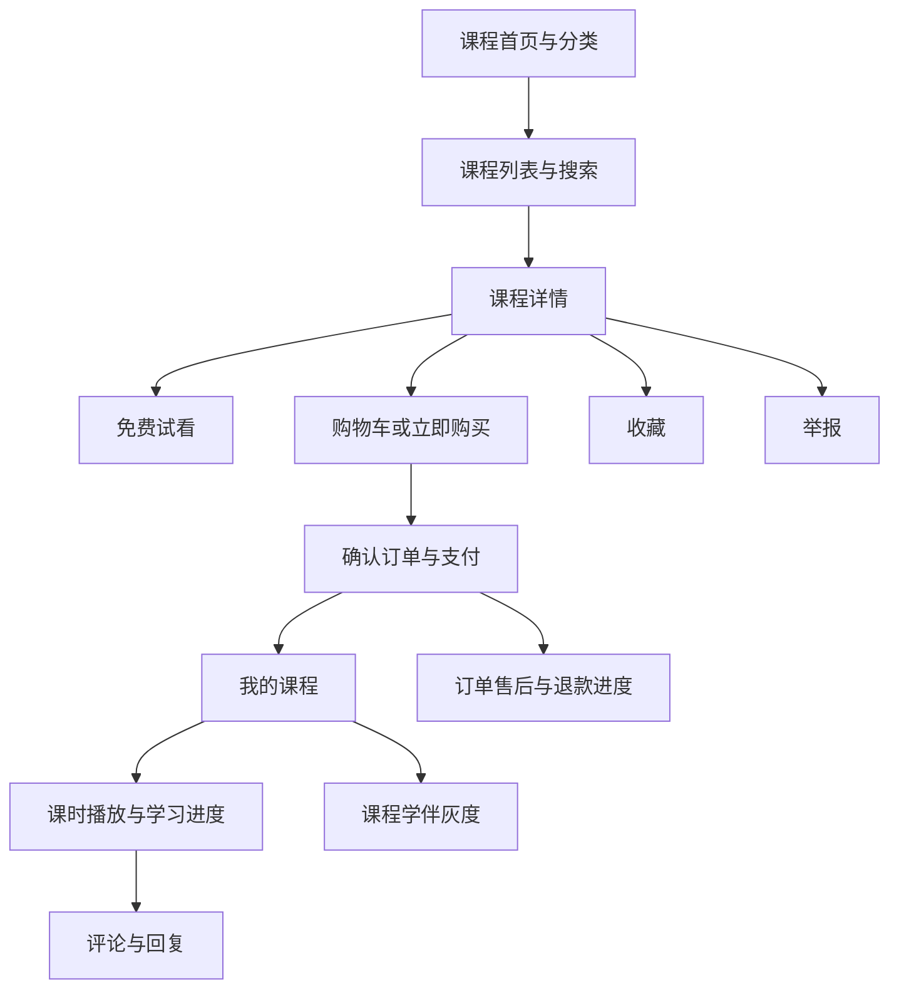

## 4.2 教师与运营信息架构

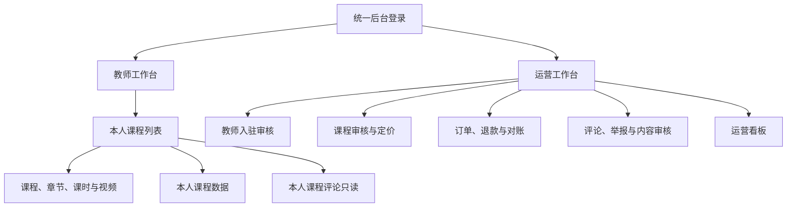

## 4.3 跨端能力矩阵

| 能力 | Web 学员端 | 微信小程序 | 教师工作台 | 运营后台 |
|---|---|---|---|---|
| 浏览、搜索、详情、试看 | P0 | P0 | 本人课程预览 | 全量课程预览 |
| 购物车 | P0 | 首版不承诺 | 不适用 | 不适用 |
| 立即购买与优惠券 | P0 | P0，按单课程购买 | 不适用 | 不适用 |
| 支付 | 支付宝 | 微信支付 JSAPI | 不适用 | 不代学员支付 |
| 我的课程、播放、进度 | P0 | P0 | 不适用 | 仅查看必要运营数据 |
| 评论与回复 | P0 | P0 | 只读本人课程评论 | 审核与处置 |
| 收藏、举报 | P0 | 首版不承诺 | 不适用 | 查看举报与处置 |
| AI 学伴 | P1 灰度 | 首版不承诺 | 不适用 | 语料与效果管理 |
| 建课与视频上传 | 不适用 | 不提供 | P0 | P0，可代运营建课 |
| 定价与审核 | 不适用 | 不提供 | 无权限 | P0 |
| 退款申请 | P0 | P0 | 不适用 | 审核与查询 |

“首版不承诺”表示不作为该端正式发布验收项，后续增加时须更新本矩阵。任何端不得通过直接调用隐藏接口绕过该范围。

# 5. 端到端业务流程

## 5.1 内容供给到学习交付

```mermaid
flowchart LR
    T0["教师提交入驻资料"] --> T1{"运营审核"}
    T1 -->|驳回| T0
    T1 -->|通过| T2["创建课程草稿"]
    T2 --> T3["维护章节、课时与视频"]
    T3 --> T4["提交课程审核"]
    T4 --> T5{"运营审核与定价"}
    T5 -->|驳回| T2
    T5 -->|通过并上架| C1["学员可搜索与查看"]
    C1 --> C2["详情与免费试看"]
    C2 --> C3["提交订单"]
    C3 --> C4{"来源端"}
    C4 -->|Web| C5["支付宝"]
    C4 -->|小程序| C6["微信支付 JSAPI"]
    C5 --> C7["支付结果确认"]
    C6 --> C7
    C7 --> C8["发放课程权益"]
    C8 --> C9["播放、进度与互动"]
    C9 --> C10["退款申请与售后"]
    C10 --> C11{"退款审核"}
    C11 -->|驳回| C9
    C11 -->|通过并退款成功| C12["权益失效"]
```

## 5.2 产品责任分界

| 环节 | 第一责任角色 | 平台责任 |
|---|---|---|
| 教师资料真实性 | 教师 | 入驻人工核验、状态记录、违规停用 |
| 课程内容合法性 | 教师 | 上架前审核、已上架抽检、违规下架 |
| 定价与优惠 | 运营 | 价格与优惠规则生效前校验，订单金额以平台计算为准 |
| 支付结果 | 平台 | 验证渠道结果、保持订单与支付一致、重复通知不重复发权益 |
| 学习交付 | 平台 | 有效权益可播放、记录进度、异常可恢复 |
| 售后 | 运营 | 按已确认政策审核、原路退款、处理差异与客诉 |
| AI 输出 | 平台与运营 | 限制数据范围、保留人工处置、失败时关闭 AI 而不影响主流程 |

# 6. 功能需求

## 6.1 功能总表

| 编号 | 模块 | 功能与关键规则 |
|---|---|---|
| F01 | 账号与身份 | 支持 Web 账号注册登录、小程序登录、资料维护、退出与注销入口；登录失效后回到登录页，完成后返回原目标页；跨端账号合并未确认前不得自动合并订单或权益。 |
| F02 | 课程浏览 | 游客和学员可按两级分类、关键词、难度、热度或上新浏览已上架课程；下架、待审核与草稿课程不出现在学员端。 |
| F03 | 课程详情与试看 | 展示课程、教师、价格、目录与权益状态；未购用户仅可播放标记为免费的课时，付费课时显示锁定状态。 |
| F04 | 教师入驻与建课 | 通过入驻审核的教师可创建本人课程，维护草稿、章节、课时与视频；教师不能填写价格，不能修改他人课程。 |
| F05 | 课程审核与上下架 | 运营完成课程审核与定价，审核通过即上架；驳回回到草稿并展示原因；内容变更后必须重新审核。 |
| F06 | 视频上传 | 仅接受符合格式、编码、分辨率、时长、大小与完整性要求的视频；失败时不产生可发布课时，并返回明确原因。 |
| F07 | 购物车与优惠券 | Web 学员可加购、移除与领券；重复加购只保留一项；确认订单时重新校验课程、价格、优惠与权益。 |
| F08 | 下单与支付 | 创建订单后按来源端固定支付渠道；重复提交不重复建单；支付取消、超时、处理中与成功均有明确页面状态。 |
| F09 | 订单与退款 | 学员仅查看本人订单并可申请全额退款；同一订单仅允许一条进行中的退款；退款成功后权益失效，渠道失败进入人工处理。 |
| F10 | 学习交付 | 支付确认后发放唯一课程权益；我的课程展示进度与最近学习位置；播放签名过期可重新获取，不视为权益失效。 |
| F11 | 评论与收藏 | 已购学员可评论课程或课时并两级回复；评论通过审核后公开；收藏与取消收藏幂等。 |
| F12 | 举报与治理 | 用户可举报评论、课程或用户；运营处理举报、评论与违规课程，所有处置保留处理人、时间与原因。 |
| F13 | 教师数据 | 教师仅查看本人课程的销售、退款、学习与评论数据；数据按 T+1 汇总并标明日期，不展示其他教师或学员敏感信息。 |
| F14 | 运营后台 | 运营处理教师、课程、订单、退款、评论与举报；管理员管理角色权限和模型配置；高风险操作需要二次确认与审计。 |
| F15 | AI 课程画像 | 根据课程内容生成摘要、适合人群、学习目标与大纲；运营确认后才对学员展示，失败时可人工填写。 |
| F16 | AI 内容审核 | 输出风险等级、类别与建议，不直接作出高风险处罚；AI 不可用时内容进入人工队列。 |
| F17 | AI 文案助手 | 每次生成 3 条候选文案，只回填编辑框，运营确认后保存，不自动发布。 |
| F18 | AI 课程学伴 | 仅服务灰度范围内的已购学员，回答限于当前课程并附课时或 FAQ 引用；无依据时拒答并给出人工或课时入口。 |

## 6.2 账号与身份

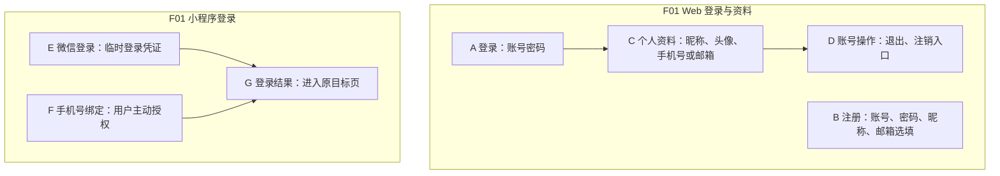

| 项目 | 需求 |
|---|---|
| 业务逻辑 | 登录成功后建立平台会话；小程序临时凭证只能使用一次，重放不得创建新会话或新账号。 |
| 交互逻辑 | 需要登录的操作先保存目标位置；登录成功后返回该位置。退出后清除本地会话，再访问受保护页面时重新登录。 |
| 资料规则 | 昵称、头像由本人维护；手机号与邮箱用于账号或通知，不进入 AI 内容。 |
| 小程序授权 | 浏览不强制授权手机号；仅账号绑定或确有通知需要时由用户主动触发。 |
| 异常状态 | 凭证无效、会话过期、账号禁用分别提示；账号禁用后不得继续下单、评论或使用 AI。 |
| 跨端身份 | 同一平台账号下权益与进度同步；不同账号不得仅凭相同昵称或头像合并。账号合并规则见 Q2。 |
| 注销 | Web 与小程序均提供入口；注销前展示影响并二次确认。未完成订单、退款与法定交易记录的处理规则见 Q6。 |

## 6.3 课程浏览、详情与试看

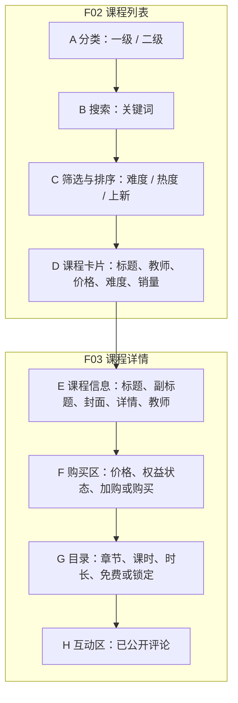

| 项目 | 需求 |
|---|---|
| 可见范围 | 仅已上架且未删除的课程进入列表、搜索与详情；无结果时展示空状态和清除筛选入口。 |
| 搜索 | 关键词匹配课程标题与副标题；搜索不返回教师草稿、待审核或已下架课程。 |
| 详情 | 展示课程标题、封面、简介、主讲教师、难度、价格、目录、课时长度和销量；不展示评分。 |
| 试看 | 免费课时可直接播放；付费课时在未购时显示锁定，点击后引导登录或购买。 |
| 购买状态 | 有效权益用户看到“继续学习”；已在购物车的课程显示“已加购”；已购课程不得重复下单。 |
| 价格变化 | 购物车保存加购时价格用于提示，确认订单按当前生效价格重新计算并展示差异。 |
| 异常状态 | 课程在浏览后下架时，详情提示不可购买；已购用户仍按权益与内容治理规则处理，不直接删除订单或学习记录。 |

## 6.4 教师入驻、建课与审核

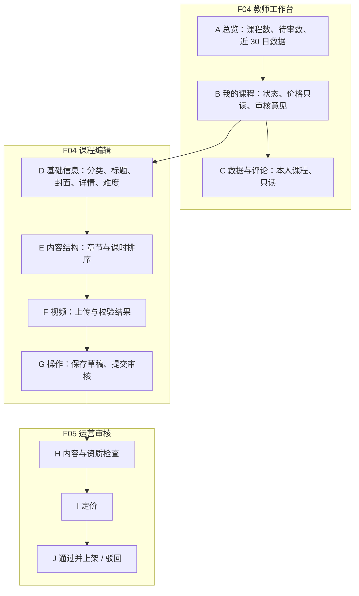

| 项目 | 需求 |
|---|---|
| 入驻前置 | 教师资料经运营审核通过后才能建课；驳回时展示原因并允许重新提交。 |
| 课程归属 | 创建时记录归属教师；所有编辑、提交、上下架、数据与评论查询均限定本人课程。 |
| 草稿 | 教师可编辑本人草稿、被驳回和已下架课程；一旦编辑已下架课程内容，课程回到草稿并必须重新审核。 |
| 待审核 | 提交后课程只读，不能重复提交；首版不提供撤回审核。 |
| 审核通过 | 运营在同一审核动作中确认价格并上架，学员端立即可见；不设置“审核通过但未上架”的中间状态。 |
| 审核驳回 | 回到草稿，保存不超过 300 字的审核意见；教师修改后重新提交。 |
| 下架与再上架 | 教师可下架本人课程；未发生内容变更的已下架课程可直接再上架，发生过变更则先回草稿并复审。运营可下架任意课程并填写原因。 |
| 删除限制 | 已产生订单的课时下架前不可删除；删除章节会同时隐藏其课时，需二次确认。 |
| 数据隔离 | 教师不能修改价格、审核本人课程、处置评论，也不能查看其他教师课程与销售数据。 |

课程与内容字段规则如下。

| 字段 | 规则 |
|---|---|
| 课程标题 | 必填，1–120 字 |
| 副标题 | 选填，最多 200 字 |
| 分类 | 必选二级分类 |
| 封面与课程详情 | 封面必填；详情可为空，但提交审核前应满足内容完整度要求 |
| 难度 | 入门、进阶、高级，默认入门 |
| 价格 | 仅运营填写，非负数，最多两位小数；0 元课程处理见 Q7 |
| 章节与课时标题 | 必填，1–120 字；同课程内按排序值展示 |
| 免费课时 | 教师可设置，审核时一并检查；付费课程至少允许配置 0 个免费课时 |
| 审核意见 | 驳回时必填，最多 300 字 |

## 6.5 视频上传与播放约束

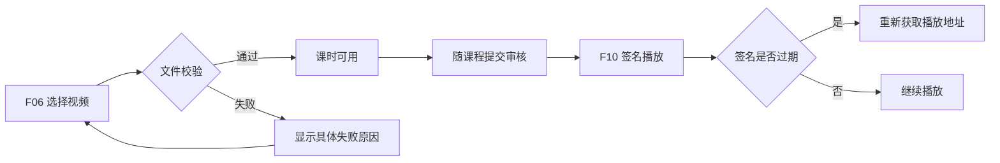

| 校验项 | 首版规则 | 用户提示 |
|---|---|---|
| 容器 | MP4 | 仅支持 MP4，请重新导出 |
| 视频与音频编码 | H.264；音频 AAC 或无声 | 视频编码须为 H.264，音频须为 AAC |
| 分辨率 | 宽不超过 1920、高不超过 1080，宽高为偶数 | 分辨率不得超过 1080p |
| 时长 | 5 秒至 4 小时 | 课时时长需在 5 秒至 4 小时之间 |
| 文件大小 | 不超过 2GB | 单个视频不得超过 2GB |
| 完整性 | 可读取时长与必要视频元信息 | 文件损坏或不完整，请重新上传 |

上传校验失败时不允许提交审核。首版不提供自动转码，教师需按提示重新导出。播放地址有效期 10 分钟，过期后客户端重新获取；同一用户同一课时最多 2 路并发播放，超出时提示关闭其他播放窗口。首版不承诺 DRM 级防录屏能力。

## 6.6 购物车、下单与支付

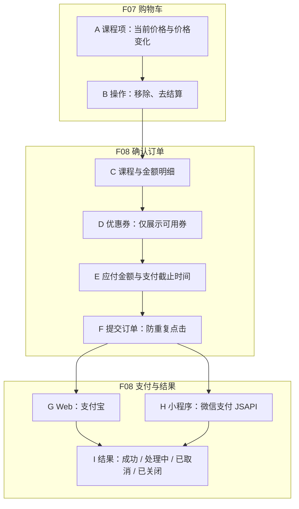

| 项目 | 需求 |
|---|---|
| 加购 | 仅已上架且未购课程可加购；同一学员同一课程只保留一条购物车记录。 |
| 优惠券 | 领取前校验活动时间、总量、领取状态；同一用户同一券模板仅领取一次；每单最多使用一张券。 |
| 下单校验 | 重新校验课程上架状态、有效权益、价格与券的适用性；任一课程不满足时整单不创建，并指出原因。 |
| 金额 | 平台按课程当前价格与优惠计算原价、优惠和应付金额，不接受客户端传入金额作为结算依据。 |
| 幂等 | 同一有效提交标识重复到达时返回同一订单；页面防止重复点击，但不以前端禁用代替服务端幂等。 |
| 渠道 | Web 仅支付宝，小程序仅微信支付 JSAPI；来源端与渠道不一致时拒绝发起支付，不提供跨渠道切换。 |
| 支付单 | 同一订单同一时刻仅一条待支付或成功支付单；重新发起支付前关闭旧支付单，渠道保持不变。 |
| 支付截止 | 订单显示支付截止时间，超时后不可继续支付；具体时长见 Q4。 |
| 用户取消 | 待支付订单可由本人取消，并关闭进行中支付单；已支付订单不能通过取消按钮退款。 |
| 结果页 | 收到可信支付成功结果前显示处理中，不提前展示已购；处理中可刷新或稍后在我的课程查看。 |
| 重复通知 | 重复支付结果不重复增加销量、不重复发放权益，向渠道返回已成功处理的结果。 |

## 6.7 订单、退款与对账

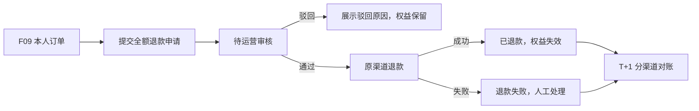

| 项目 | 需求 |
|---|---|
| 订单查询 | 学员仅查看本人订单；运营可按订单号、学员、状态、日期与渠道查询。 |
| 退款申请 | 已支付订单可申请，原因必填且不超过 300 字；首版仅全额退款，不提供部分退款。 |
| 重复申请 | 同一订单存在待审核、退款中或已成功退款时，不得再次申请。 |
| 退款审核 | 运营通过后按原支付渠道退款；驳回必须填写原因并恢复可再次申请的状态。 |
| 权益 | 仅退款成功后使对应课程权益失效；审核中与渠道失败期间不提前失效。 |
| 失败处理 | 渠道退款失败保留失败原因并进入人工处理，不向学员展示“已退款”。 |
| 优惠退回 | 见 Q1；未确认前不得在界面承诺退券。 |
| 对账 | 每日按渠道分别核对支付与退款；差异不影响学员正常使用，但须形成差异记录并阻断相关结算。 |
| 退款政策 | 可退期限、学习进度限制和特殊不可退情形见 Q1；政策确认前，首版不得开放正式退款承诺文案。 |

## 6.8 学习交付与进度

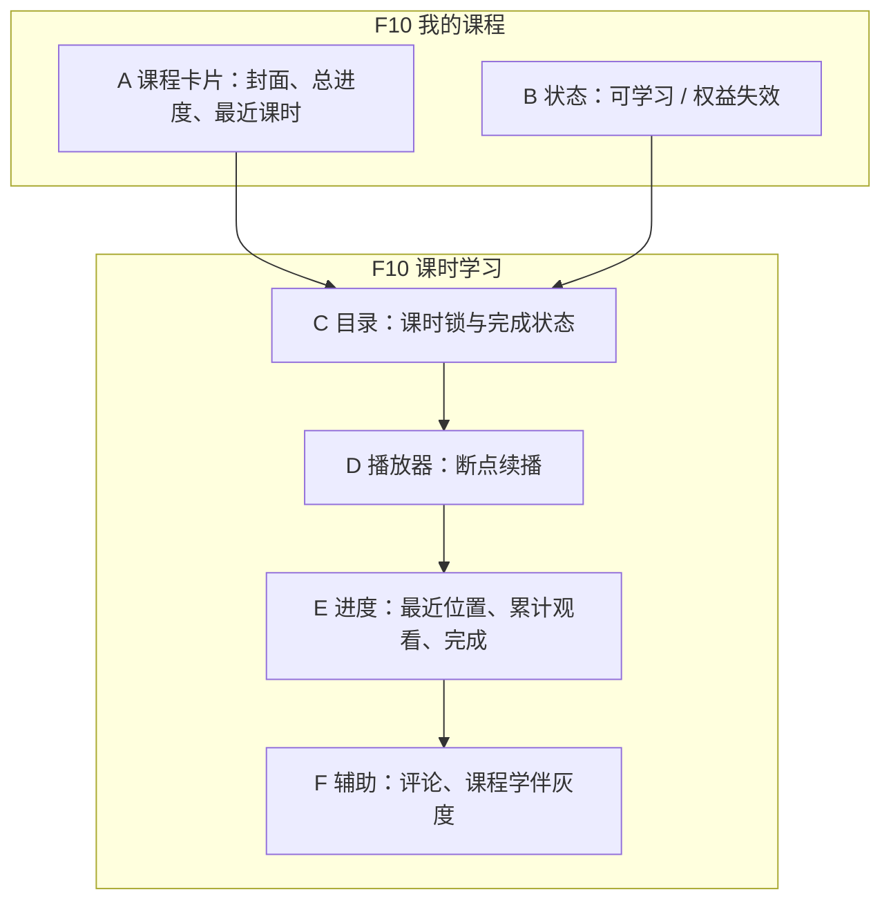

| 项目 | 需求 |
|---|---|
| 权益发放 | 支付结果确认后创建唯一课程权益；同一学员同一课程不能存在重复有效权益。 |
| 权益来源 | 首版以购买为主；赠送与兑换仅保留后续扩展，不进入首版前台流程。 |
| 我的课程 | 按最近学习排序，展示课程总进度和最近课时；无课程时引导浏览课程。 |
| 播放权限 | 免费课时可试看；付费课时必须具有有效权益。课程下架不自动删除有效权益，违规内容可按治理要求停止播放。 |
| 断点 | 记录最近一次有效播放位置，Web 与小程序在同一账号下共享。 |
| 进度 | 累计观看时长只增不减；倒退拖动不扣减累计值，重复播放可累计有效观看行为。 |
| 完成 | 完成判定阈值、拖动与倍速是否计入见 Q5；未确认前不得将客户端单方面提交的完成状态作为严格学习证明。 |
| 播放异常 | 签名过期自动重新获取；无权益、课程不可播、并发超限与网络失败分别提示。 |
| 退款后 | 权益失效后停止付费课时播放，保留历史订单与学习记录供本人查看。 |

## 6.9 评论、收藏与举报

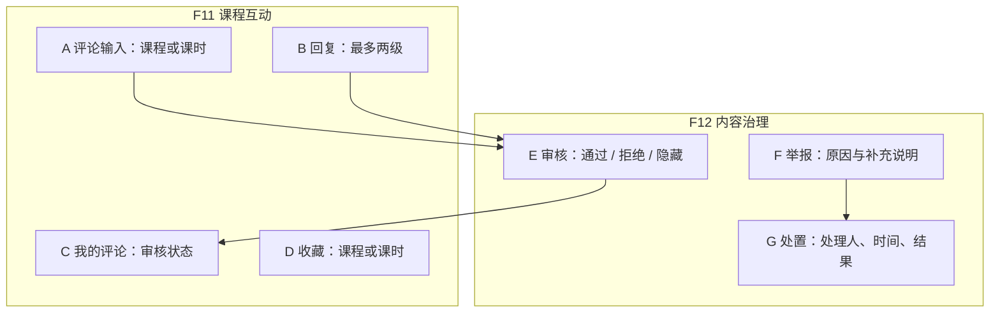

| 项目 | 需求 |
|---|---|
| 评论资格 | 仅具有有效课程权益的学员可评论课程或课时；回复同样要求权益。 |
| 评论内容 | 必填，1–1000 字；仅两级回复，不支持图片、私信或关注。 |
| 审核 | 新评论默认待审，通过后才公开；作者可看到本人审核状态，其他用户只能看到已通过内容。 |
| 删除 | 学员可删除本人评论；运营可通过、拒绝或隐藏，操作需留痕。 |
| 收藏 | 支持课程与课时；重复收藏不生成多条记录，取消后可再次收藏。 |
| 举报 | 支持评论、课程与用户；补充说明最多 500 字，举报结果分为成立与驳回。 |
| 联动处置 | 举报成立时可隐藏评论或下架课程；处罚教师账号由运营按教师协议执行。 |
| 空与异常 | 无评论时展示空状态；审核中不公开；提交失败保留用户输入，避免重复提交。 |

## 6.10 教师与运营数据

| 看板 | 展示内容 | 数据范围与时效 |
|---|---|---|
| 教师总览 | 课程数、已上架数、待审核数、近 30 日成交与学习情况 | 仅本人课程；T+1 |
| 教师课程看板 | 支付订单数、成交额、退款额、新增学习者、活跃学习者、平均进度、评论数 | 仅本人单课程；查询跨度不超过 90 天；T+1 |
| 运营看板 | 成交额、订单数、支付转化率、新增用户、课程销量前 5 | 全平台；时间范围可选 |
| 交易对账 | 渠道与平台笔数、金额、差异数、差异额、处理状态 | 分渠道、分账单日；T+1 |

成交额按付款口径，不扣退款；退款额单独展示。平均进度只展示汇总值，教师不能查看可识别单个学员的学习轨迹。首版不展示评分与评分均值。

## 6.11 AI 功能与人工兜底

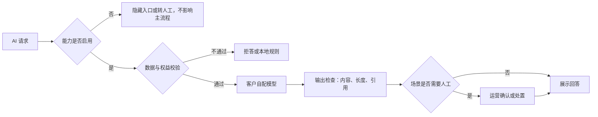

| 场景 | 输入与输出 | 质量要求 | 失败与降级 |
|---|---|---|---|
| 课程画像 | 输入课程公开内容；输出摘要、适合人群、3–5 个学习目标、大纲与难度 | 不编造价格、时长、就业或收益承诺 | 失败不展示；允许重试或人工填写；运营确认后公开 |
| 内容审核 | 输入脱敏后的评论或举报内容；输出风险等级、类别、理由与建议 | 高风险全部人工处理；人工可改判 | AI 不可用时转人工，不自动放行待审内容 |
| 运营文案 | 输入场景、风格与长度；输出 3 条候选 | 不使用绝对化或未经证实的承诺 | 失败保留原编辑内容，不自动保存或发布 |
| 课程学伴 | 输入已购学员问题、当前课程与课时上下文；输出回答及引用 | 事实性回答至少 1 条有效课时或 FAQ 引用；课程外问题拒答 | 未配置、超时或配额耗尽时关闭入口或提示转人工 |

AI 使用客户自配模型。管理员负责配置与启停，教师不能查看或修改模型密钥。平台无默认模型密钥，不以平台名义承担模型调用费用。

学伴灰度期为单课程白名单加 10% 用户，首版无法回答率目标不超过 50%，每次事实性回答均须带来源。每名学员每日最多 30 轮，运营文案每账号每日最多 200 次；达到日或月配额后停止使用外部模型。上述限制与课程主流程相互独立。

# 7. 业务状态与权限

## 7.1 课程状态

| 当前状态 | 允许操作 | 操作角色 | 下一状态 | 学员端表现 |
|---|---|---|---|---|
| 草稿 | 编辑、提交审核 | 归属教师、运营 | 待审核 | 不可见 |
| 待审核 | 通过并定价上架 | 运营 | 已上架 | 审核前不可见 |
| 待审核 | 驳回 | 运营 | 草稿 | 不可见 |
| 已上架 | 下架 | 归属教师、运营 | 已下架 | 停止新购；已有权益按 6.8 处理 |
| 已下架且内容未变 | 再上架 | 归属教师、运营 | 已上架 | 恢复购买 |
| 已下架 | 编辑内容 | 归属教师、运营 | 草稿 | 不可新购，需复审 |

待审核为只读，首版不提供撤回。运营审核通过与首次上架为同一动作，避免产生无人负责的中间状态。

## 7.2 订单与支付状态

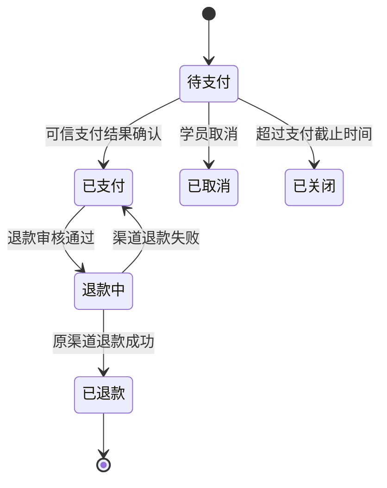

| 对象 | 状态 | 含义 |
|---|---|---|
| 订单 | 待支付、已支付、已取消、已关闭、退款中、已退款 | 订单面向学员与运营的主状态 |
| 支付单 | 待支付、成功、已关闭、已退款、退款中、退款失败 | 记录单次渠道支付，不等同于订单 |
| 退款单 | 待审核、审核通过、已退款、驳回、退款失败 | 记录售后处理，不单独代表资金到账 |
| 权益 | 有效、失效 | 支付成功后有效，退款成功后失效；到期规则如适用按有效期处理 |

支付结果与订单状态不一致时，以可信渠道结果和对账处理为准，界面不得通过手工改状态掩盖差异。

## 7.3 权限矩阵

| 操作 | 游客 | 学员 | 教师 | 运营 | 管理员 |
|---|---|---|---|---|---|
| 浏览与试看 | 允许 | 允许 | 允许 | 允许 | 允许 |
| 下单、支付、退款申请 | 禁止 | 本人 | 学员角色下本人 | 不代为操作 | 不代为操作 |
| 付费课时播放 | 禁止 | 本人有效权益 | 学员角色下有效权益 | 仅审核预览 | 仅按授权预览 |
| 建课与上传 | 禁止 | 禁止 | 本人课程 | 全量课程 | 默认无业务权限 |
| 课程定价与审核 | 禁止 | 禁止 | 禁止 | 允许 | 默认无业务权限 |
| 查看课程数据 | 禁止 | 本人学习数据 | 本人课程汇总 | 全平台汇总 | 按授权 |
| 评论处置 | 禁止 | 删除本人评论 | 只读 | 通过、拒绝、隐藏 | 默认无业务权限 |
| 退款审核与对账 | 禁止 | 查看本人进度 | 查看本人课程汇总 | 允许 | 按授权 |
| 角色与菜单 | 禁止 | 禁止 | 禁止 | 禁止 | 允许 |
| 模型配置 | 禁止 | 禁止 | 禁止 | 可发起业务需求 | 配置、启停与审计 |

教师越权访问他人课程、章节、课时、评论或看板时统一拒绝，且不泄露目标内容是否存在。权限验证必须在服务端执行。

# 8. 异常、合规与安全要求

## 8.1 核心异常处理

| 异常 | 产品表现 | 后续处理 |
|---|---|---|
| 登录失效 | 保存当前目标，跳转登录 | 成功后返回原目标 |
| 课程浏览后下架 | 提示课程不可购买 | 保留返回列表入口；已购权益按治理规则处理 |
| 重复下单或重复支付 | 返回原订单或原支付结果 | 不新增订单、销量或权益 |
| 支付成功但页面未更新 | 显示处理中 | 可刷新；后台继续确认并发放权益 |
| 权益发放延迟 | 订单显示已支付，学习入口提示开通中 | 自动重试；持续异常进入人工处理 |
| 退款失败 | 显示退款处理中或失败说明，不显示已退款 | 运营核查渠道并重新处理 |
| 视频上传不合规 | 指出具体不合规项 | 保留其他已填内容，允许重新上传 |
| 播放签名过期 | 自动重新获取 | 权益仍有效，不要求重新购买 |
| 评论审核积压 | 作者看到审核中 | 超过 12 小时触发运营告警 |
| AI 未配置或不可用 | 隐藏入口或转人工 | 浏览、交易、播放与进度不受影响 |
| 小程序审核或发布失败 | Web 继续服务 | 小程序整改，服务端可关闭相关入口 |

## 8.2 隐私与内容合规

不采集身份证和银行卡信息。手机号、邮箱、微信身份标识、订单与支付信息只用于明确的账号、交易或通知目的，不进入模型上下文。日志、页面与运营导出不得展示完整密钥、支付凭证或微信身份标识。

课程、课时与评论不得包含站外购买引导、联系方式、诱导分享、学历或就业承诺。教师协议须明确内容责任与违规处置；平台对所有上架课程进行人工审核，每月抽检不少于已上架课程的 10%。

小程序须配置与实际收集行为一致的隐私保护指引和账号注销入口。首版不申请位置、通讯录等与课程学习无关的权限。

## 8.3 高风险操作

支付结果确认、退款审核、课程审核、教师停用、权限变更、模型配置与密钥轮换均须记录操作者、时间、对象和结果。退款、下架、停用与权限变更在界面二次确认；模型密钥只显示掩码尾号，不提供查看明文能力。

# 9. 验收要求

## 9.1 核心场景验收

| 编号 | 前置条件 | 操作 | 预期结果 |
|---|---|---|---|
| AC01 | 游客浏览已上架课程 | 打开付费课时 | 仅可查看目录与课程信息，播放前引导登录并购课 |
| AC02 | 同一小程序临时凭证使用两次 | 第二次登录 | 不创建新账号或有效会话，返回凭证无效 |
| AC03 | 教师未通过入驻审核 | 创建课程 | 拒绝操作并提示先完成入驻审核 |
| AC04 | 教师 A 与教师 B 均有课程 | 教师 A 修改或查看教师 B 课程与数据 | 全部拒绝，不泄露目标内容 |
| AC05 | 教师课程为草稿且资料完整 | 提交审核 | 状态为待审核，内容只读，不能重复提交 |
| AC06 | 课程待审核 | 运营驳回并填写原因 | 回到草稿，教师可见原因并可修改后重提 |
| AC07 | 课程待审核且价格已确认 | 运营通过 | 课程直接上架，学员端可搜索与购买 |
| AC08 | 已下架课程曾通过审核 | 未编辑直接再上架 | 恢复上架，无需重复审核 |
| AC09 | 已下架课程曾通过审核 | 修改课程内容 | 自动回草稿，必须复审后才能再上架 |
| AC10 | 上传非 H.264、超过 1080p、超过 2GB 或损坏视频 | 上传课时视频 | 分别拦截并显示具体原因，课时不能提交审核 |
| AC11 | Web 学员提交订单 | 查看支付入口 | 仅出现支付宝；请求微信支付被拒绝 |
| AC12 | 小程序学员提交订单 | 查看支付入口 | 仅出现微信支付 JSAPI；不提供支付宝或站外支付引导 |
| AC13 | 连续提交同一有效下单请求 | 重复点击或重试 | 仅生成一个订单，应付金额一致 |
| AC14 | 渠道重复发送支付成功结果 | 处理通知 | 订单仅一次变为已支付，销量与权益不重复 |
| AC15 | 支付结果已确认但页面尚未刷新 | 打开我的课程 | 权益开通后可学习；延迟时显示开通中而非要求重新支付 |
| AC16 | 学员具有有效权益 | 跨端打开同一课程 | 可播放并读取同一学习进度；不同账号不适用 |
| AC17 | 学员无有效权益或权益已退款失效 | 请求付费课时播放 | 拒绝播放；免费试看不受影响 |
| AC18 | 学员提交评论 | 审核前用另一账号查看 | 评论不公开；审核通过后可见 |
| AC19 | 已支付订单无进行中退款 | 提交全额退款申请 | 生成唯一待审核退款单，权益暂不失效 |
| AC20 | 退款审核通过 | 原渠道退款成功 | 订单与退款单显示已退款，权益失效，可对账 |
| AC21 | 渠道退款失败 | 查看学员与运营页面 | 不显示已退款，进入人工处理并保留原因 |
| AC22 | 模型未配置、密钥失效或配额耗尽 | 浏览、购课、播放、保存进度 | 主流程全部可用，AI 入口关闭或转人工 |
| AC23 | 灰度学员提出课程外问题 | 使用课程学伴 | 拒答并引导相关课时或人工，不编造答案 |
| AC24 | 学伴生成事实性回答 | 检查来源 | 至少包含一个可跳转的有效课时或 FAQ 引用 |

## 9.2 首版质量门槛

| 维度 | 门槛 |
|---|---|
| 交易 | Web 支付成功率 ≥ 98%，小程序 ≥ 97%；两渠道回调幂等场景全部通过 |
| 对账 | 两渠道连续 3 个账单日差异为 0；差异可在 24 小时内定位到具体支付或退款记录 |
| 权限 | 教师越权、跨用户订单与伪造身份用例全部拦截 |
| 内容 | 教师课程、评论与举报审核覆盖率 100%；非法视频拦截用例全部通过 |
| 学习 | 有效权益可播放，签名过期可恢复，进度重复上报不产生异常跳变 |
| 性能 | 课程详情服务端 P95 ≤ 300ms；下单与支付回调 P95 ≤ 500ms；视频首帧 P95 ≤ 2 秒 |
| 稳定性 | 连续 72 小时验证无内存泄漏，错误率低于 0.5% |
| AI | 隐私信息泄露为 0；审核建议与人工一致率 ≥ 85%；学伴灰度无法回答率 ≤ 50% |
| 合规 | 用户协议、隐私政策、教师协议、小程序隐私指引与必要资质完成评审 |

# 10. 产品指标与数据采集

## 10.1 指标树

北极星指标暂定为“每周有效学习学员数”，即自然周内累计有效观看课程不少于 15 分钟的去重购课学员数。该定义与阈值为假设—待确认，正式采用前须与首发课程时长和运营目标核对。

| 层级 | 指标 | 口径与用途 |
|---|---|---|
| 获客与选课 | 课程详情访客、试看开始率、详情到下单转化率 | 判断课程供给与详情是否有效 |
| 交易 | 下单成功率、分端支付成功率、支付取消率 | 定位下单与渠道问题 |
| 交付 | 支付到权益开通时延、开通失败数 | 判断支付后能否可靠学习 |
| 学习 | 周有效学习学员数、课时完成率、7 日与 30 日学习留存 | 判断课程是否被持续使用 |
| 供给 | 教师入驻通过率、课程审核通过率、上架周期 | 判断供给效率和审核瓶颈 |
| 售后 | 退款申请率、退款成功率、退款处理时长、客诉量 | 识别课程质量与售后风险 |
| 互动治理 | 评论审核时长、举报成立率、违规下架数 | 配置审核资源与改进规则 |
| AI | 无法回答率、引用准确率、有用反馈率、人工一致率、降级次数 | 决定扩量、整改或关闭 |
| 财务质量 | 分渠道对账差异数与差异额 | 识别资金与数据不一致 |

## 10.2 事件采集

| 事件名 | 触发时机 | 必要属性 | 服务的决策 |
|---|---|---|---|
| course_list_view | 课程列表成功展示 | source、categoryId、filterType | 分类与筛选使用分析 |
| course_detail_view | 课程详情成功展示 | source、courseId、entitled | 选课漏斗 |
| free_preview_start | 免费课时开始播放 | source、courseId、lessonId | 试看质量与转化 |
| cart_item_add | 加购成功 | source、courseId | Web 加购与购买分析 |
| order_submit_result | 下单成功或失败 | source、result、reasonCode、courseCount | 下单失败归因 |
| payment_result | 收到可信支付结果 | source、channel、result、reasonCode、orderId | 分渠道支付质量 |
| entitlement_grant_result | 权益开通成功或失败 | source、courseId、result、delayMs | 学习交付稳定性 |
| lesson_play_start | 课时开始播放 | source、courseId、lessonId、preview | 播放与首帧分析 |
| learning_progress_save | 进度保存成功 | source、courseId、lessonId、positionSec、completed | 学习深度与留存 |
| comment_submit_result | 评论提交完成 | source、courseId、result、reviewStatus | 互动与审核压力 |
| refund_apply_result | 退款申请完成 | source、channel、result、reasonType | 售后原因与政策评估 |
| review_handle_result | 教师、课程或 UGC 审核完成 | reviewType、result、riskLevel、durationMs | 审核效率与一致性 |
| ai_answer_result | AI 回答完成或降级 | scene、courseId、result、hasCitation、latencyMs | AI 扩量与降级 |
| ai_answer_feedback | 用户提交 AI 反馈 | scene、messageId、rating | 回答质量与 bad case 分析 |

事件不得携带明文手机号、邮箱、微信身份标识、支付报文或模型密钥。订单号、课程号和消息号仅作为分析标识，不进入公开页面或第三方模型。

# 11. 发布、运营与迭代

## 11.1 生命周期阶段与准出条件

| 阶段 | 主要产出 | 准出条件 |
|---|---|---|
| 产品定义 | 本文、待确认事项、首发课程与教师计划 | P0 范围冻结；Q1、Q2、Q4、Q5、Q6、Q7 有结论或明确不阻塞方案 |
| 交互与技术设计 | 页面原型、状态与异常设计、技术对齐稿 | 产品、研发、测试对 P0 流程和权限无歧义 |
| 研发与联调 | 各端功能、契约与安全用例 | 第 9 章核心场景通过，无 P0/P1 缺陷 |
| 预发验收 | 双渠道支付退款、教师建课、学习与对账演练 | 质量门槛达到；正式资质和协议可用 |
| Web 灰度 | 内部、5%、30%、100% 分阶段开放 | 每阶段支付、错误率、越权与对账结果达标 |
| 小程序发布 | 体验版验收、类目审核、正式发布 | Web 全量稳定至少 7 天；体验版全链路通过 |
| 运营观察 | 72 小时重点观察与 90 天指标评估 | 无未控制资损、隐私或权限事件；运营队列可消化 |
| 后续迭代 | 基于指标与反馈的新版本需求 | 触发条件满足，重新进入产品定义与评审 |

## 11.2 发布顺序

Web 与后端先发布，依次经过内部、小流量、扩量和全量；小程序在 Web 全量稳定至少 7 天后发布。小程序采用体验版充分验证后整体发布，服务端保留登录、支付、播放和 AI 的独立关闭能力。

AI 学伴不随 Web 或小程序全量自动开放，按单课程白名单和用户灰度独立推进。任一 AI 指标恶化不得影响其他产品能力。

## 11.3 日常运营机制

| 工作 | 时限与频率 | 异常升级 |
|---|---|---|
| 教师与课程审核 | 按提交队列处理；上架周期中位数 ≤ 3 个工作日 | 积压影响首发供给时由运营负责人调整优先级 |
| 评论与举报 | 审核队列超过 12 小时告警 | 高风险内容优先，必要时先隐藏再复核 |
| 已上架课程抽检 | 每月不少于 10% | 违规课程立即下架并记录，按教师协议处理 |
| 退款处理 | 待处理超过 24 小时告警 | 渠道失败或对账差异进入交易负责人队列 |
| 分渠道对账 | 每日 T+1 | 差异立即告警；连续 2 天未处理升级为高优先级事件 |
| AI 质量抽检 | 每场景每周 50 条 | 出现隐私泄露立即关闭出域能力；质量下降停止扩量 |
| 数据观察 | 上线后 72 小时重点观察，随后按 90 天目标评估 | 支付、权益、权限或隐私异常优先于增长指标 |

## 11.4 后续阶段

第二阶段仅在有稳定课程语料和首版数据后推进：学伴全量评估、AI 找课、推荐理由、本地售后 FAQ。学伴全量目标为无法回答率不超过 30%；找课与推荐理由是否进入开发，以课程详情转化和搜索无结果率为依据。

第三阶段按明确收益与成本评审推进字幕、运营问数与学习陪伴。新增班级、考试、直播、教师分账或多租户均属于新产品域，不视为首版自然延伸，必须重新立项。

# 12. 里程碑与依赖

## 12.1 首版产品里程碑

以下沿用现有方案估算，不构成未经评审的交付承诺。

| 阶段 | 产品结果 | 关键依赖 |
|---|---|---|
| M0 | 产品基线、环境与工程约束就绪 | 产品事实源确认；首发规模采用临时基线 |
| M1 | 账号、教师入驻、课程供给与浏览可用 | 教师协议、审核规则、视频规范 |
| M2 | 下单、支付宝、微信支付后端能力、权益与播放可用 | 支付商户资质、课程与价格规则 |
| M3 | 评论、举报、退款、运营后台与对账可用 | 退款政策、内容处置规则 |
| M4 | AI 画像、审核、文案与学伴灰度可用 | 客户模型配置、评测集、隐私审查 |
| M5 | Web 达到正式发布条件 | 双渠道、权限、性能、合规与回滚验证 |
| M6 | 小程序体验版全链路可用 | 小程序账号、合法域名、隐私指引、类目录入 |
| M7 | 小程序正式发布并完成观察 | Web 稳定至少 7 天、微信审核通过 |

## 12.2 外部依赖

| 依赖 | 影响 | 未就绪时处理 |
|---|---|---|
| 支付宝正式商户与应用签约 | Web 正式支付 | 不以测试环境代替正式验收，不伪造上线结论 |
| 微信支付商户号与小程序绑定 | 小程序支付与退款 | 小程序不发布支付能力 |
| 小程序主体、类目与教育资质 | 小程序审核 | 继续 Web，小程序整改或延后 |
| 域名、备案与 HTTPS | 正式访问与小程序合法域名 | 不进入正式发布 |
| 教师与首发课程内容 | 搜索、购买、学习与 AI 评测 | 不满足语料门禁时不上线对应课程学伴 |
| 客户模型配置 | AI 功能 | 关闭 AI，主流程照常 |
| 退款与账号政策 | 售后、注销和正式协议 | 不发布超出已确认政策的承诺 |

# 13. 风险与待确认事项

## 13.1 产品风险

| 风险 | 影响 | 产品应对 |
|---|---|---|
| 退款政策不清导致客诉或资金争议 | 高 | Q1 未确认前不发布政策文案；全额申请与人工审核先行 |
| 跨端形成重复账号 | 高 | Q2 确认前不自动合并；提供明确账号识别与绑定路径 |
| 教师供给不足或审核积压 | 高 | 首发教师与课程计划先于开发验收；监控上架周期 |
| 教师越权或价格被篡改 | 高 | 服务端归属校验、价格只由运营维护、越权用例全量通过 |
| 双渠道订单与权益不一致 | 高 | 可信支付结果、幂等、延迟提示、每日对账与人工补偿 |
| 不合规视频导致无法播放 | 中 | 上传即校验，错误原因具体，课程审核前再次验证 |
| AI 无依据回答或隐私出域 | 高 | 引用门禁、拒答、脱敏、抽检、独立关闭与人工兜底 |
| 小程序审核延误 | 中高 | 提前准备资质，Web 先行，两端至少错开 7 天 |
| 首版范围蔓延 | 中 | 以第 2.5 节为边界，新域重新立项 |

## 13.2 待确认事项

| 编号 | 待确认决策 | 默认推进口径 | 影响范围 |
|---|---|---|---|
| Q1 | 退款可申期限、学习进度限制、特殊不可退情形、退款后优惠券是否返还 | 仅全额退款、人工审核；不承诺退券 | 交易、协议、售后、运营与验收 |
| Q2 | Web 与小程序已有账号如何合并，绑定冲突时订单与权益如何归属 | 不自动合并；必须由用户验证身份并确认 | 账号、跨端权益、学习进度、隐私 |
| Q3 | 首发课程规模、课时数量与视频容量 | 暂按不超过 20 门、约 200 课时、100–200GB 估算 | 内容计划、审核人力、容量与成本 |
| Q4 | 订单支付截止时长 | 假设—待确认为 30 分钟 | 下单、支付页、超时关单与优惠占用 |
| Q5 | 课时完成阈值、拖动与倍速的进度口径 | 不作为具有证明效力的学习考核 | 播放器、我的课程、指标与教师看板 |
| Q6 | 账号注销时未完成订单、退款与法定记录的处理 | 展示影响并二次确认，不自动删除交易记录 | 账号、隐私、订单、客服与合规 |
| Q7 | 是否允许 0 元课程及其权益领取方式 | 首版按付费课程设计，免费内容通过试看提供 | 课程定价、下单、权益与营销 |
| Q8 | 北极星指标“每周有效学习学员数”的 15 分钟阈值 | 作为暂定分析口径，不作为对外承诺 | 指标、数据看板与运营评估 |

# 14. 需求变更与追踪

P0 范围、角色权限、支付渠道、退款规则、课程状态、视频约束、AI 数据边界或跨端能力发生变化时，提出方须说明原因、影响端、指标影响、兼容性与回滚方式。产品负责人确认后更新本文版本，研发与测试同步更新技术方案和验收用例。

每项研发需求至少关联本文的一个功能编号 F01–F18；每项验收用例至少关联一个 AC 编号。新增功能没有对应功能编号、异常状态和验收口径时，不进入开发。技术文档与本文冲突时，产品规则以本文为准，须发起文档变更评审完成对齐，不在研发过程中口头选择另一套口径。
